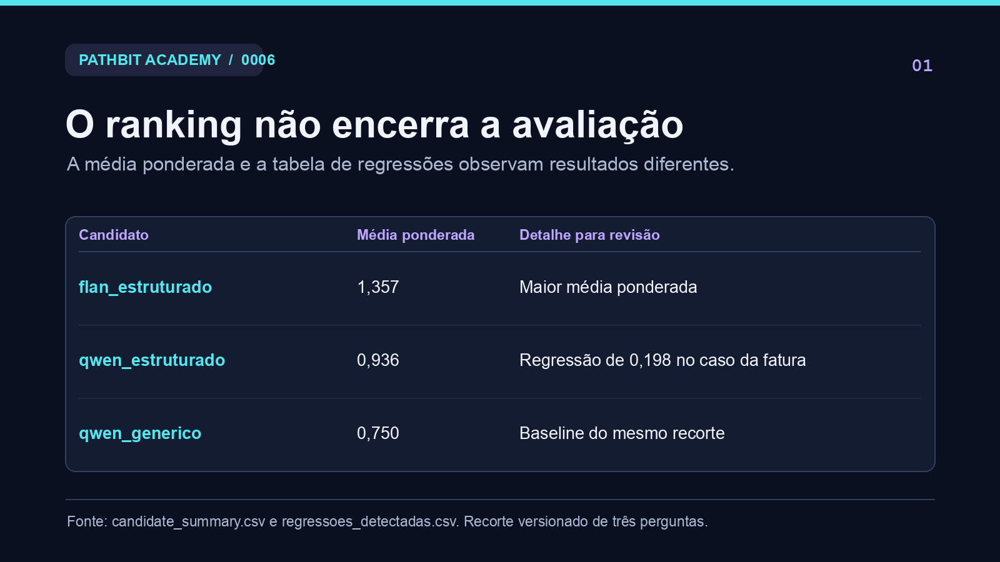
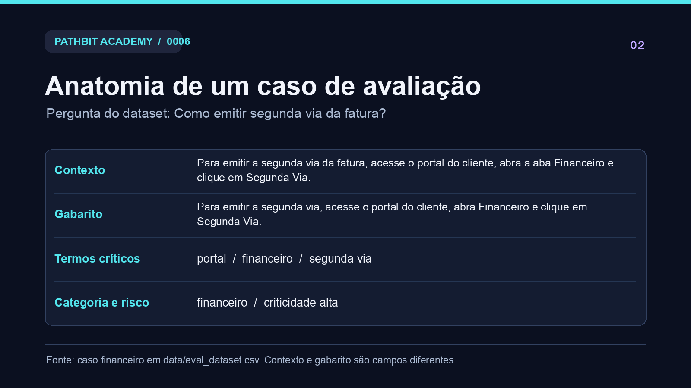
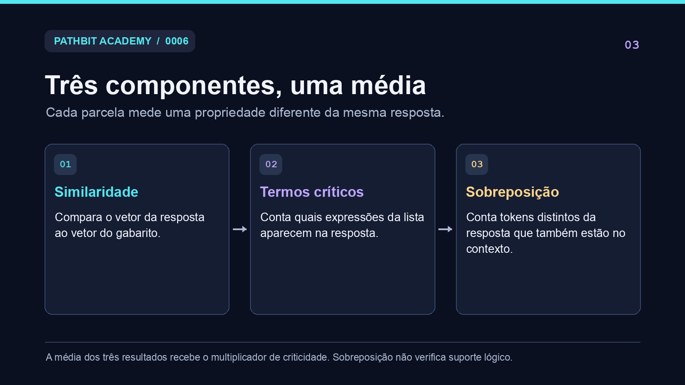
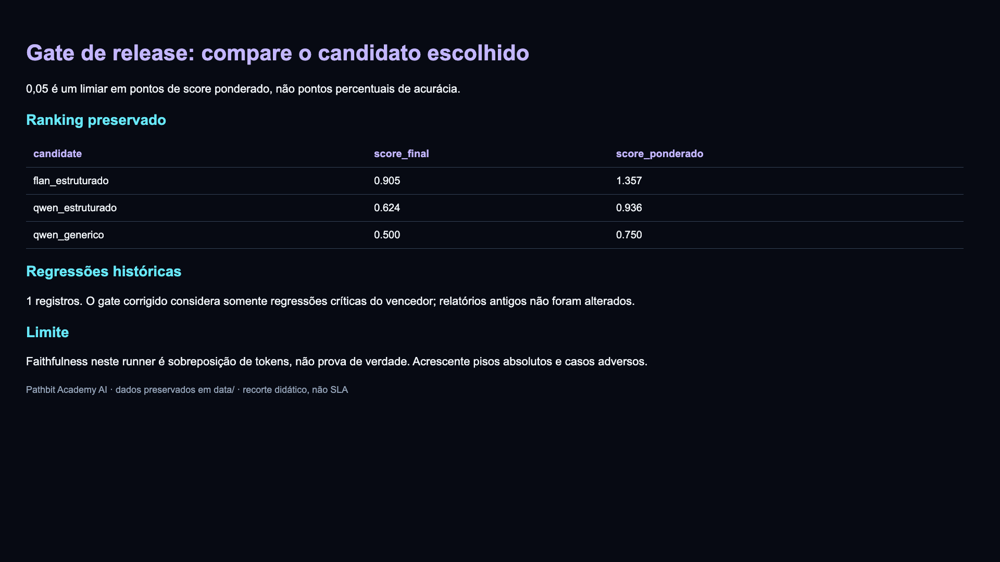
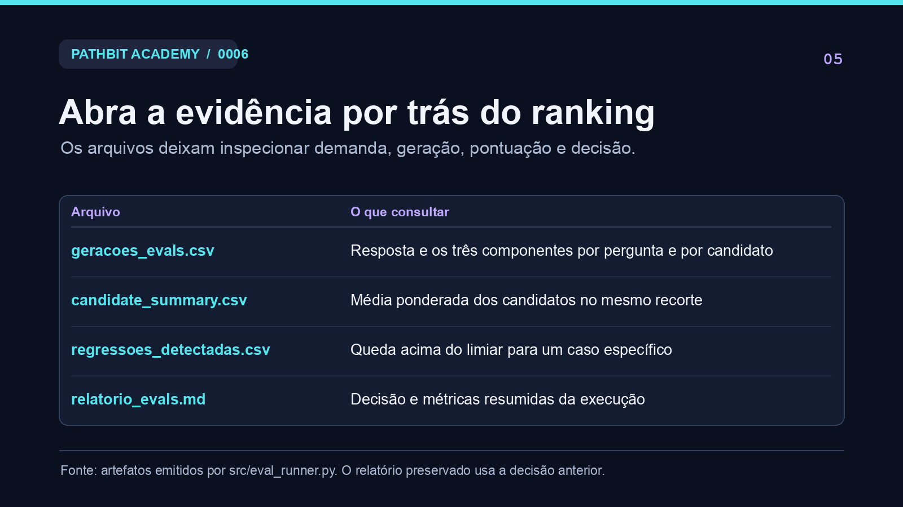
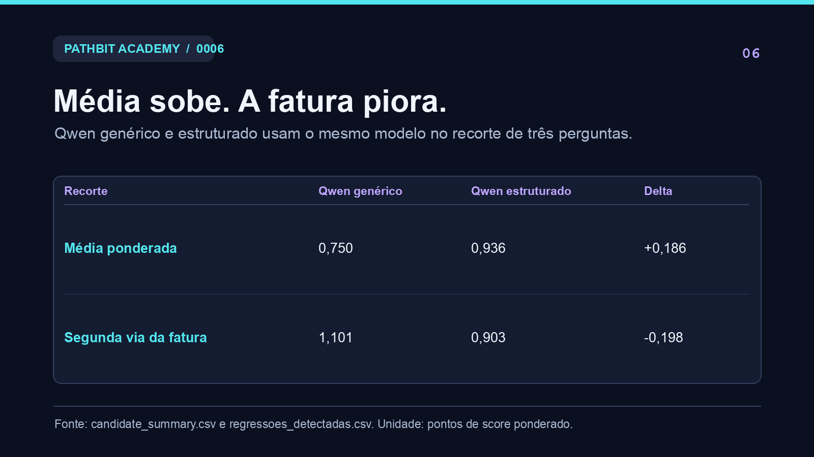

# 🧪 LLM Evals na prática: quando uma resposta melhor esconde uma regressão

> Série Academy IA · Artigo 0006 · Compare candidatos no mesmo conjunto de perguntas, abra as respostas e descubra quando uma média não autoriza uma troca.

“Para emitir a segunda via, procure a aba de acessibilidade financeira.” A resposta tem passos, verbo de ação e palavras que lembram o gabarito. O problema é que o portal não tem essa aba. A instrução esperada é abrir **Financeiro** e clicar em **Segunda Via**. No experimento deste módulo, essa resposta saiu do candidato com prompt estruturado. No agregado, ele ficou acima do prompt genérico. Na fatura, ficou abaixo.

Em [Prompt Engineering avançado](../../0005_prompt_engineering_avancado/article/ARTICLE.md) comparamos estratégias e modelos sob o mesmo contrato. Agora vamos usar o mesmo princípio para avaliar regressões caso a caso. A pergunta é se podemos substituir o comportamento atual de um assistente de suporte quando mudamos prompt ou modelo. Para responder precisamos enxergar o texto produzido, o escore de cada caso e a regra que transforma as medidas em decisão.



> Figura 1. Um ganho no agregado pode conviver com a piora de uma instrução financeira que a equipe já conhecia.

## 1. Compare candidatos completos usando as mesmas perguntas

O [runner](../src/eval_runner.py) define três candidatos. Cada um junta um modelo ao código que constrói seu prompt.

| Candidato | Modelo | O que muda |
| --- | --- | --- |
| `qwen_generico` | `Qwen/Qwen2.5-0.5B-Instruct` | Prompt de referência. É a baseline calculada sobre o mesmo recorte a cada execução |
| `qwen_estruturado` | `Qwen/Qwen2.5-0.5B-Instruct` | Muda a construção do prompt e mantém o modelo |
| `flan_estruturado` | `google/flan-t5-small` | Muda o modelo e usa o construtor de prompt adequado a ele |

A comparação dos dois Qwen permite investigar o efeito da estratégia de prompt nessa configuração. Quando o FLAN vence, podemos dizer que aquela combinação venceu neste experimento. O laboratório não cruza todas as estratégias com o FLAN, então esse resultado sozinho não atribui o ganho ao modelo ou ao prompt.

O [dataset](../data/eval_dataset.csv) tem cinco casos. Os três primeiros cobrem devolução, segunda via de fatura e cancelamento sem multa, todos de criticidade alta. Os outros dois cobrem suporte e limites de orientação do assistente. Os CSVs preservados foram produzidos com `--limit 3`, que pega as três primeiras linhas. Essa ordem explica por que o resumo versionado não mostra as outras duas categorias.



> Figura 2. Cada linha fixa o que o modelo recebe e dá referências para avaliar a resposta. A classificação de risco pertence ao caso.

Na pergunta de fatura, o contexto indica a aba Financeiro do portal e a opção Segunda Via. O gabarito repete essa operação em termos diretos e a lista de palavras críticas inclui `portal|financeiro|segunda via`. Se outro canal ou outro nome de menu também servir, o gabarito precisa deixar isso documentado. Palavras críticas dão um sinal rápido de cobertura, mas um formulário de atendimento funciona com instruções válidas, não só com termos presentes.

## 2. Leia o escore decomposto

Cada resposta recebe três medidas. A **similaridade semântica** compara os embeddings da resposta e do gabarito. A **cobertura de termos críticos** conta quantas expressões do gabarito aparecem como substrings, ignorando caixa. A função **`faithfulness`** conta a fração de tokens distintos da resposta com mais de quatro caracteres que também aparecem no contexto após a normalização usada no runner. Essa sobreposição permite suspeitar de conteúdo introduzido, mas não verifica negações, relações nem suporte factual.



> Figura 3. O índice composto coloca as medidas na mesma conta. Para revisar uma resposta, mantenha os componentes e o texto original visíveis.

O código faz a média dos três componentes e multiplica o resultado por 1,5, 1,0 ou 0,8 conforme a criticidade alta, média ou baixa. O valor resultante fica em `score_ponderado`. O resumo é a média dos escores já multiplicados. Como todos os casos preservados são de criticidade alta, o multiplicador 1,5 vale para cada linha e não muda a ordem entre candidatos nesse recorte. Um dataset com riscos variados pode mudar a ordem. A nota ponderada pode passar de 1 e deve ser lida na unidade do índice.

No caso da fatura, `qwen_estruturado` registrou cerca de 0,750 de similaridade, 0,667 de cobertura literal e 0,389 de sobreposição. A média é 0,602. Multiplicar por 1,5 leva a aproximadamente 0,903. A baseline registrou 1,101 nessa mesma pergunta. A diferença ficou em −0,198 pontos do índice ponderado. Quando abrimos a resposta, encontramos uma aba que o texto de referência não oferece e uma saída incompleta. É a hora de ler a instrução inteira, inclusive quando o escore entrega uma estimativa plausível.

## 3. Reconstrua a decisão a partir dos dados

O runner calcula o delta ponderado de cada candidato frente à baseline da mesma pergunta e registra quedas maiores que 0,05 pontos. Em seguida, ordena os candidatos pela média ponderada. O primeiro só recebe `aprovado` se superar a baseline em pelo menos 0,05 e não tiver regressão de criticidade alta entre as que foram registradas. Assim a regra de escolha usa o ranking e guarda o resultado por caso.



> Figura 4. O relatório mostra regressões de todos os candidatos. A decisão atual filtra os registros do candidato escolhido.

Os artefatos versionados registram as médias de 1,357 para `flan_estruturado`, 0,936 para `qwen_estruturado` e 0,750 para `qwen_generico`. A única regressão registrada pertence ao Qwen estruturado. O [relatório original](../data/relatorio_evals.md) foi gerado antes da correção da regra e mostra `reprovado`. Ao aplicar a regra atual aos mesmos CSVs, a regressão de outro candidato não barra o FLAN. O ganho é 0,607 e a contagem de regressões altas do vencedor é zero. Esse é um reprocessamento da decisão, preservando a inferência histórica.

Você consegue verificar a diferença sem carregar pesos. Na pasta deste módulo, execute com Python 3.10+:

```bash
python3 - <<'PY'
import csv

with open("data/candidate_summary.csv", encoding="utf-8", newline="") as source:
    scores = {row["candidate"]: float(row["score_ponderado"])
              for row in csv.DictReader(source)}
with open("data/regressoes_detectadas.csv", encoding="utf-8", newline="") as source:
    regressions = list(csv.DictReader(source))
winner = max(scores, key=scores.get)
gain = scores[winner] - scores["qwen_generico"]
critical = [row for row in regressions
            if row["candidate"] == winner and row["criticidade"] == "alta"]
print(f"{winner} | ganho={gain:.3f} | regressões altas={len(critical)}")
PY
```

O snippet imprime `flan_estruturado | ganho=0.607 | regressões altas=0`. Para saber o que manteve a regressão visível, abra as linhas comparáveis em [geracoes_evals.csv](../data/geracoes_evals.csv). Em tarefas onde respostas incorretas têm custo alto, adicione critérios absolutos. Se o modelo atual já erra um prazo, exigir apenas que o próximo não piore aquela média conserva a falha. Uma verificação focada pode exigir o número de dias certo, a unidade correta e as condições que limitam o prazo. [CheckList, testes comportamentais para NLP](https://arxiv.org/abs/2005.04118).



> Figura 5. Perguntas, geração, métricas e decisão deixam resultados intermediários consultáveis. Em revisões do dataset, mantenha os gabaritos versionados.



> Figura 6. Valores dos CSVs preservados. `qwen_estruturado` melhora a média em 0,186 pontos e regride 0,198 no caso da fatura.


### Um caso de negócio merece uma checagem que a média não faz

Veja a regra de cancelamento do dataset. O documento autoriza cancelar sem multa em até sete dias corridos após a contratação. Depois desse período vale o contrato. A expressão “sete dias” aparece tanto numa orientação correta quanto na frase “depois de sete dias o cancelamento sempre é gratuito”. O trecho exige pelo menos o número, a unidade, o ponto de partida e o sentido da condição. Se sua empresa aceita diferentes formas de escrever o mesmo número, dê exemplos no gabarito antes de programar um filtro literal.

Para revisar uma mudança de prompt, monte perguntas pareadas com a mesma política. Pergunte sobre seis dias, sobre o sétimo dia e sobre oito dias. Conserve a resposta ideal de cada caso e marque se a operação é permitida, depende de outra regra ou precisa de revisão. Faça a comparação sempre no mesmo recorte. Um resultado que acerta seis e oito dias ainda merece inspeção no limite exato. Esse exercício é uma extensão do laboratório, e os CSVs preservados usam apenas a pergunta geral de cancelamento.

Assim o agregado continua informando tendência e os casos de fronteira medem obrigações específicas. Se a regra usar perguntas do ambiente real, registre por que uma versão incorreta da política apareceu no contexto. Trocar o modelo pode melhorar a redação e ainda conservar a fonte errada.

## 4. Rode sua primeira comparação

Para gerar novas respostas, siga os [pré-requisitos](../README.md). A primeira execução pode baixar os pesos dos modelos e do encoder de embeddings. O runner grava resultados em `data/`; se quiser preservar os resultados do clone durante o exercício, use uma cópia local. Depois de instalar as dependências, rode:

```bash
python src/main.py --check
python src/eval_runner.py --limit 3
```

Compare o CSV de gerações, o resumo por candidato e o [notebook](../notebooks/llm_evals_regressao.ipynb). O launcher com `--check` faz uma checagem de configuração. Uma nova inferência produz números da sua execução, sujeitos aos pesos disponíveis, às versões e ao hardware. Em uma comparação controlada, mantenha o conjunto de perguntas, o gerador de embeddings e as opções de inferência fixos.

1. Leia a resposta de fatura dos três candidatos. Marque quais orientações estão no documento e quais vieram só do modelo.
2. Retire `--limit` para incluir os casos de suporte e compliance. Confira quantas perguntas e categorias entram na média antes de compará-la à execução histórica.
3. Adicione perguntas pareadas sobre cancelamento `até` e `depois` de sete dias. O que você validaria com código e o que exige revisão do contexto?

O próximo artigo passa da avaliação de texto à [escolha de ferramentas](../../0007_agentes_tool_calling/article/ARTICLE.md). Quando um modelo pode propor ações, também precisamos olhar a ferramenta selecionada, os seus argumentos e o que a resposta realmente fez.

---

Developed with ❤️ by [Pathbit](https://www.pathbit.com.br/)
