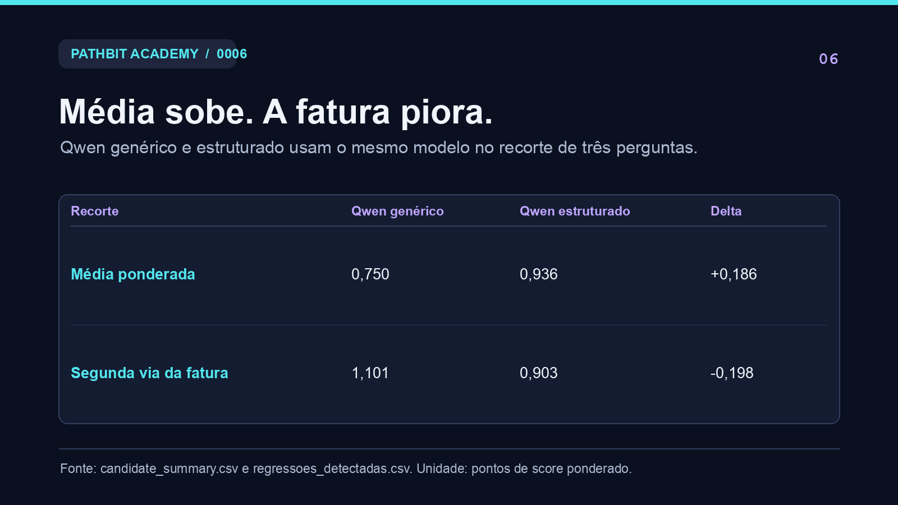

# O prompt estruturado melhorou a média e piorou a instrução de fatura

“Abra a Acessibilidade Financeira.” A resposta parece orientar o usuário para a segunda via, mas o contexto diz para abrir a aba **Financeiro** e clicar em **Segunda Via**. No laboratório de LLM Evals da Academy IA, essa instrução saiu do candidato Qwen com prompt estruturado. Ele superou a baseline na média e regrediu no caso de fatura.

## Separe a pontuação do diagnóstico

O laboratório compara três combinações de modelo e prompt sobre as mesmas perguntas. Uma função compara embeddings da resposta e do gabarito. Outra conta expressões críticas presentes no texto. Uma terceira usa sobreposição de palavras com o contexto como aproximação de aderência. Nenhuma dessas medidas sozinha verifica que o menu existe.

No caso de fatura do Qwen estruturado, a similaridade foi 0,750, a cobertura de palavras críticas 0,667 e a sobreposição 0,389. A média desses três sinais, multiplicada por 1,5 por criticidade alta, dá escore de 0,903. A referência chegou a 1,101 na mesma pergunta. O delta foi −0,198 pontos do índice ponderado. Abra a resposta e você consegue apontar a instrução introduzida pelo candidato.

## O vencedor ainda precisa passar pelos próprios casos críticos

A regra atual organiza os candidatos pela média ponderada. O escolhido precisa ganhar pelo menos 0,05 pontos da baseline e passar pelo filtro de regressões críticas do próprio candidato. Nos CSVs versionados, FLAN estruturado lidera com 1,357, frente a 0,750 da baseline. A regressão de criticidade alta pertence ao outro candidato.

O relatório original registrou `reprovado` porque a versão anterior da regra levou a regressão de outro candidato à decisão do vencedor. Aplicar a regra atual aos mesmos arquivos dá ganho de 0,607 e nenhuma regressão alta do FLAN entre as registradas. A mudança é da lógica de decisão. Não geramos novas respostas para obter esse resultado.

## Faça a inspeção antes de repetir a inferência

Na pasta do módulo, abra `data/candidate_summary.csv`, depois procure a pergunta da fatura em `data/geracoes_evals.csv` e `data/regressoes_detectadas.csv`. Compare os termos do gabarito com as etapas que o candidato recomenda. Num projeto real, inclua critérios independentes para o nome da opção, número do prazo e condições que valem para o atendimento. Se a baseline já erra, comparar só em relação a ela pode manter uma falha conhecida.

O [módulo com código, notebook e reprodução do cálculo offline](https://github.com/pathbit/pathbit-academy-ai/tree/master/0006_llm_evals_regressao) integra a Academy IA da [Pathbit](https://www.pathbit.com.br/).
