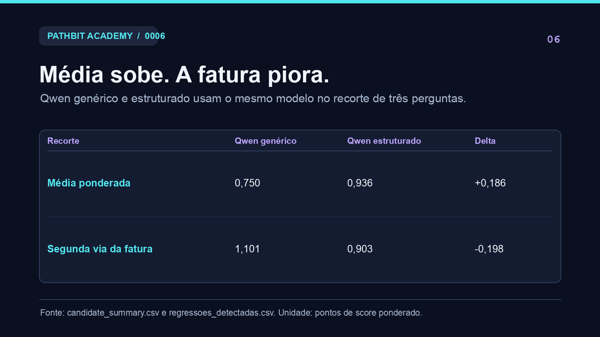

O mesmo modelo. Um prompt estruturado. Uma média melhor. Um passo errado no portal de faturas.

Nos dados do laboratório de LLM Evals da Academy IA, o Qwen estruturado sobe de 0,750 para 0,936 no escore médio ponderado, mas perde 0,198 pontos no caso de fatura. A resposta indica uma aba que não aparece no contexto.

O artigo abre as três métricas que compõem a nota, reconstrói a regra de escolha a partir dos CSVs e mostra onde a revisão humana faz diferença.

📎 Artigo, código e notebook

https://github.com/pathbit/pathbit-academy-ai/tree/master/0006_llm_evals_regressao

#LLMEvals #PromptEngineering #AvaliaçãoDeIA #PathbitAcademy
