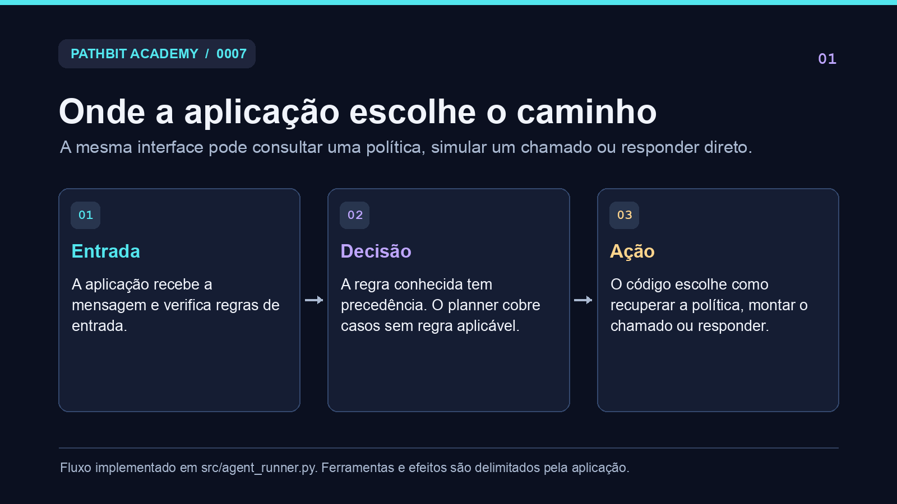
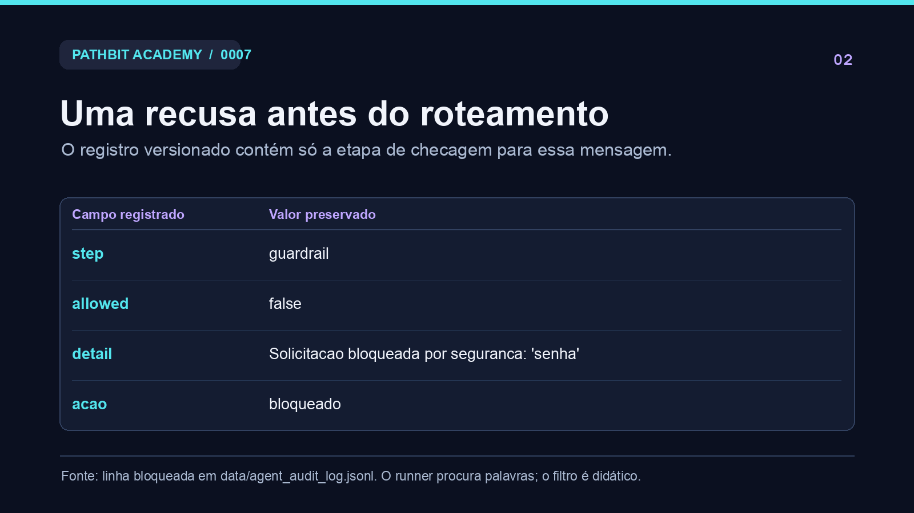
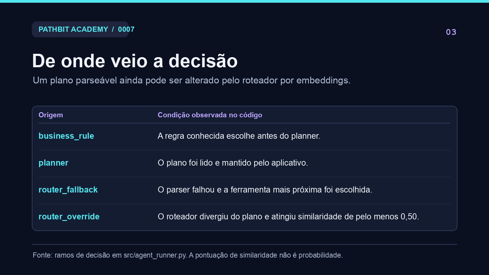
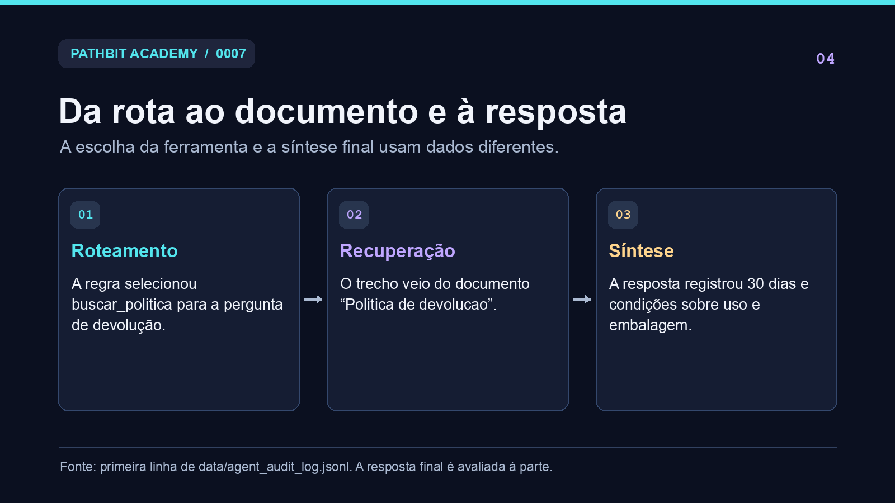
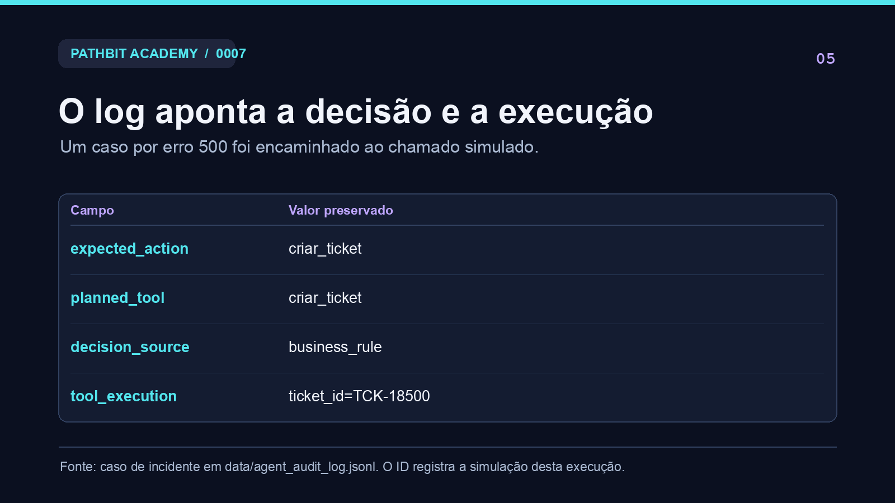
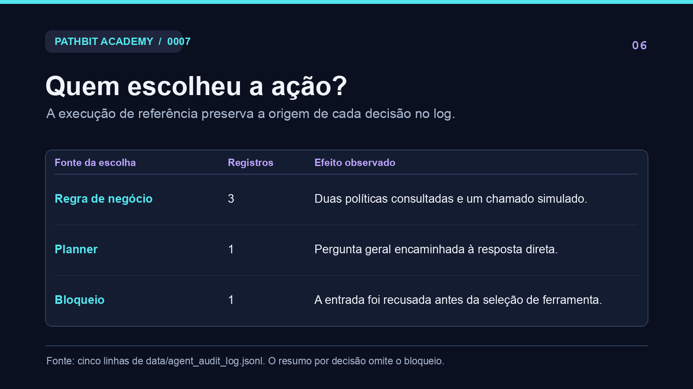

# 🛠️ Agentes e tool calling: quem decide qual ferramenta roda?

> Série Academy IA · Artigo 0007 · Siga uma solicitação do roteamento à resposta e identifique qual decisão veio do modelo, de uma regra ou de um fallback.

“Meu app está com erro 500 desde ontem. Pode abrir um chamado?” O assistente tem duas opções que soam razoáveis: consultar uma política de suporte ou abrir um chamado. O usuário já informou o incidente e pediu a ação. Se o modelo responder com instruções sobre onde abrir um chamado, pode parecer prestativo enquanto deixa o trabalho para a pessoa.

Em [LLM Evals](../../0006_llm_evals_regressao/article/ARTICLE.md), avaliamos o que um modelo escreveu. Neste módulo, a resposta final é só uma parte: antes dela alguém escolhe uma ferramenta, monta argumentos e interpreta o retorno. O [laboratório](../README.md) implementa um agente de suporte em Python com uma base local de políticas, um catálogo de ferramentas e um chamado simulado. Vamos separar as decisões para descobrir por que cada ação aconteceu.



> Figura 1. O aplicativo controla o catálogo e define quais etapas podem usar modelo, regras e recuperação.

## 1. Antes do planner, o código já toma decisões

O runner [agent_runner.py](../src/agent_runner.py) carrega um modelo de embeddings e um gerador no início da execução. Para cada mensagem, passa por uma checagem de palavras e depois por regras de negócio. Se a mensagem for bloqueada, o fluxo daquele cenário termina antes de chamar planner, recuperação ou síntese. O modelo pode já estar carregado em memória.

A checagem usa correspondências simples, como `senha` ou `token`. Serve para observar uma recusa no exercício. Pode recusar uma dúvida legítima sobre política de credenciais e não oferece detecção abrangente de dados sensíveis. A aplicação que integra uma ferramenta real precisa aplicar autorização no serviço executor, limitar quais dados entram no contexto e reduzir o que registra. Essa proteção opera independentemente do texto que o modelo produzir.

Em seguida, `business_rule_router()` verifica intenções conhecidas. Termos como `fatura`, `boleto` e `cancelamento` selecionam `buscar_politica`. `erro 500` e `indisponibilidade` podem selecionar `criar_ticket`. A regra de política vem primeiro. Em uma solicitação como “erro 500 ao emitir fatura”, a presença de `fatura` pode fazer a lista de regras encaminhar para a política. Quem define o roteamento precisa decidir como tratar intenções combinadas e registrar casos assim no dataset.



> Figura 2. O caso recusado registra apenas a etapa de checagem. Em entradas permitidas, o planner só propõe ferramenta se nenhuma regra selecionar a ação.

Mesmo quando a regra já escolheu a ferramenta, o runner calcula a sugestão por embeddings para o registro de auditoria. O texto final também pode passar pelo gerador. “Roteado por regra” significa que o modelo não escolheu aquela ação. Para interpretar custo e latência, confira também recuperação e síntese.

## 2. Um plano válido define forma. A aplicação controla a execução

Na ausência de uma regra aplicável, o prompt pede um objeto com três strings: `tool`, `argument` e `reason`.

```json
{
  "tool": "buscar_politica",
  "argument": "devolucao",
  "reason": "A solicitacao pede a regra de devolucao."
}
```

O exemplo mostra o formato, sem representar uma geração registrada. O parser busca um objeto no texto, tenta ler JSON e exige que os três campos existam e tenham tipo string. Campos extras ficam de fora do retorno do parser. O caso de tipos verifica a forma do objeto. Um argumento string vazio ou uma ferramenta inexistente ainda exigem tratamento. Neste laboratório, a execução usa dois ramos de ferramenta e trata as outras ações como `resposta_direta`. O log preserva o nome planejado separadamente da ação que rodou.



> Figura 3. O contrato do planejador deixa explícita a proposta. A ação depende do código que interpreta os campos.

Quando o plano não é parseável, `route_with_embeddings()` escolhe o rótulo mais próximo entre as descrições do catálogo. O caminho registra `router_fallback`. Quando o plano é parseável, mas o modelo e o roteador divergem, um escore do roteador de pelo menos 0,50 pode levar à substituição, registrada como `router_override`. Esse limite é um parâmetro de similaridade usado pela implementação. Ele não significa “50% de chance de estar certo”. O ramo de fallback por falha de parse nem usa esse limiar para escolher.

Em um projeto em que a ação produz efeitos, atribua regras por ferramenta. Uma leitura pode aceitar confirmação automática quando o argumento é válido. Um efeito externo pode exigir aprovação e uma chave reaproveitável por tentativa. Com um plano de baixa confiança, uma pergunta curta sobre a intenção do usuário pode ser melhor que seguir com a ferramenta mais parecida. O [módulo de aprovação](../../0011_aprovacao_idempotencia/article/ARTICLE.md) implementa esse controle em um próximo exercício.

## 3. Confira o que cada ferramenta realmente retorna

`buscar_politica` recupera a entrada mais próxima na base local por embeddings e entrega título, conteúdo e escore para a aplicação. O trecho precisa ser pertinente à pergunta. A ação pode ter sido a esperada e, ainda assim, a base pode devolver uma política errada ou antiga. Para avaliar esse caso, confira o documento recuperado separadamente no [relatório de recuperação](../data/retrieval_summary.csv).

`criar_ticket` gera um payload simulado com assunto, prioridade e identificador. `erro 500` e `indisponibilidade` dão prioridade alta. O ID usa `hash(assunto)`, que pode mudar entre processos de Python. Nenhum serviço de suporte recebe o resultado, e o ID simulado não oferece persistência nem idempotência.

Depois de escolher e executar a ação, o gerador recebe o resultado para compor a resposta final. Esse resultado é evidência para a síntese. O gerador ainda pode omitir um detalhe ou prometer algo que a ferramenta não afirmou. Avalie a ação, o argumento, o retorno e o texto final em etapas.



> Figura 4. O desenho permite que cada parte tenha um teste. Uma resposta convincente pode nascer de uma recuperação ou ação inadequada.

## 4. Abra o log antes de interpretar a taxa de acerto

O [log versionado](../data/agent_audit_log.jsonl) tem cinco registros: duas consultas encaminhadas a políticas por regra, um chamado simulado escolhido por regra, uma solicitação bloqueada e uma pergunta geral roteada pelo planner para resposta direta. O [resumo por decisão](../data/decision_summary.csv) tem os quatro casos não bloqueados, agrupados em três linhas. No fixture preservado, o planner foi o responsável pela ferramenta em apenas um deles.

Use a biblioteca padrão para abrir o log sem carregar peso de modelo. Rode na pasta deste módulo:

```bash
python3 - <<'PY'
import json
from collections import Counter
from pathlib import Path

data = Path("data/agent_audit_log.jsonl")
records = [json.loads(line) for line in data.read_text(encoding="utf-8").splitlines()]
print(Counter(item.get("decision_source", item["status"]) for item in records))
for item in records:
    print(item["acao"], "→", item["documento"] or "sem documento")
PY
```

A contagem devolve `business_rule: 3`, `bloqueado: 1` e `planner: 1`. As duas recuperações apontam para política de devolução e segunda via da fatura. O campo `acertou_roteamento` compara `acao` ao gabarito `expected_action`; ele não mede a qualidade do texto ou a autorização para uma ação. Esse recorte permite examinar o fluxo. Para estimar a qualidade do planner, adicione cenários em que ele realmente precise decidir, além de exercícios em que a melhor ação é pedir esclarecimento.



> Figura 5. Consulte as etapas registradas para localizar a decisão. Os arquivos são locais e regraváveis, e precisam de regras de acesso e retenção em outro ambiente.



> Figura 6. A execução preservada tem três ações escolhidas por regra, uma por planner e uma recusa antes do roteamento. O resumo por decisão exclui a recusa.


### Separe o erro do parser do erro de decisão

No diretório do módulo, com as dependências Python instaladas, teste as duas funções diretamente. O exemplo usa texto e JSON didáticos. Nenhum modelo precisa ser carregado para verificar essas regras.

```python
import sys

sys.path.insert(0, "src")
from agent_runner import business_rule_router, parse_plan

print(business_rule_router("Erro 500 ao emitir fatura")[0])
print(parse_plan('{"tool":"buscar_politica","argument":{},"reason":"fatura"}'))
print(parse_plan('{"tool":"buscar_politica","argument":"fatura","reason":"fatura"}')["tool"])
```

As saídas são `buscar_politica`, `None` e `buscar_politica`. O primeiro resultado expõe a precedência da regra de política na mensagem de intenção dupla. O segundo é uma estrutura recusada pelo parser. O terceiro mostra uma estrutura aceita; confirmar se o usuário precisava da política continua sendo uma avaliação da escolha. Usar esses três casos como checagens separadas evita atribuir uma falha de roteamento ao modelo quando a regra já tinha decidido o caminho.

Se a ferramenta de consulta devolver um documento inadequado, olhe primeiro a consulta que recebeu. Uma regra que repassa a mensagem toda e um planner que extrai um tópico podem acionar a mesma ferramenta com argumentos diferentes. O nome da ação sozinho não resolve essa investigação.

## 5. Rode, altere um caso e veja onde o comportamento muda

Para gerar novos registros, siga os [pré-requisitos](../README.md). A primeira execução pode baixar pesos. Use uma cópia do módulo se quiser preservar os CSVs versionados durante o exercício.

```bash
python src/main.py --check
python src/agent_runner.py
```

1. Rode o snippet de leitura antes e depois de uma nova geração. Compare `planned_tool`, `acao` e a origem da escolha.
2. Adicione uma solicitação sintética que combine “erro 500” com “fatura”. Marque no gabarito a ação que resolveria o pedido e explique a ordem das regras que causou o resultado.
3. Abra o [notebook](../notebooks/agentes_tool_calling.ipynb), escolha uma sugestão de política e confira se o documento recuperado realmente responde à pergunta.
4. Pense numa consulta fora do catálogo. Defina o que o serviço deveria devolver se a aplicação não tiver uma ação autorizada para aquele objetivo.

O artigo conversa com a ideia de combinar linguagem e ações apresentada em [ReAct](https://arxiv.org/abs/2210.03629). O laboratório executa uma decisão e uma síntese por cenário, sem implementar uma sequência aberta de passos do artigo de pesquisa. O [próximo módulo](../../0008_llms_locais_ollama/article/ARTICLE.md) mostra como rodar modelos localmente com Ollama; em [MCP](../../0010_mcp_local/article/ARTICLE.md), vamos mover o catálogo e a execução de ferramentas para um processo separado.

---

Developed with ❤️ by [Pathbit](https://www.pathbit.com.br/)
