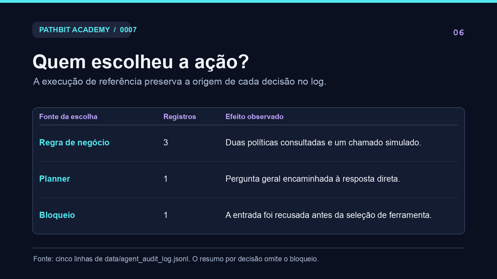

# Quem escolheu a ferramenta: o modelo ou a regra?

O usuário relata erro 500 e pede um chamado. O assistente responde “Chamado criado”. Antes de creditar a ação ao modelo, abra o log. No laboratório de tool calling da Academy IA, esse percurso depende de uma regra de negócio. O modelo participa da síntese, mas a regra escolheu `criar_ticket`.

## O fluxo toma decisões antes e depois do plano

Uma checagem de entrada pode recusar o pedido antes do roteamento. Em seguida, regras do código cobrem intenções conhecidas: fatura e boleto seguem para política; erro 500 pode seguir para chamado. Uma mensagem com duas intenções expõe a ordem dessas regras. “Erro 500 ao emitir fatura” é um bom exemplo para colocar no gabarito, pois `fatura` cai na primeira condição aplicável.

Quando nenhuma regra resolve a mensagem, o planner recebe o catálogo e propõe `tool`, `argument` e `reason`. O parser exige strings. Um plano fora desse formato ativa o roteador por embeddings. Um plano parseável também pode ser substituído quando o roteador propõe outra ferramenta e ultrapassa o limite de similaridade definido no runner. Similaridade é um sinal de proximidade, e a decisão final continua no código da aplicação.

## O que aconteceu nos cinco cenários versionados

- Duas buscas de política e um chamado simulado foram escolhidos por regra.
- Uma entrada foi bloqueada antes do roteamento.
- Em um caso, o planner escolheu resposta direta.

O resumo por origem traz as quatro decisões que passaram pelo bloqueio. A taxa de roteamento compara a ação executada à esperada. Ela não diz se o documento recuperado tinha a informação certa, se o texto final respeitou a política ou se um efeito foi autorizado.

A função de chamado do módulo gera um payload com ID, assunto e prioridade. O ID vem de um hash local e pode mudar entre processos. O exercício não abre chamados externos. Para um efeito persistente, leve autorização e controle de repetição à ferramenta que grava o estado.

## Reproduza com os registros, depois faça a geração

Abra `data/agent_audit_log.jsonl` e compare os campos `planned_tool`, `acao`, `decision_source` e as etapas do registro. Adicione um exemplo que combine duas intenções aos cenários locais. Defina antes se o agente deve buscar a política, abrir um chamado ou perguntar o que a pessoa quer resolver primeiro.

O [artigo com o exercício, o código e o notebook](https://github.com/pathbit/pathbit-academy-ai/tree/master/0007_agentes_tool_calling) integra a Academy IA da [Pathbit](https://www.pathbit.com.br/).
