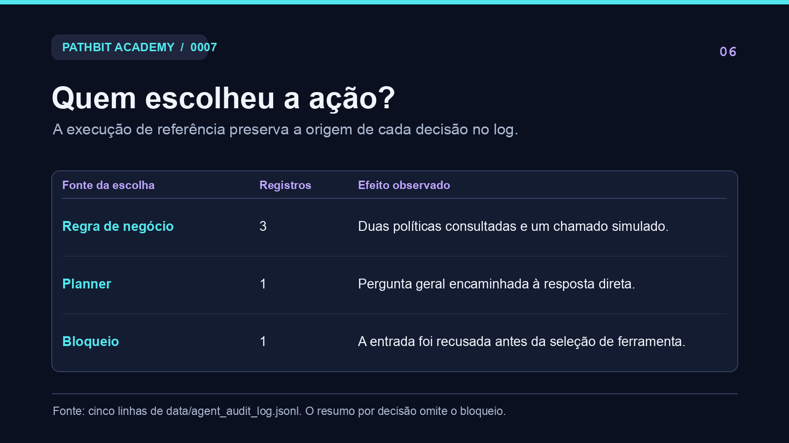

O assistente abriu o chamado porque entendeu o incidente ou porque uma regra encontrou “erro 500”?

Nos registros do laboratório de tool calling da Academy IA, três ações vieram de regras, uma veio do planner e uma entrada foi bloqueada antes da escolha. A origem muda o que devemos testar.

O artigo mostra como ler o log, o que acontece com um plano malformado e por que uma ação simulada exige outro desenho quando passa a alterar dados reais.

📎 Artigo, código, registros e notebook

https://github.com/pathbit/pathbit-academy-ai/tree/master/0007_agentes_tool_calling

#AgentesIA #ToolCalling #Python #PathbitAcademy
