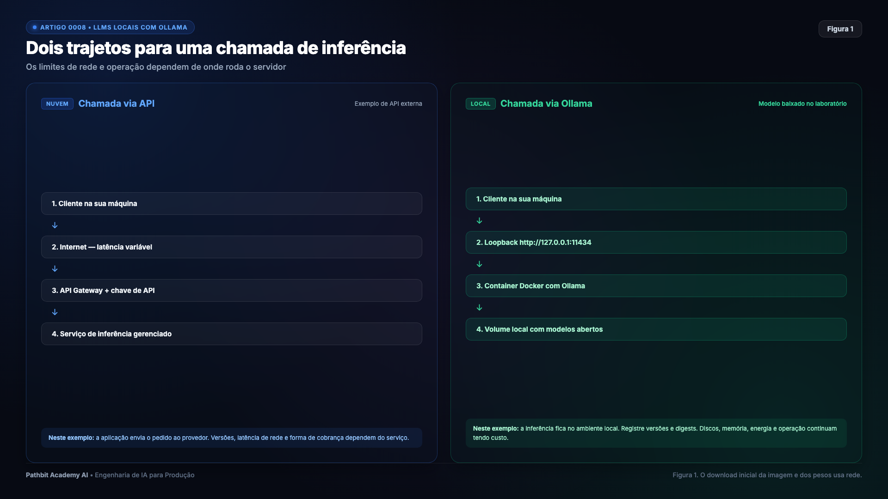
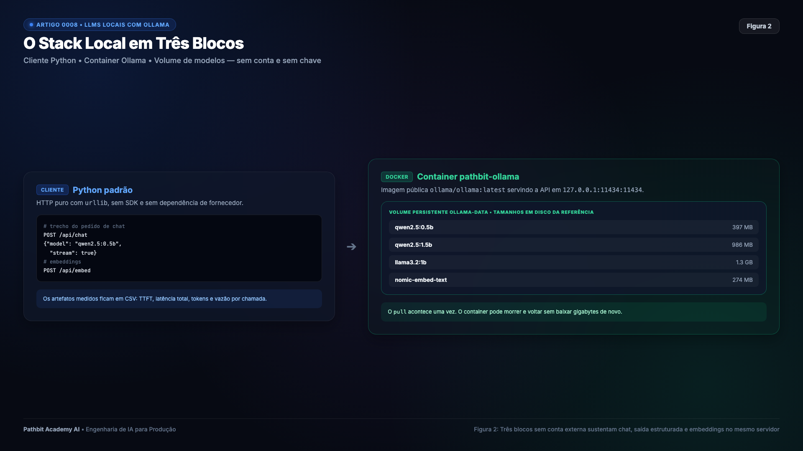
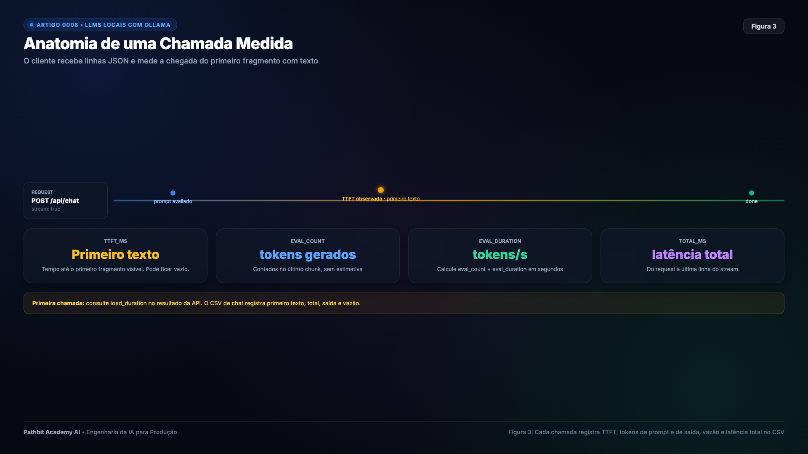
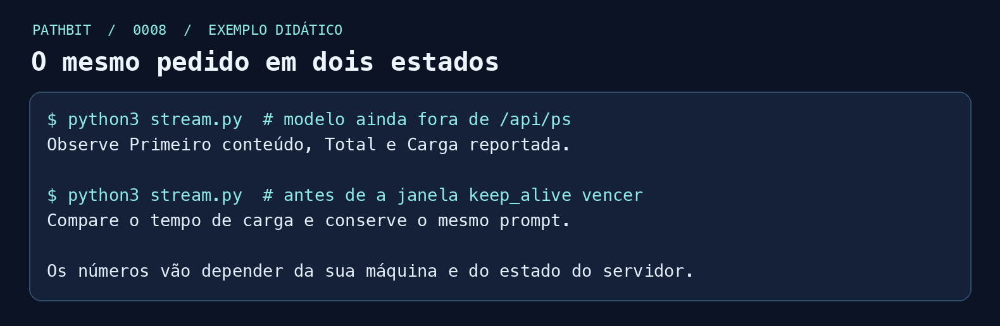
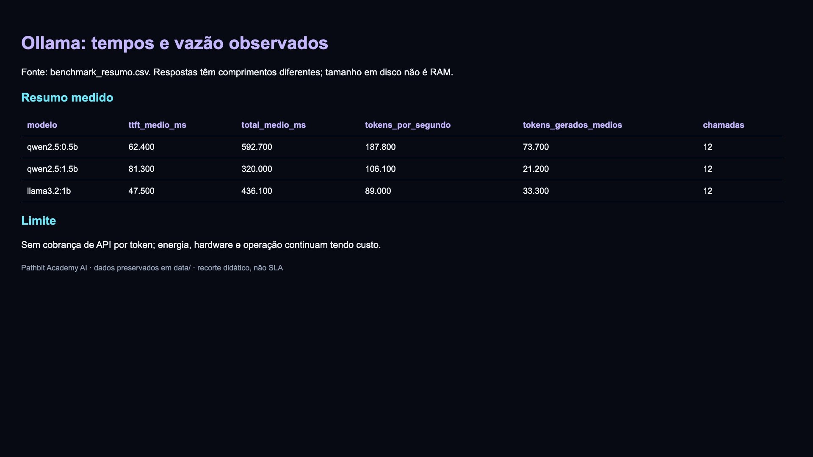
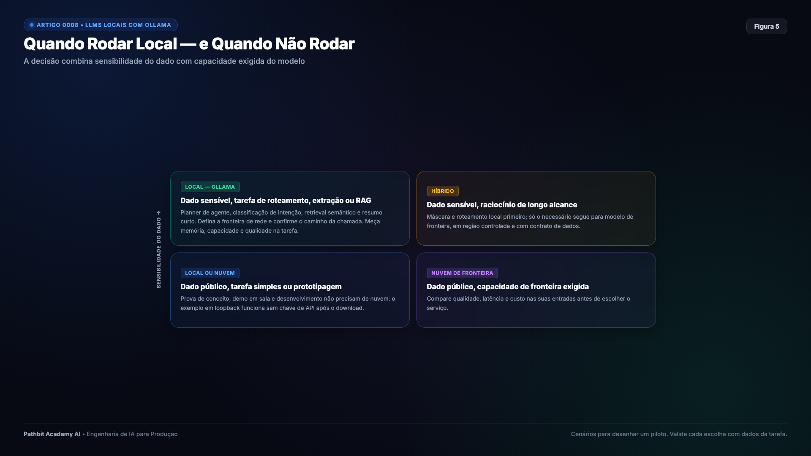

# LLMs locais com Ollama. Do primeiro chat à leitura de um benchmark

Você instalou um modelo pequeno para responder perguntas de suporte. Na primeira chamada, a tela fica alguns segundos sem mostrar texto. Na segunda, a resposta começa quase imediatamente. Qual tempo deve entrar no seu relatório? Depende de qual experiência você está medindo: o primeiro acesso depois de carregar o modelo ou a fila de chamadas com os pesos já em memória.

Neste módulo nós vamos subir um servidor local, conversar com um modelo pelo terminal e seguir o caminho da resposta até os números do benchmark. O [módulo 0007](../../0007_agentes_tool_calling/article/ARTICLE.md) usou um agente que escolhe ferramentas. Aqui a pergunta vem antes: se o agente precisar de inferência, como você instala o serviço, identifica a chamada mais lenta e verifica o que o modelo realmente devolveu?

---

## O que passa a acontecer na sua máquina

O navegador ou o script envia um pedido HTTP, e o servidor Ollama gerencia o modelo. Neste exercício, o cliente fala com `127.0.0.1`, endereço de loopback do host, e o Docker encaminha a porta até o container. Os pesos ficam num volume e podem ser reutilizados quando o container for recriado. As chamadas que o cliente faz aos modelos baixados não pedem chave de API externa.



> **Figura 1.** O caminho da demonstração termina no servidor local. O download inicial precisa de rede. O comportamento de outros processos, ferramentas e integrações é uma escolha separada.

Isso concentra algumas responsabilidades no seu ambiente. Você controla a exposição da porta, pode registrar a versão do servidor e consegue medir o comportamento no mesmo hardware em que executa os exemplos. Para reproduzir resultados, registre a versão ou o digest da imagem e o digest do modelo, além do prompt, das opções de geração e do hardware. Um nome como `latest` pode mudar no registry. Até com os mesmos pesos, a troca de motor ou de backend pode alterar o resultado.

A ausência de cobrança por token em uma chamada local tira uma variável do exemplo. Energia, disco, memória e tempo de operação continuam limitando o que cabe nesse ambiente. O Docker Desktop no macOS executa containers Linux dentro de uma VM. Inferência em CPU no container e inferência pelo backend Metal de uma instalação nativa são ambientes diferentes. Registre o backend antes de comparar latências.

## Suba o menor laboratório que atende ao exercício

A partir da raiz do repositório, rode o [Docker Compose versionado](../docker-compose.yml). Você precisa do Docker em execução e de conexão para baixar a imagem e os pesos.

```bash
cd 0008_llms_locais_ollama
docker compose up -d
docker exec pathbit-ollama ollama pull qwen2.5:0.5b

curl -fsS http://127.0.0.1:11434/api/version
curl -fsS http://127.0.0.1:11434/api/tags
```



> **Figura 2.** O Compose deste módulo publica a porta com `127.0.0.1:11434:11434` e monta o volume persistente de pesos. Para o primeiro chat, só um modelo de texto é necessário.

`/api/version` informa a versão que está respondendo. `/api/tags` lista modelos instalados e suas informações. `/api/ps` lista os que estão carregados. Antes do primeiro chat, uma lista vazia em `/api/ps` é compatível com um modelo já aparecer em `/api/tags`. A primeira pergunta é “está instalado?”. A segunda é “está carregado agora?”. [API de versões do Ollama](https://github.com/ollama/ollama/blob/main/docs/api.md#version), [API de modelos carregados](https://docs.ollama.com/api/ps).

Faça o primeiro pedido sem streaming para enxergar o envelope da API.

```bash
curl -fsS http://127.0.0.1:11434/api/chat \
  -H 'Content-Type: application/json' \
  -d '{
    "model": "qwen2.5:0.5b",
    "messages": [{"role": "user", "content": "Responda apenas com a palavra OK."}],
    "stream": false,
    "options": {"temperature": 0, "num_predict": 8}
  }'
```

O corpo traz o texto dentro de `message.content` e as métricas de execução no envelope. Veja se `done` está marcado e confira `done_reason`, quando disponível. Um modelo que chegou ao limite de tokens pode devolver uma resposta incompleta com sucesso HTTP. Troque o prompt por uma pergunta simples se quiser observar a diferença no número de tokens de entrada e de saída. [API de chat do Ollama](https://docs.ollama.com/api/chat).

### De onde vem a primeira espera?

O servidor administra o carregamento dos pesos e pode mantê-los em memória por um período. O arquivo de Compose usa `OLLAMA_KEEP_ALIVE=24h` para facilitar a repetição do laboratório no mesmo dia. Seu pedido também pode informar `keep_alive`. A disponibilidade efetiva do modelo depende dos recursos e do que mais o servidor estiver atendendo. Confira o estado com `/api/ps` em vez de inferi-lo a partir da configuração.

O formato GGUF permite distribuir pesos e metadados em diferentes quantizações. Pense em quantização como uma representação que ocupa menos espaço por peso. A escolha afeta tamanho, desempenho e qualidade conforme o modelo e a tarefa. Compare duas quantizações com os mesmos casos de avaliação antes de trocar a configuração.

A RAM em execução inclui mais do que os pesos. O KV cache guarda estados de atenção de tokens anteriores e cresce conforme o contexto efetivamente alocado, a arquitetura e a configuração do cache. Duas requisições longas em paralelo podem pressionar mais a memória do que uma conversa curta. O tamanho do download informa quanto guardar em disco e serve como ponto de partida para medir o consumo com o modelo carregado. [Formato GGUF](https://github.com/ggml-org/ggml/blob/master/docs/gguf.md), [FAQ do Ollama](https://docs.ollama.com/faq).

---

## Meça o primeiro conteúdo, o total e a taxa de geração

Com `stream: true`, cada linha recebida é um objeto JSON. Leia a primeira linha com texto visível, junte os fragmentos e espere a linha com `done: true`. Há linhas que carregam metadados ou não têm texto visível. O número de linhas não é uma contagem de tokens.



> **Figura 3.** O cliente observa o momento em que chega o primeiro fragmento com texto. O servidor informa contagem e duração de avaliação na linha final.

Salve o bloco como `stream.py` em uma pasta temporária. Ele usa só a biblioteca padrão do Python. Rode `python3 stream.py` duas vezes em sequência. Para comparar carga sob demanda, use uma instância de laboratório em que `/api/ps` ainda não mostre o modelo. Se executou o primeiro `curl` há pouco, pode repetir a prova depois de descarregar o modelo dessa instância com `docker exec pathbit-ollama ollama stop qwen2.5:0.5b`.

```python
import json
import os
import time
import urllib.request

base = os.getenv("OLLAMA_BASE_URL", "http://127.0.0.1:11434")
payload = {
    "model": "qwen2.5:0.5b",
    "messages": [{"role": "user", "content": "Responda apenas com a palavra OK."}],
    "stream": True,
    "keep_alive": "5m",
    "options": {"temperature": 0, "num_predict": 8},
}
request = urllib.request.Request(
    f"{base}/api/chat",
    data=json.dumps(payload).encode("utf-8"),
    headers={"Content-Type": "application/json"},
)
start = time.perf_counter()
first_content_ms = None
pieces = []
final = None
with urllib.request.urlopen(request, timeout=120) as response:
    for line in response:
        if not line.strip():
            continue
        chunk = json.loads(line)
        if "error" in chunk:
            raise RuntimeError(chunk["error"])
        piece = chunk.get("message", {}).get("content", "")
        if piece:
            if first_content_ms is None:
                first_content_ms = (time.perf_counter() - start) * 1_000
            pieces.append(piece)
        if chunk.get("done"):
            final = chunk
            break

if final is None:
    raise RuntimeError("O streaming terminou sem a linha final")
total_ms = (time.perf_counter() - start) * 1_000
eval_ns = final.get("eval_duration", 0)
visible_ms = f"{first_content_ms:.1f} ms" if first_content_ms is not None else "ausente"
print(f"Texto: {''.join(pieces).strip()!r}")
print(f"Primeiro conteúdo no cliente: {visible_ms}")
print(f"Total no cliente: {total_ms:.1f} ms")
print(f"Carga reportada pelo servidor: {final.get('load_duration', 0) / 1e6:.1f} ms")
print(f"Tokens na geração: {final.get('eval_count', 0)}")
if eval_ns:
    print(f"Vazão da geração: {final.get('eval_count', 0) * 1e9 / eval_ns:.1f} tokens/s")
```



> **Figura 4.** Roteiro para comparar duas chamadas com o mesmo modelo, prompt e opções. Verifique em `/api/ps` se o modelo está carregado e compare `load_duration` nas duas chamadas.

**Primeiro conteúdo no cliente.** O relógio começa antes da chamada HTTP e para ao receber o primeiro fragmento com conteúdo. Esse número aproxima o TTFT percebido, com custo de transporte e leitura do stream. Se o modelo não emitiu texto, o exemplo registra “ausente”. O cliente não tem como tratar uma linha de configuração como se fosse texto entregue ao usuário.

**Tempo total no cliente.** O cronômetro segue até ler a linha final. Inclui a espera pelo primeiro conteúdo e o restante do processamento. Para afinar a interpretação, compare com `total_duration` e `load_duration`, que vêm do servidor e usam nanossegundos. As origens dos relógios são diferentes.

**Velocidade de geração.** Divida `eval_count` por `eval_duration` em segundos. Ela expressa o ritmo da fase final, depois do processamento inicial da entrada. Dividir pela latência total daria outra medida: produtividade da operação inteira. Consulte também `prompt_eval_count` e `prompt_eval_duration` para investigar quanto de entrada o servidor processou. [Streaming do Ollama](https://docs.ollama.com/api/streaming), [API de chat e métricas](https://docs.ollama.com/api/chat).

### Leia o tamanho da resposta junto com a latência

Se dois modelos receberam a mesma pergunta e um respondeu usando 75 tokens enquanto outro usou 20, o primeiro pode produzir mais tokens por segundo e demorar mais para terminar. Uma pergunta que pede só um rótulo é boa para praticar porque torna evidente a diferença entre “começou a responder cedo” e “terminou rápido”. Para avaliar vários modelos, informe também o quanto acertaram a tarefa e quantos textos ficaram incompletos.

---

## Refaça o benchmark em uma cópia do módulo

A partir de uma cópia de trabalho, mantenha o container em execução. Prepare a dependência de embeddings mesmo para a rodada de um único modelo de chat. O script roda as etapas de chat, saída JSON e busca por similaridade.

```bash
docker exec pathbit-ollama ollama pull nomic-embed-text
python3 -m venv .venv
source .venv/bin/activate
python -m pip install -r requirements.txt
python src/ollama_lab.py --models qwen2.5:0.5b --repeat 1 --attempts 3 --skip-plots
```

O laboratório escreve seus resultados dentro de `data/`. Se quiser conservar lado a lado os arquivos versionados e a rodada nova, execute o comando em outra cópia do módulo. Para comparar os três modelos do CSV histórico, adicione `qwen2.5:1.5b` e `llama3.2:1b` ao servidor e rode a linha sem limitar `--models`. A versão atual do laboratório deixa o número de threads com o runtime, de acordo com os recursos disponíveis no ambiente. O [README](../README.md) lista todos os comandos. O [notebook](../notebooks/llms_locais_ollama.ipynb) usa o mesmo laboratório, e você pode abri-lo com `python src/main.py`.

No benchmark de chat, `warmup_model()` faz uma chamada curta por modelo antes dos casos medidos. Esse passo pode incluir geração e não fornece, por si só, a duração pura de carga. As linhas de `benchmark_resultados.csv` são chamadas depois desse preparo. O runner usado na rodada histórica preenchia TTFT com o total quando não encontrava texto visível. Na implementação atual, o campo fica vazio e é excluído da média de TTFT. A chamada ainda entra na contagem e no tempo total.

### O que os dados publicados permitem afirmar

A tabela pertence à rodada histórica do repositório, com Ollama 0.35.1 em CPU. São 12 chamadas por modelo, com prompts em comum. As médias de geração usam a duração reportada pelo servidor para essa fase. [CSV de resumo](../data/benchmark_resumo.csv), [relatório da rodada](../data/benchmark_relatorio.md).

| Modelo | Primeiro texto médio | Total médio | Vazão média | Tokens de saída médios |
| --- | ---: | ---: | ---: | ---: |
| `qwen2.5:0.5b` | 62,4 ms | 592,7 ms | 187,8 tokens/s | 73,7 |
| `qwen2.5:1.5b` | 81,3 ms | 320,0 ms | 106,1 tokens/s | 21,2 |
| `llama3.2:1b` | 47,5 ms | 436,1 ms | 89,0 tokens/s | 33,3 |



> **Figura 5.** O Qwen 0.5B liderou em vazão média e produziu a maior saída média. O Qwen 1.5B terminou primeiro na média. Os dados descrevem esse hardware e esses prompts.

Há outras duas perguntas nos dados. No teste JSON, cada Qwen acertou a seleção de ferramenta em cinco de cinco tentativas. A coluna histórica `json_valido` representa parse de um dicionário **e** presença de `tool` e `reason`. O zero do Llama nessa coluna não indica que toda resposta era JSON malformado. Você vai decompor essas verificações no [módulo 0009](../../0009_saida_estruturada/article/ARTICLE.md). [CSV de saída estruturada](../data/structured_output.csv).

### Embeddings no mesmo servidor

O laboratório troca de endpoint para `/api/embed` quando precisa recuperar a política mais relacionada a uma consulta. O modelo recebe textos e devolve vetores. O código calcula similaridade e escolhe o documento mais próximo no conjunto de demonstração. A recuperação desse documento é uma etapa que pode alimentar o chat. Ela é executada por outro modelo, com outra carga e outra métrica.

O conjunto histórico tem oito documentos e quatro consultas. No exemplo “como pego a segunda via do boleto?”, a primeira posição foi `segunda_via_fatura`. Os quatro exemplos tiveram o documento esperado no topo. Para uma avaliação de português real, inclua paráfrases, consultas ambíguas e casos nos quais nenhuma política atende. Guarde os resultados por consulta. Assim um 4/4 no exemplo não vira, por arredondamento, uma estimativa de qualidade geral. [Consultas e documentos recuperados](../data/embedding_routes.csv), [API de embeddings do Ollama](https://docs.ollama.com/api/embed).

---

## Use a medição para desenhar um piloto



> **Figura 6.** Matriz para levantar hipóteses sobre o ambiente, o tipo de tarefa e os dados que o fluxo consulta.

Considere dois pedidos de uma central de suporte. “Escolha entre segunda via, incidente e dúvida geral” pode virar um pequeno teste com três rótulos. “Explique ao cliente qual trecho da política se aplica, com exceções” já combina recuperação, seleção e geração. Comece com exemplos nos quais a equipe consegue concordar com o resultado. Registre o tempo de cada etapa e quantos pedidos foram encaminhados à revisão. Assim, a escolha de hardware e de modelo fica ligada a um trabalho que você consegue repetir.

## Diagnostique pela primeira medida que saiu do esperado

| Sinal observado | Primeira conferência |
| --- | --- |
| A versão responde e o chat devolve erro de modelo | Compare o nome completo, incluindo a tag, com `/api/tags` |
| O primeiro pedido demora e o segundo começa rápido | Compare `load_duration` e `/api/ps` nos dois momentos |
| O fluxo termina sem texto ou acaba muito cedo | Procure a linha final, seu `done_reason` e o limite `num_predict` |
| O servidor demora mais sob chamadas simultâneas | Separe fila, contexto, número de pedidos e uso de memória |
| A busca devolve uma política parecida e errada | Abra o caso em `embedding_routes.csv` e compare o rótulo esperado com o recuperado |

Altere um fator por vez. Uma boa rodada separa primeira chamada e chamadas aquecidas, mantém prompt e opções constantes e anota a versão do servidor. Se quiser avaliar concorrência, acrescente-a em outra rodada mantendo as demais variáveis. Mede-se memória do processo ou do container à parte. O tamanho do arquivo no registry e os tokens por segundo não fornecem essa medição.

Para parar o serviço preservando o volume de modelos, use `docker compose down`. Você pode reiniciar o laboratório e repetir primeiro o `/api/ps` e depois o streaming. O módulo seguinte reaproveita esse servidor para estudar a diferença entre [resposta JSON, contrato e decisão](../../0009_saida_estruturada/article/ARTICLE.md). O [módulo 0010](../../0010_mcp_local/article/ARTICLE.md) conecta as decisões a ferramentas locais e registra o que circula entre o cliente e o servidor MCP.
