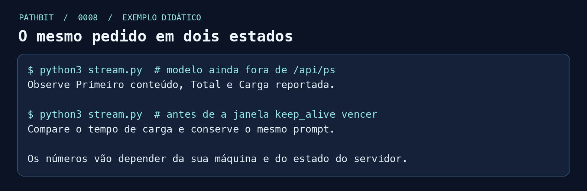
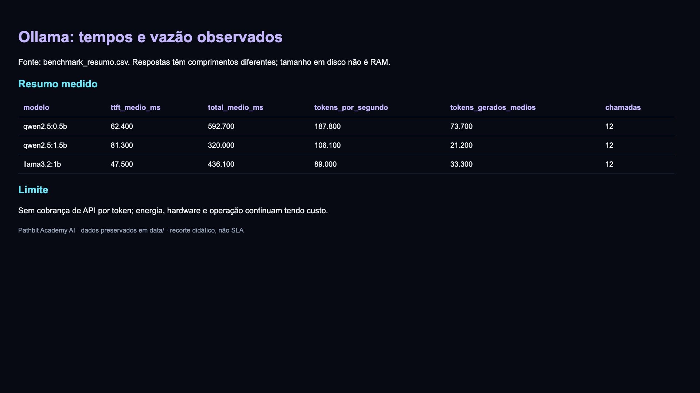

# O seu modelo local demorou para pensar ou para carregar?

Você faz a primeira pergunta ao modelo local. A tela demora a mostrar texto. Na segunda chamada, com a pergunta igual, a resposta aparece quase na hora. Se você registrar um único número no benchmark, perde a informação que provavelmente explica a diferença.

Neste módulo da Pathbit Academy, subimos o Ollama em Docker, enviamos um chat em streaming e coletamos três medidas. O tempo até o primeiro conteúdo conta o que o leitor espera para começar a ver a resposta. O tempo total conta até o fim. A vazão separa o trabalho de gerar tokens da espera anterior.

## Da porta local à primeira resposta

O Compose do exercício publica a porta em `127.0.0.1` e mantém os modelos baixados num volume. A primeira instalação precisa de rede para obter imagem e pesos. Com o modelo aberto e baixado, o pedido do exemplo é local e não usa chave de API de um provedor.

Na pasta do módulo, basta baixar um modelo para começar:

```bash
docker compose up -d
docker exec pathbit-ollama ollama pull qwen2.5:0.5b
curl -fsS http://127.0.0.1:11434/api/version
curl -fsS http://127.0.0.1:11434/api/tags
```

Duas listas parecidas respondem a perguntas diferentes. `/api/tags` mostra o que está instalado. `/api/ps` mostra o que está carregado naquele momento. Se aparecer o nome em uma e a outra estiver vazia, o primeiro pedido pode ter trabalho de carga antes da geração.

O caminho tem mais uma fronteira importante. No Docker Desktop para macOS, o servidor em container roda dentro de uma VM Linux. Um teste em CPU no container descreve um cenário distinto de uma instalação nativa que usa Metal. Quando comparar sua máquina com outra, registre o ambiente antes de procurar uma explicação no número de parâmetros.

## Observe duas execuções seguidas

Na API de streaming, o cliente recebe linhas JSON. A linha pode ter texto, estar vazia de conteúdo ou encerrar o pedido com as métricas de execução. O primeiro fragmento com texto marca a primeira medida que o usuário consegue perceber. Conte os tokens pelo campo `eval_count` do servidor. Um fragmento recebido e um token são unidades diferentes.



> Rode o mesmo prompt duas vezes. A primeira chamada pode carregar os pesos. A chamada seguinte pode reutilizar o modelo em memória.

Compare `load_duration` e o tempo até o primeiro conteúdo. Uma média que mistura chamadas frias e aquecidas pode esconder a origem da espera. Guarde as métricas do cliente e as do servidor para comparar os dois pontos de observação.

### O primeiro texto pode aparecer cedo e a resposta demorar para terminar

Na rodada histórica do repositório, houve 12 chamadas por modelo. O Qwen de 0,5 bilhão gerou cerca de 188 tokens/s em média e terminou em aproximadamente 593 ms. O Qwen de 1,5 bilhão gerou cerca de 106 tokens/s e terminou em 320 ms. O primeiro escreveu em média 74 tokens, o segundo cerca de 21. A pergunta “qual terminou primeiro?” tem resposta diferente de “qual gerou mais rápido?”.



> As barras vêm dos dados versionados da rodada em CPU com Ollama 0.35.1. A figura anterior mostra como preparar sua própria comparação de primeira chamada e chamada aquecida.

Rode novamente com um prompt que peça só um rótulo e depois com um prompt que peça uma explicação curta. Registre o limite de saída, a duração e se o conteúdo cumpriu a tarefa. Se você trocar modelo, tamanho de contexto e limite de saída de uma vez, o resultado descreve uma mudança composta. A comparação fica mais legível quando só muda a pergunta que você quer responder.

## Faça primeiro a leitura de ponta a ponta

O laboratório ainda pede JSON e usa um segundo modelo para recuperar políticas de suporte com embeddings. A planilha de JSON reúne parse de dicionário e presença de duas chaves em uma coluna histórica. A tabela de embeddings dá o documento mais próximo para quatro consultas. Ambas são boas para praticar a leitura de resultados por caso. Use entradas novas e rótulos esperados antes de usar qualquer um dos percentuais para defender uma troca de arquitetura.

Para montar o seu primeiro experimento, escolha uma tarefa que você consiga avaliar à mão. Anote a versão do Ollama, o nome do modelo, o prompt, o primeiro conteúdo, o tempo total e o tamanho da resposta. Compare uma chamada com carga sob demanda e outra com o modelo já carregado. Depois verifique se a resposta de fato resolve o exercício.

Os comandos completos incluem a chamada HTTP, o cliente de streaming e os CSVs que sustentam o gráfico. [Leia o módulo 0008 da Pathbit Academy](https://github.com/pathbit/pathbit-academy-ai/blob/master/0008_llms_locais_ollama/article/ARTICLE.md).
