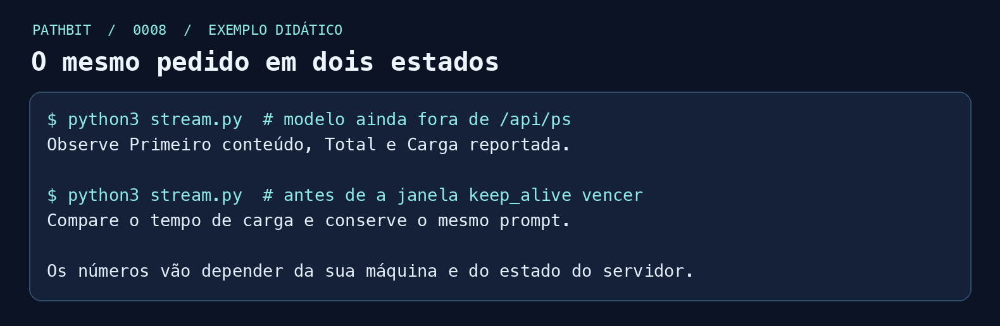

# O mesmo modelo começou a responder em tempos diferentes?

Faça duas chamadas ao Ollama: uma logo depois de iniciar o servidor e outra com o mesmo modelo em memória. Conserve o prompt e as opções. Veja quanto tempo passa até o primeiro texto e quanto o servidor reporta em `load_duration`.

Guarde três números: a chegada do primeiro conteúdo, o tempo total e a vazão da geração. Inclua o número de tokens. Uma resposta longa pode ter boa vazão e ainda terminar depois de outra mais curta.

O módulo inclui o Docker Compose, um script Python sem SDK e os CSVs do benchmark histórico. [Leia o artigo e execute o exemplo](https://github.com/pathbit/pathbit-academy-ai/blob/master/0008_llms_locais_ollama/article/ARTICLE.md).

#InteligenciaArtificial #Ollama #Docker
