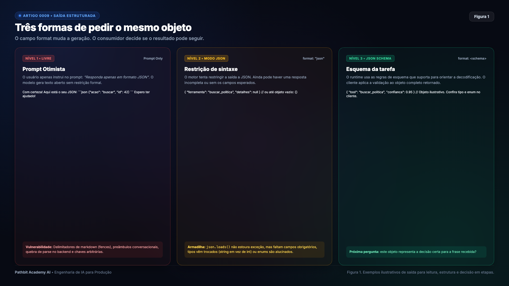
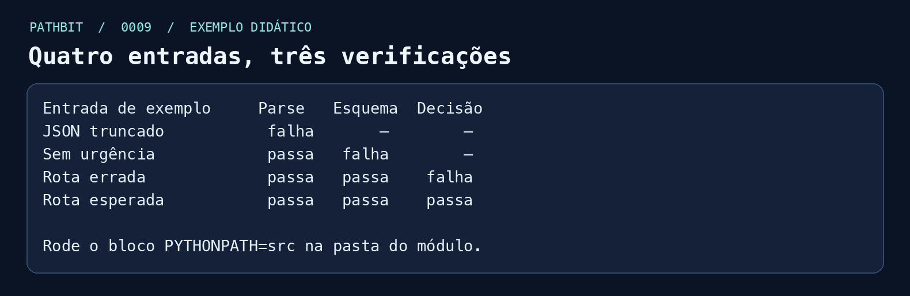
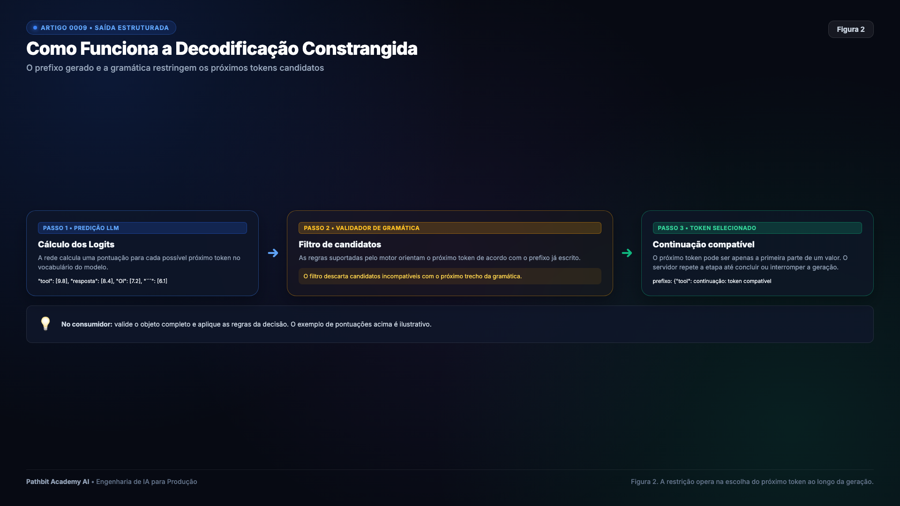
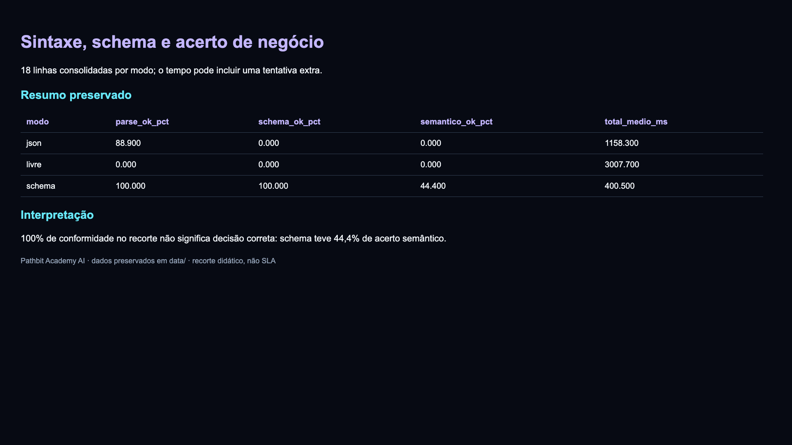
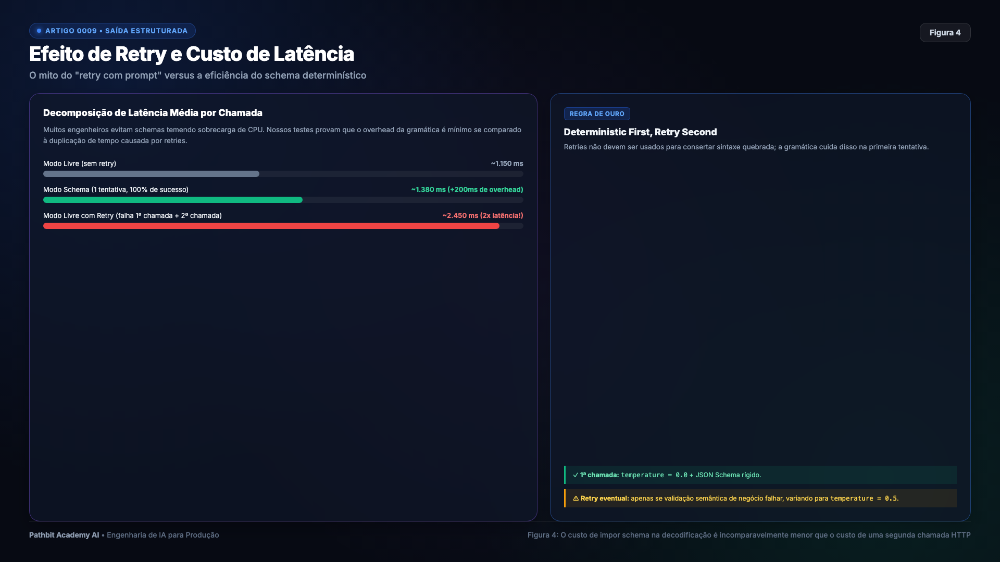
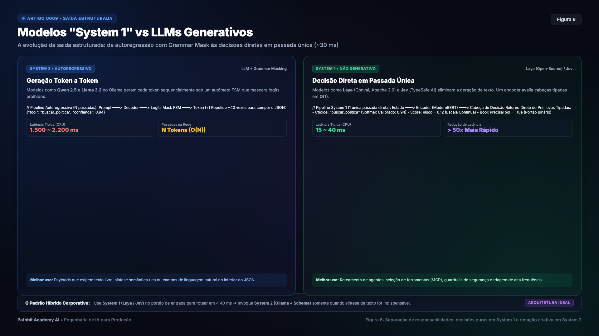
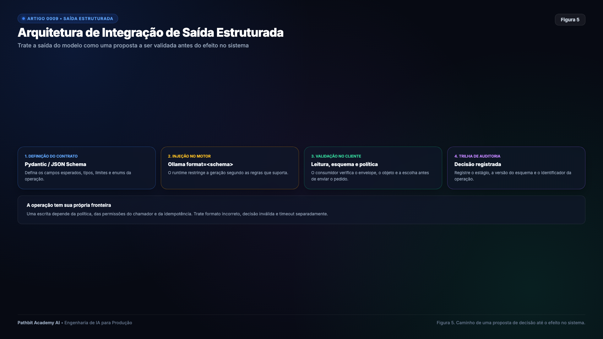

# Saída estruturada com Ollama. Do JSON que abre à decisão que o sistema pode usar

Imagine que o atendimento de uma loja recebeu esta frase: “Meu app mostra erro 500 desde ontem”. O seu modelo devolveu um objeto com `rota` e `urgencia`. O Python conseguiu ler o JSON e todos os campos passaram na validação. A rota, porém, veio como `resposta_direta`: um valor permitido pelo esquema e uma escolha errada segundo a política do exercício. A fila de incidentes nem chegou a receber o caso.

Esse é o ponto de partida do laboratório. Vamos medir separadamente se a resposta pode ser lida, se tem a forma combinada e se expressa a decisão esperada. Depois vamos repetir a mesma validação com respostas fixas, para que você consiga observar os três níveis mesmo sem carregar um modelo. Se o Ollama ainda não estiver de pé, o [artigo anterior](../../0008_llms_locais_ollama/article/ARTICLE.md) acompanha a instalação, o primeiro chat e a leitura das métricas no terminal.

---

## Três perguntas antes de despachar um chamado

1. **Sintaxe.** O consumidor consegue transformar a saída em um valor JSON? Uma aspa aberta ou um prefixo em linguagem natural já pode interromper a leitura.
2. **Estrutura.** O valor atende ao contrato da operação? `{}` é JSON válido e não contém nenhum dos campos obrigatórios de um chamado.
3. **Decisão.** A política do atendimento considera o valor correto para a entrada recebida? Tanto `criar_ticket` quanto `resposta_direta` podem estar no enum. É a política que diz qual deve ser escolhido.



> **Figura 1.** O cliente pode enviar só o prompt, solicitar JSON ou enviar um esquema. A aplicação continua responsável por verificar a resposta que consome.

Um bom exemplo precisa de saída ruim que pareça plausível. Eis quatro respostas para o mesmo erro 500:

| Saída do modelo | Parse | Esquema de rota | Política do exercício |
| --- | --- | --- | --- |
| `{"rota": "criar_ticket",` | Falha | Não avaliado | Não avaliada |
| `{"rota": "criar_ticket"}` | Passa | Falha, falta `urgencia` | Não avaliada |
| `{"rota": "resposta_direta", "urgencia": "alta"}` | Passa | Passa | Falha |
| `{"rota": "criar_ticket", "urgencia": "alta"}` | Passa | Passa | Passa |

O conceito se transfere para extração de dados. Um inteiro no campo `prazo_dias` pode satisfazer o contrato e ainda devolver 1 quando a frase dizia 10. Para número de dias, o problema é fidelidade ao texto. Para uma ação no sistema, o problema pode incluir política, autorização e consequência da ação.

## Valide quatro saídas com o código do repositório

Na pasta `0009_saida_estruturada`, com o ambiente Python configurado conforme o [README](../README.md), execute este bloco. Ele importa as regras do laboratório e não acessa o Ollama. Os quatro textos são entradas fixas escolhidas para expor uma diferença de cada vez.

```bash
PYTHONPATH=src python - <<'PY'
from structured_lab import TASKS, avaliar

task = next(task for task in TASKS if task["id"] == "roteamento")
cases = {
    "truncado": '{"rota": "criar_ticket",',
    "sem_urgencia": '{"rota": "criar_ticket"}',
    "rota_errada": '{"rota": "resposta_direta", "urgencia": "alta"}',
    "rota_esperada": '{"rota": "criar_ticket", "urgencia": "alta"}',
}

for name, raw in cases.items():
    parse_ok, schema_ok, value = avaliar(raw, task["schema"])
    business_ok = task["semantico"](value) if schema_ok else None
    print(f"{name:<15} parse={parse_ok}  schema={schema_ok}  negocio={business_ok}")
PY
```



> **Figura 2.** Resultados esperados para as quatro entradas fixas. No bloco, `None` indica que a lógica pulou a regra de negócio após a falha de estrutura. No CSV do benchmark, as etapas anteriores são registradas como falso para permitir a agregação.

Abra [`avaliar()`](../src/structured_lab.py) e siga o caminho inverso a partir da saída. O primeiro `try` chama `json.loads`. O segundo só tenta remover as cercas de Markdown de um bloco, caso o parse direto falhe. Depois, `jsonschema.validate` testa a instância contra o contrato da tarefa. O validador retorna o valor lido mesmo quando o esquema falha. O chamador deve usar o indicador de validação antes de trabalhar com esse valor.

Essa tolerância a cercas permite estudar respostas de modelos pequenos. Se o contrato da sua API exige JSON cru, registre a tolerância como uma decisão do consumidor. Em uma fronteira que rejeita qualquer conteúdo extra, use o parse direto e mantenha um teste de regressão para a cerca e para o texto após o objeto.

---

## Envie o esquema na requisição e conserve a verificação local

A rota `/api/generate` devolve um envelope com métricas e uma propriedade `response`. O texto gerado vive dentro de `response`. Decodificar o envelope HTTP com sucesso diz pouco sobre a validade do texto interno.

O código de [`gerar()`](../src/structured_lab.py) mantém a interface igual para os três modos. Em modo livre, o payload omite `format`. No modo JSON, `format` vale `"json"`. No modo com esquema, `format` recebe o objeto que descreve a tarefa. Para rodar a comparação em seu ambiente, siga as instruções da [API de geração do Ollama](https://docs.ollama.com/api/generate).

Este trecho monta um esquema mais estrito para uma integração de demonstração. A rejeição de campos extras é uma decisão desse exemplo. O benchmark preservado usa o contrato original e não será reclassificado com essas regras novas.

```python
ROUTING_SCHEMA = {
    "type": "object",
    "properties": {
        "rota": {
            "type": "string",
            "enum": ["buscar_politica", "criar_ticket", "resposta_direta"],
        },
        "urgencia": {"type": "string", "enum": ["baixa", "media", "alta"]},
    },
    "required": ["rota", "urgencia"],
    "additionalProperties": False,
}
```

Conserve os campos indispensáveis no `required`. Descrever uma propriedade em `properties` diz como validá-la quando estiver presente. Para exigir sua presença, use `required`. Use um enum para os estados de negócio que o código sabe tratar. No planner, o contrato histórico aceita qualquer número em `confianca`, inclusive 27. Se a interface precisar de intervalo de 0 a 1, expresse isso com `minimum` e `maximum`. Mesmo dentro da faixa, o número continua sendo uma saída do modelo cuja calibração precisa de avaliação própria.

### O que ocorre durante a geração

Na decodificação livre, o modelo atribui uma pontuação a cada token possível e o gerador escolhe o próximo de acordo com suas opções de amostragem. Com uma restrição de gramática, o motor pode excluir tokens incompatíveis com o prefixo permitido antes de escolher. Depois de abrir uma lista de valores, por exemplo, o conjunto de próximos tokens válidos depende do que já foi escrito. Um token pode até representar mais de um caractere.



> **Figura 3.** O desenho ilustra pontuações e uma etapa de escolha. A regra aplicada nesse ponto depende do prefixo e do subconjunto de esquema aceito pelo motor.

A implementação e o conjunto de regras suportadas variam com a versão do motor. Se a geração terminar cedo, o objeto pode continuar incompleto. Mantenha o contrato na aplicação e trate recusa, timeout, resposta vazia e JSON truncado como estados observáveis. Em produção, evite aceitar uma saída parcial para “salvar” uma operação de escrita. [Saídas estruturadas do Ollama](https://docs.ollama.com/capabilities/structured-outputs), [especificação JSON Schema 2020-12](https://json-schema.org/draft/2020-12).

---

## Rode o teste completo com o modelo local

A partir da pasta do módulo anterior, mantenha o Docker Compose em execução. No primeiro teste use um modelo de chat e baixe também o modelo de embeddings, porque o roteiro mede uma rota alternativa usando essa segunda dependência.

```bash
docker exec pathbit-ollama ollama pull qwen2.5:0.5b
docker exec pathbit-ollama ollama pull nomic-embed-text
curl -fsS http://127.0.0.1:11434/api/tags

python src/structured_lab.py --base-url http://127.0.0.1:11434 \
  --models qwen2.5:0.5b --repeat 1 --skip-plots
```

Rode a última linha em `0009_saida_estruturada`. O script escreve os CSVs e o relatório em `data/` dentro da pasta do módulo. Para guardar o histórico do Git junto com o seu experimento, rode o laboratório em uma cópia de trabalho separada. O [notebook](../notebooks/saida_estruturada.ipynb) usa os mesmos dados e permite conferir como o resultado chega ao gráfico.

Na comparação há três tarefas. A segunda via da fatura pede a escolha de uma ferramenta. A devolução do televisor pede produto e prazo, exigindo que o modelo conserve “10 dias”. O caso do erro 500 pede rota e urgência. Para cada combinação de tarefa, modelo e modo, a primeira chamada usa temperatura 0. Se falhar o parse ou o esquema, o código faz uma segunda chamada com temperatura 0,7. Um resultado estruturalmente válido com decisão errada termina aquela linha sem pedir outra geração.

Abra [`structured_resultados.csv`](../data/structured_resultados.csv) e filtre `tarefa=roteamento`. Compare `modo`, `tentativa`, `schema_ok`, `semantico_ok` e o trecho guardado em `resposta`. Cada linha representa uma decisão consolidada. Quando houve duas tentativas, `total_ms` e `tokens` somam as duas, e a coluna de resposta guarda até 160 caracteres do texto da última. O CSV permite encontrar um caso final ruim. Ele não preserva a primeira resposta bruta de um retry.

## O que os números históricos mostram

A tabela vem do resultado incluído no repositório, produzido com Ollama 0.35.1. Ela descreve 18 casos consolidados por modo, três modelos e os prompts deste exercício. `parse_ok` inclui o resgate de cercas do validador. A latência é a média de ponta a ponta do cliente para aquela linha.

| Modo | JSON lido | Esquema válido | Decisão esperada | Média por caso |
| --- | ---: | ---: | ---: | ---: |
| Livre | 0/18 | 0/18 | 0/18 | 3.007,7 ms |
| JSON | 16/18 | 0/18 | 0/18 | 1.158,3 ms |
| Esquema | 18/18 | 18/18 | 8/18 | 400,5 ms |



> **Figura 4.** Resultados agregados do CSV publicado. A distância entre a barra de esquema e a de decisão é a observação central. [Relatório da execução](../data/structured_relatorio.md).

Se a sua análise terminar na taxa de parse, o modo JSON parece atender ao contrato na maior parte dos casos. Troque para a coluna seguinte e aparecem 16 respostas lidas que, mesmo assim, não satisfazem os campos esperados. Olhe então para o modo com esquema. Das 18 saídas válidas, dez ainda não correspondem ao gabarito.

A diferença de latência combina tempo de execução, número de tokens e ocorrência de uma segunda tentativa. Ela não mede isoladamente o custo da gramática. Para medir esse custo, mantenha a política de retry e as opções de geração constantes, isole a primeira chamada, registre o volume de tokens e separe as chamadas frias das aquecidas. Aí você consegue discutir o efeito da restrição com outras variáveis sob controle.



> **Figura 5.** A tabela reúne latência e números de saída. O tempo por caso pode reunir mais de uma tentativa.

Ao repetir o benchmark, procure o caso que combina esquema válido com decisão errada. Abra a linha correspondente no CSV novo e compare a resposta final com o predicado de negócio.

### Quando a pergunta só pede um rótulo

O laboratório também mede `nomic-embed-text` como roteador por similaridade. Ele transforma cada entrada em um vetor e o compara com exemplos representativos de três rotas. A maior similaridade escolhe o rótulo. O código entrega esse resultado como estrutura definida pela aplicação, sem gerar texto token a token.



> **Figura 6.** Resultado histórico do roteador por embeddings. Os vetores das classes foram preparados antes do cronômetro.

Na amostra histórica, a posição central superior foi 13,61 ms. O runner rotula esse valor como p50 e, com seis chamadas, escolhe o maior dos dois valores centrais. O tempo inclui calcular o embedding da consulta e classificá-la. Os vetores das rotas já estavam calculados. O caminho não extrai argumentos nem produz uma resposta ao cliente. Para experimentar com seus dados, reserve mensagens que não entraram nos exemplos e observe também quais duas rotas ficam mais próximas em casos de empate. A pontuação de similaridade continua sendo uma medida vetorial, não uma probabilidade de decisão certa. [Resultados do roteador](../data/system_one_comparativo.json).

---

## Da decisão proposta ao efeito no sistema

Uma integração de atendimento pode aplicar o seguinte percurso: validar o envelope recebido, decodificar o objeto, validar sua estrutura, consultar as permissões e a política vigente, gravar a decisão ou encaminhar o caso para revisão. Em chamadas que alteram dados, coloque o mecanismo de idempotência ao lado da escrita. Um segundo pedido de classificação não pode gerar dois chamados para o mesmo incidente.



> **Figura 7.** A leitura da resposta, a validação e a operação são pontos distintos de diagnóstico. O resultado da inferência alimenta somente a proposta.

Quando o serviço rejeita uma saída, prefira guardar metadados que permitam investigar: versão do modelo, versão do esquema, ID de correlação, estágio da falha e latência. Retire do log os dados pessoais e os segredos do atendimento. Se fizer retry, delimite o caso que pode ganhar com outra chamada e preserve a razão da primeira recusa. Repetir a mesma estrutura dificilmente resolve uma rota que já tinha forma correta e contrariava a política.

### Exercício de revisão com mudança sob controle

1. Acrescente ao teste das quatro saídas uma urgência fora da enumeração e confira a falha de esquema.
2. Acrescente um campo `canal` sem alterar o CSV histórico. Rode primeiro com a definição do laboratório e depois com `additionalProperties: False` na cópia do contrato. Compare as duas decisões de formato.
3. Escreva duas mensagens de erro 500 que exijam encaminhamentos diferentes conforme a política do seu exemplo. Defina os rótulos antes de chamar o modelo. A tarefa continua igual no tipo, mas muda na interpretação.
4. Confira o total de chamados que seria criado com cada modo. Preserve as entradas rejeitadas para explicar se houve falha de leitura, formato ou decisão.

No próximo módulo, o [MCP local](../../0010_mcp_local/article/ARTICLE.md) usa contratos de ferramentas com parâmetros e respostas observáveis. Leve a mesma disciplina para a ferramenta: receber argumentos válidos é apenas a primeira condição para executar a operação pedida.
