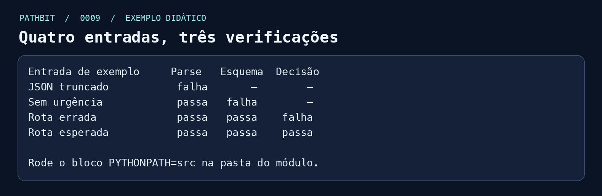
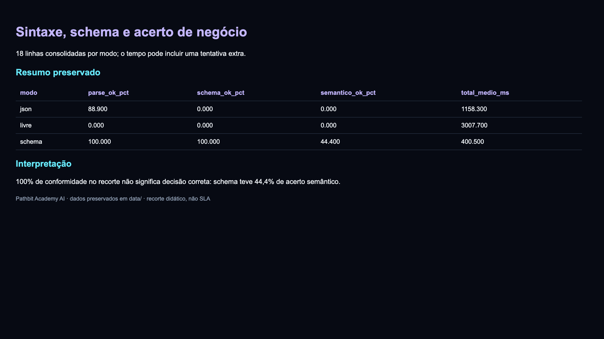

# Seu JSON é válido. A decisão do modelo também?

O cliente escreve “Meu app mostra erro 500 desde ontem”. O modelo responde em JSON, o validador aceita a estrutura e seu sistema segue para a próxima etapa. Só depois você percebe o que saiu dentro do campo `rota`: `resposta_direta`. Pela política do exercício, a mensagem deveria abrir um chamado de alta urgência.

Esse caso parece simples até você precisar explicar por que o contrato falhou se nenhum parser levantou uma exceção. No módulo de saída estruturada da Pathbit Academy, o mesmo exemplo percorre três verificações independentes. Dá para repetir a primeira parte na sua máquina sem iniciar o Ollama.

## Quando o objeto que chegou tem a forma certa

A primeira pergunta é de leitura. Chaves abertas, aspas faltando e texto fora do objeto podem impedir que `json.loads()` reconheça a saída.

A segunda pergunta é de contrato. Digamos que toda decisão precise de uma `rota` e de uma `urgencia`. Um dicionário vazio abre no Python e falha no contrato. Um objeto com `urgencia: "ontem"` pode abrir e falhar pelo valor, se o enum aceitar somente baixa, média e alta.

A terceira pergunta é do atendimento. O enum pode aceitar `buscar_politica`, `criar_ticket` e `resposta_direta`. Quando o problema é um erro 500 e a regra manda registrar incidente, o valor precisa ser `criar_ticket`. Essa condição vem da política do exercício, que pode mudar de uma equipe para outra. Um validador de esquema geral não tem como deduzi-la a partir da mensagem.

> A figura separa as três verificações do exercício. O JSON da terceira linha tem todos os campos e o enum certo, mas propõe a rota errada. A quarta linha passa pelas três etapas.

O exercício usa o mesmo validador que produz os CSVs do laboratório. O detalhe importa: se o material didático usar um parser e a aplicação usar outro, o leitor terá dificuldade para explicar divergências. Aqui, a tolerância a cercas de Markdown está explícita. Para um contrato que requeira JSON cru, você pode retirar essa recuperação e repetir os exemplos.

## Onde a restrição muda a chamada

O cliente fala com a mesma rota `/api/generate` do Ollama para comparar três estratégias. A primeira põe o pedido no prompt. A segunda acrescenta `format: "json"`. A terceira envia um JSON Schema no campo `format`, com o tipo do valor e os campos que o consumidor espera.

O servidor consegue retornar um envelope HTTP válido mesmo quando o texto dentro de `response` ficou incompleto. Por isso há duas leituras distintas. Uma lê o envelope com o texto e as métricas. A outra lê o objeto que o modelo escreveu. Um timeout no meio da geração, um limite de tokens alcançado ou uma restrição que o runtime não suporta também precisam de tratamento do lado da aplicação.

Pense na regra `urgencia` antes de colocar uma palavra bonita no prompt. O esquema pode definir o tipo e restringir valores. A política diz quando o valor deve ser `alta`. Se uma integração incluir uma pontuação de confiança entre zero e um, a faixa pode entrar no esquema. Avaliar se a pontuação expressa a frequência de decisões corretas exige dados de avaliação próprios.

## O que aconteceu nas execuções preservadas

No CSV histórico, produzido com Ollama 0.35.1, cada modo reúne 18 casos depois de aplicar a política de tentativas. O modo JSON apresentou leitura em 16 deles. Nenhum desses 16 satisfez todo o esquema da tarefa. Com o esquema enviado à API, os 18 objetos passaram na estrutura. Só oito acertaram o gabarito de negócio.

> Os resultados descrevem três modelos compactos e os cenários publicados. A diferença entre as barras de esquema e de negócio concentra o aprendizado.

O modo com esquema teve latência média menor nesse conjunto. O código também pode repetir chamadas que falham em parse ou formato, e o total por linha soma as tentativas. Os modos produziram comprimentos diferentes de saída. A média observada é o custo das estratégias naquele percurso. Para medir só a gramática, faça outra rodada com o mesmo número de tentativas, controle o tamanho de saída e informe primeira chamada e chamada aquecida separadamente.

Há ainda um roteiro por embeddings que escolhe um rótulo entre três exemplos representativos. Ele mostra uma alternativa para uma tarefa fechada de classificação. O laboratório não exige que você escolha a mesma técnica para extrair “televisor” e “10 dias” de texto livre. Comece perguntando se o sistema precisa de um rótulo, de argumentos ou de uma resposta aberta.

## Procure a primeira diferença no seu sistema

Imagine que o efeito final é abrir um chamado. Registre em ordem se a saída chegou, se abriu em JSON, se atende à versão do esquema e se sua política permite o encaminhamento. Se a etapa final gravar dados, use um identificador que impeça criar dois chamados quando o mesmo incidente for tratado novamente.

Um jeito de praticar é alterar apenas uma das quatro entradas do laboratório. Coloque um campo extra e compare o esquema permissivo com o que usa `additionalProperties: false`. Depois mantenha a forma e troque `criar_ticket` por `resposta_direta`. Você vai enxergar duas falhas que pedem duas correções diferentes.

O artigo completo traz os comandos, os CSVs, a rota de inferência e a função usada para avaliar as respostas. Os quatro casos do primeiro terminal servem para exercitar a fronteira da aplicação antes de gastar tempo discutindo qual modelo escolher. [Leia o módulo completo](https://github.com/pathbit/pathbit-academy-ai/blob/master/0009_saida_estruturada/article/ARTICLE.md).
