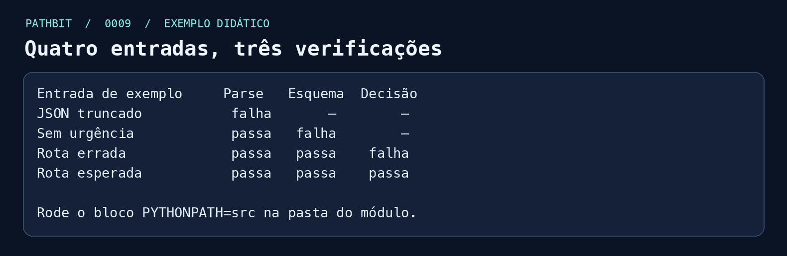

# O JSON passou. O chamado foi para a fila errada.

“Meu app está com erro 500 desde ontem.”

No laboratório da Pathbit Academy, `{"rota":"resposta_direta","urgencia":"alta"}` é um objeto válido. O parser lê. O esquema aceita. Pela regra do exercício, o cliente deveria ir para a rota `criar_ticket`.

A figura mostra os quatro resultados esperados com as entradas fixas do exemplo. Começa com JSON truncado, passa por um campo faltando e chega a dois objetos com exatamente a mesma estrutura e decisões diferentes.

No resultado histórico, o modo com esquema entregou 18 de 18 objetos válidos. Só oito seguiram o gabarito de negócio. Se a sua métrica termina na validação do JSON, há dez decisões desse conjunto que ficam fora da conversa.

O artigo traz o teste de quatro entradas para rodar sem Ollama e o benchmark local para comparar os três modos. O exercício que fica é simples. Pegue uma decisão que sua aplicação toma hoje e escreva um exemplo de resposta bem formada que deveria ser recusada.

[Leia e execute o módulo 0009 da Pathbit Academy](https://github.com/pathbit/pathbit-academy-ai/blob/master/0009_saida_estruturada/article/ARTICLE.md).

#InteligenciaArtificial #Ollama #EngenhariaDeSoftware
