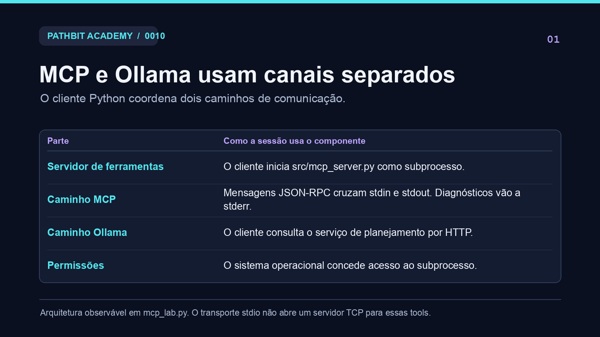
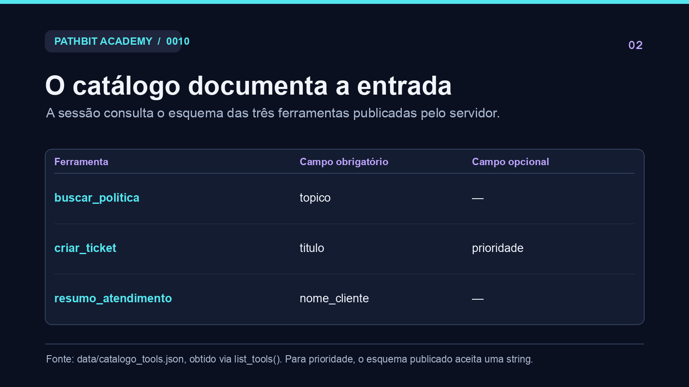
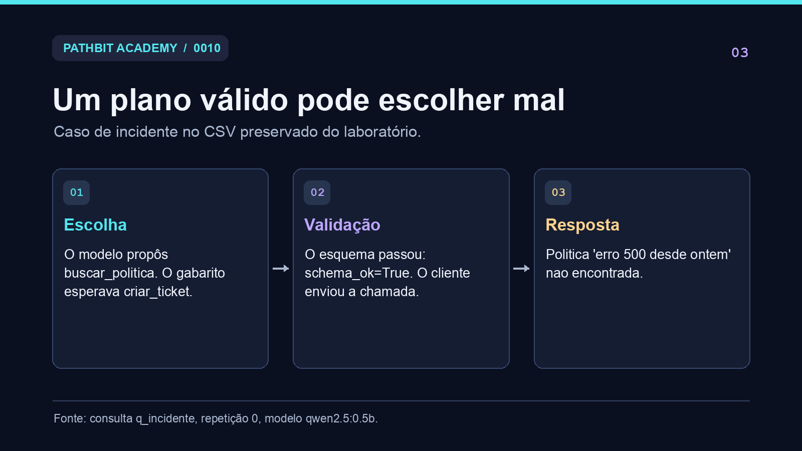
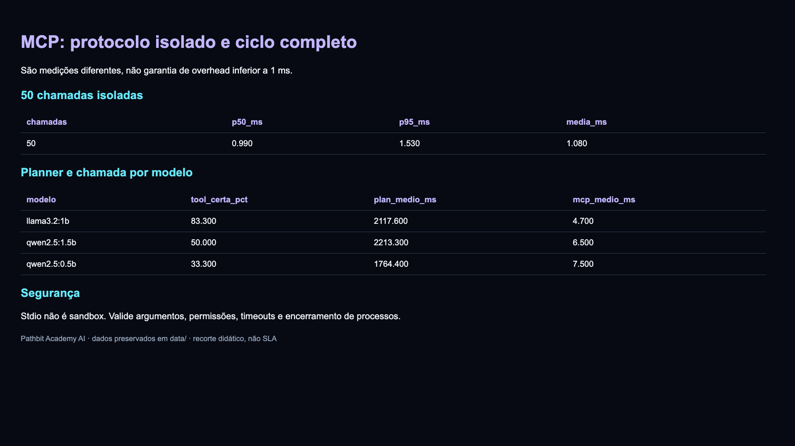
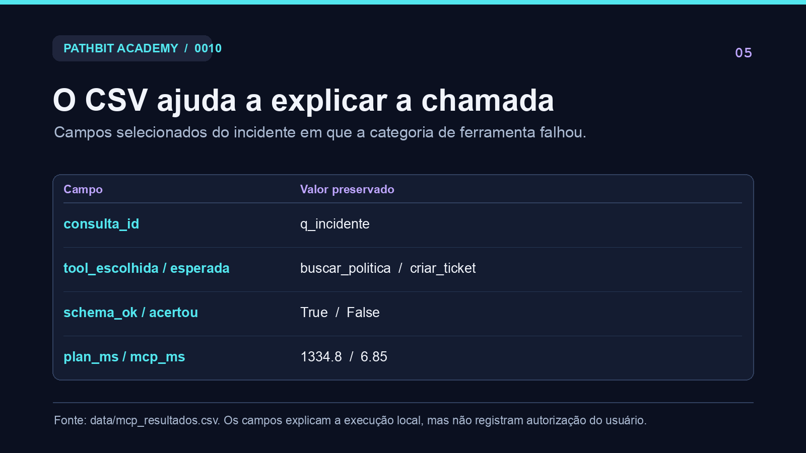
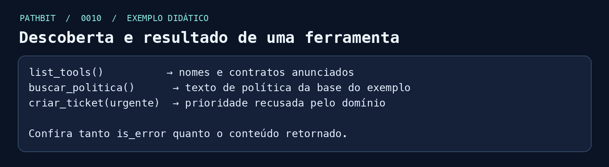

# 🔌 MCP local na prática: descubra a ferramenta, valide a chamada e confira o resultado

> Série Academy IA · Artigo 0010 · Separe o protocolo que transporta a chamada, o modelo que escolhe a ferramenta e a política que autoriza o efeito.

O usuário pediu para abrir um chamado por erro 500. O modelo produziu JSON válido, preencheu os campos obrigatórios e escolheu `buscar_politica`. O servidor recebeu a chamada e respondeu que a política “erro 500 desde ontem” não existe. A requisição atravessou o protocolo. O pedido do usuário ficou sem solução.

Esse caso aparece nos [resultados versionados](../data/mcp_resultados.csv) deste módulo. Depois de [rodar modelos com Ollama](../../0008_llms_locais_ollama/article/ARTICLE.md) e de estudar [saída estruturada](../../0009_saida_estruturada/article/ARTICLE.md), vamos conectar um cliente Python a um servidor de ferramentas. Primeiro fazemos uma sessão de protocolo sem modelo. Depois conferimos o que o planner acrescenta ao fluxo, onde ele pode errar e quanto tempo cada parte custou na execução preservada.

## 1. O servidor de ferramentas e o modelo são processos diferentes

No [laboratório](../README.md), o cliente Python inicia [mcp_server.py](../src/mcp_server.py) como subprocesso, usando o mesmo interpretador do cliente. A sessão MCP usa JSON-RPC sobre `stdio`. O cliente escreve no `stdin` do servidor e lê as mensagens do seu `stdout`. O servidor pode escrever diagnósticos em `stderr`, preservando `stdout` para o protocolo.

A conexão com o modelo segue outro caminho. O mesmo cliente chama o endpoint HTTP configurado para Ollama. Quando o endereço é local, o HTTP vai ao serviço de modelos da máquina. A comunicação MCP via pipes do subprocesso não abre a porta de rede do servidor de ferramentas. O processo filho ainda roda com os recursos e permissões que o sistema operacional lhe conceder. Rodar em stdio não altera sua identidade nem impõe isolamento de arquivos e rede. [Transporte stdio na especificação MCP](https://modelcontextprotocol.io/specification/2025-11-25/basic/transports).



> Figura 1. O cliente inicia o servidor MCP como subprocesso. O caminho até Ollama é uma conexão HTTP separada.

Quando você confirma uma instalação local, observe qual executável o cliente vai lançar e quais arquivos e variáveis de ambiente ele pode acessar. Uma ferramenta que só consulta políticas pode rodar com permissões de leitura. Uma que escreve no sistema de chamados precisa de autorização por ação e por dados de entrada. A existência de um catálogo ou o uso de transporte local não substitui esses controles.

## 2. Descubra o contrato antes de chamar a ferramenta

Depois de `initialize()`, o cliente chama `list_tools()`. O servidor anuncia `buscar_politica`, `criar_ticket` e `resumo_atendimento`. O catálogo inclui nome, descrição e um esquema de argumentos. O snapshot gerado pelo laboratório está em [data/catalogo_tools.json](../data/catalogo_tools.json).

| Ferramenta | Argumento principal | Efeito no laboratório |
| --- | --- | --- |
| `buscar_politica` | `topico` | Procura texto em um dicionário local |
| `criar_ticket` | `titulo` e prioridade opcional | Devolve uma mensagem simulada, com número fixo para prioridades aceitas |
| `resumo_atendimento` | `nome_cliente` | Devolve um texto sintético com o nome recebido |

Um cliente consegue montar a parte do prompt que descreve as ferramentas a partir desse retorno. A descoberta identifica operações oferecidas. A política da aplicação ainda precisa decidir quais delas serão expostas a cada usuário e em quais condições. O MCP também descreve recursos e prompts em capacidades próprias. Este exercício usa ferramentas. [Ferramentas na especificação MCP](https://modelcontextprotocol.io/specification/2025-11-25/server/tools).



> Figura 2. O esquema descreve a interface de entrada. O executável e as regras de domínio ficam no servidor.

## 3. Faça a primeira chamada sem Ollama

Instale as dependências do [módulo](../README.md) e execute o trecho a seguir na pasta `0010_mcp_local`, com o ambiente virtual ativo. O cliente só usa o SDK de MCP. A questão que queremos responder é se o servidor inicia, anuncia o catálogo e devolve o resultado esperado.

```python
import asyncio
from pathlib import Path
import sys

from mcp import ClientSession, StdioServerParameters
from mcp.client.stdio import stdio_client


async def main():
    server = Path("src/mcp_server.py").resolve()
    params = StdioServerParameters(command=sys.executable, args=[str(server)])
    async with stdio_client(params) as (read, write):
        async with ClientSession(read, write) as session:
            await session.initialize()
            catalog = await session.list_tools()
            print("Catálogo:", ", ".join(sorted(item.name for item in catalog.tools)))
            calls = [
                ("buscar_politica", {"topico": "devolucao"}),
                ("criar_ticket", {"titulo": "Checkout indisponivel", "prioridade": "urgente"}),
            ]
            for name, arguments in calls:
                result = await session.call_tool(name, arguments)
                print(name, "is_error:", result.is_error)
                print(result.content[0].text)


asyncio.run(main())
```

A primeira chamada devolve a política de devolução. A segunda chega ao servidor porque `prioridade` aceita uma string no esquema publicado. O código da ferramenta só permite `baixa`, `media` e `alta`. Ele recusa `urgente` em texto e o resultado continua com `is_error: False`, pois a função devolveu normalmente essa mensagem. Esse resultado distingue três verificações: argumentos com tipos válidos, resposta do protocolo e aceitação pelo domínio.

Em uma integração real, modele êxito e recusa da ferramenta para que o cliente consiga interpretá-los. A especificação descreve erros de execução em `isError` no transporte. O SDK usado aqui expõe o atributo Python `is_error`. Se o servidor não sinalizar um erro de negócio, a aplicação não pode tratar toda resposta de transporte bem-sucedida como confirmação do efeito. Nas chamadas que alteram estado, leia o resultado do domínio e vincule-o ao pedido aprovado.

## 4. Inclua o modelo e meça três dimensões

O cliente [mcp_lab.py](../src/mcp_lab.py) monta um prompt com os nomes e as descrições do catálogo. Pede a Ollama um plano com `tool` e `argumentos` em formato estruturado. No retorno, confere o JSON, valida o esquema do plano e consulta o esquema da ferramenta anunciada quando há correspondência. Só chama a ferramenta quando a validação passa e o nome consta do catálogo. O plano `responder_direto` é uma opção local de controle e não corresponde a uma ferramenta do servidor. O gabarito `tool_esperada` avalia a escolha em separado.



> Figura 3. Em um caso registrado, o plano foi validado e enviado, mas a ferramenta escolhida não resolveu a intenção do usuário.

Na execução registrada, cada modelo passou por seis consultas, com duas repetições. O `llama3.2:1b` teve 100% em `schema_ok` e escolheu a ferramenta esperada em 10 de 12 tentativas. O `qwen2.5:1.5b` acertou 6 de 12, e o `qwen2.5:0.5b` acertou 4 de 12. Os três mantiveram 100% no critério estrutural do laboratório. A taxa `argumento_ok` verifica o indicador de esquema e a presença de conteúdo no argumento esperado pela ferramenta selecionada. Essa taxa não avalia se o valor resolve a intenção do usuário. [Resumo e métricas preservados](../data/mcp_resumo.csv).

Quando `qwen2.5:0.5b` classifica `q_incidente` como consulta de política, o plano atravessa as validações e o servidor procura um tópico inexistente. A falha principal foi de escolha. Se trocar apenas o protocolo, a mesma proposta ainda escolherá o método errado. Um caso desse tipo precisa aparecer na avaliação do roteamento. Uma aplicação que controla efeitos também pode exigir confirmação antes de chamar ferramentas de escrita, mesmo quando o plano é válido.

## 5. Leia cada medida de latência no seu recorte

O benchmark de protocolo fez 50 chamadas consecutivas de `buscar_politica` numa sessão stdio já aberta e sem modelo no percurso. A medição inclui a chamada do SDK, a travessia pelo pipe e a execução pequena da ferramenta. O resultado preservado foi p50 de 0,99 ms, p95 de 1,53 ms e média de 1,08 ms. Isso não mede apenas serialização nem inclui inicialização do processo.



> Figura 4. As 50 chamadas isoladas usam stdio e uma operação fixa. As médias no experimento completo usam as ferramentas selecionadas durante as consultas.

No experimento completo do mesmo repositório, a coluna `mcp_ms` ficou entre 4,7 e 7,5 ms em média por modelo. Essa média inclui as linhas de resposta direta, que registram zero por não chamar o servidor. Para medir a chamada efetivamente realizada, filtre essas linhas. A chamada HTTP de planejamento levou de 1.764,4 a 2.213,3 ms em média. Ela inclui o tempo do cliente para fazer a requisição e ler a resposta, além da inferência. Compare tipo de operação, ambiente, aquecimento e unidade antes de estimar o mesmo fluxo em outra máquina. A ferramenta maior em um produto pode chamar um serviço externo e mudar completamente a distribuição.

O log da execução tem consulta, repetição, modelo, escolha, escolha esperada e tempos. Observe que ele não preserva todo o pedido nem prova que uma ação foi autorizada. Coloque nomes de ambiente e versões nas medições que for comparar, e registre campos sensíveis de acordo com a necessidade operacional.



> Figura 5. O registro ajuda a separar latência de escolha ou execução. O CSV local continua regravável.



> Figura 6. Saída local do cliente Python sem modelo. A ferramenta informa a recusa no conteúdo; neste servidor de exemplo, o campo de erro do SDK continua falso.

## 6. Reproduza as duas camadas

Use o cliente curto para provar a descoberta e a execução local. Depois, com o Ollama e os modelos esperados disponíveis, execute o [laboratório completo](../README.md) em uma cópia de trabalho se quiser preservar os resultados históricos:

```bash
python src/mcp_lab.py --repeat 2
```

- No teste curto, envie `prioridade: "alta"` e compare o conteúdo com a recusa de `urgente`. O número simulado se repete em chamadas válidas e nenhum chamado real é persistido.
- No teste completo, abra `q_incidente` e compare `schema_ok`, `tool_escolhida`, `tool_esperada` e `resposta_mcp`. Escreva qual verificação falhou.
- Use o [notebook](../notebooks/mcp_local.ipynb) e compare as medidas da sua máquina com os dados de referência. Separe p50 de chamadas isoladas, média de chamadas do agente e média de planejamento.
- Se a sessão não iniciar, execute o cliente com o mesmo interpretador que tem o SDK, confira o caminho do servidor e leia `stderr`. Mantenha mensagens de diagnóstico fora do `stdout` do subprocesso.

O [próximo módulo](../../0011_aprovacao_idempotencia/article/ARTICLE.md) persiste o chamado em SQLite e adiciona aprovação humana e idempotência. Ele completa a parte que este laboratório apenas simula: o que deve acontecer antes e depois de uma ferramenta que realmente altera dados.

---

Developed with ❤️ by [Pathbit](https://www.pathbit.com.br/)
