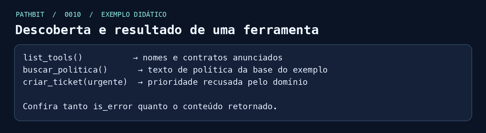

# A chamada MCP funcionou. O chamado ficou sem abrir.

O usuário relata erro 500 e pede um chamado. O modelo gera um plano válido e escolhe procurar uma política. O servidor responde que a política “erro 500 desde ontem” não existe. O protocolo fez a comunicação esperada. A escolha de ferramenta estava errada.

No laboratório da Academy IA, um cliente Python conecta o planner em Ollama a um servidor MCP local. O cliente inicia o subprocesso, descobre as ferramentas e chama a escolhida. A conversa MCP usa `stdin` e `stdout`. A geração do plano usa HTTP local separado. O subprocesso continua sujeito às permissões da configuração do sistema operacional.

## Teste a sessão de ferramentas sem modelo

Inicie a sessão, liste o catálogo e chame `buscar_politica` com o tópico `devolucao`. O servidor devolve a regra do dataset. Depois chame `criar_ticket` com prioridade `urgente`. O catálogo descreve a prioridade como string. A ferramenta recebe o argumento e devolve “ticket nao criado”. No exemplo, `is_error` continua falso porque o servidor representou a recusa no texto.

Esse teste separa três perguntas. O servidor conversou com o cliente? O valor tinha o tipo correto? A operação foi aceita pelas regras de domínio? Antes de considerar um efeito realizado, a aplicação precisa verificar a última resposta.

## Quando o modelo entra, avalie a escolha à parte

No experimento preservado, os três modelos passaram em 100% das validações estruturais. No gabarito de ferramenta, Llama 3.2 1B acertou 10 de 12 tentativas; Qwen 2.5 1.5B, 6; Qwen 2.5 0.5B, 4. As diferenças estão em qual função o modelo escolheu para seis perguntas executadas duas vezes. Os resultados dizem respeito aos modelos e consultas daquele experimento.

Os tempos têm dois recortes. As 50 chamadas stdio a uma operação fixa, já depois da inicialização, tiveram p50 de 0,99 ms e p95 de 1,53 ms. No experimento com planner, a duração média de uma chamada MCP variou entre 4,7 e 7,5 ms, enquanto o planejamento HTTP levou entre 1.764,4 e 2.213,3 ms em média. Compare métodos e unidades antes de transportar os números para outra integração.

## Reproduza em duas etapas

O [módulo](https://github.com/pathbit/pathbit-academy-ai/tree/master/0010_mcp_local) traz um cliente curto que roda sem Ollama. Depois de instalar as dependências e preparar os modelos locais, rode `python src/mcp_lab.py --repeat 2` para observar as decisões. Abra `q_incidente` e confronte `schema_ok`, `tool_escolhida` e `resposta_mcp` para descobrir onde ocorreu a falha.

No próximo módulo da Academy IA da [Pathbit](https://www.pathbit.com.br/), a proposta precisa de aprovação humana antes de produzir um chamado persistente.
