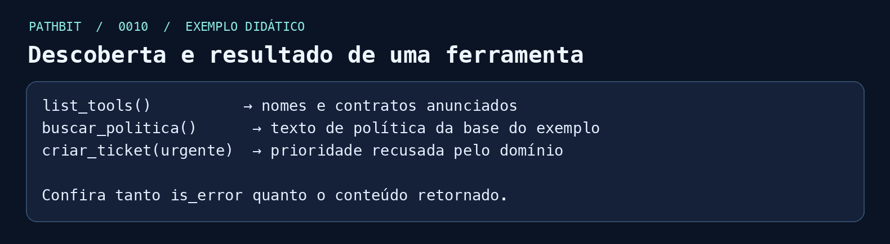

JSON válido. Sessão MCP funcionando. Ferramenta errada.

Num caso do laboratório da Academy IA, um modelo tentou consultar uma política quando o usuário tinha pedido um chamado por erro 500. Em outro teste, o próprio servidor recebeu uma prioridade inválida e devolveu a recusa no texto embora a chamada tivesse completado.

O artigo mostra como reproduzir a sessão MCP stdio sem Ollama, como avaliar a escolha e como ler as latências de cada parte.

📎 Artigo, código, sessão reproduzível e notebook

https://github.com/pathbit/pathbit-academy-ai/tree/master/0010_mcp_local

#MCP #ToolCalling #Ollama #PathbitAcademy
