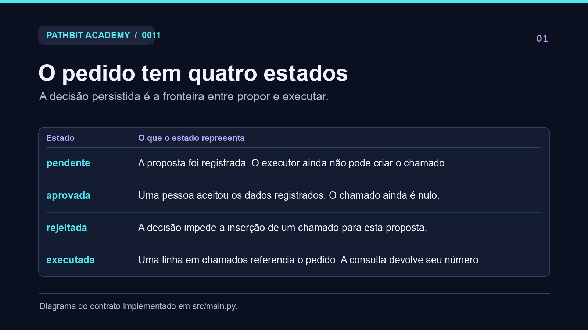
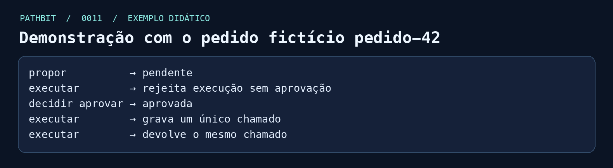
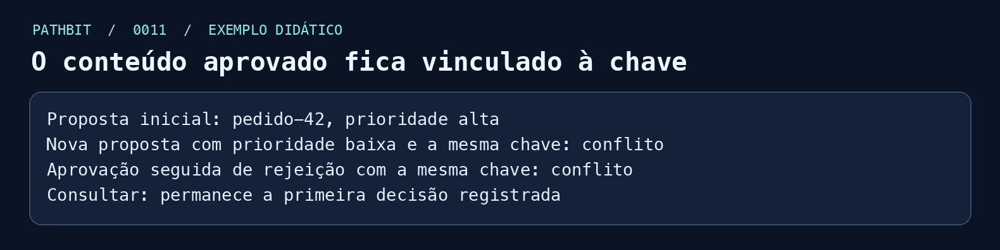
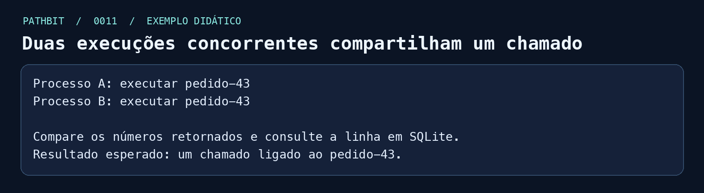

# 🤝 Quando um agente pode agir? Aprovação humana e idempotência

> Série Academy IA · Artigo 0011 · Um pedido de suporte, uma decisão persistida e um único chamado, mesmo com tentativas repetidas.

O agente de plantão lê “o checkout está indisponível”, identifica a intenção e sugere abrir um chamado com prioridade alta. O operador concorda. O sistema cria o chamado, mas a conexão cai antes de devolver o número. O cliente tenta de novo. Se o executor tratar cada chamada como um pedido novo, o mesmo incidente agora tem dois responsáveis, dois avisos e duas conversas que alguém terá de conciliar.

No [artigo sobre MCP](../../0010_mcp_local/article/ARTICLE.md), o cliente descobria ferramentas e chamava uma operação com argumentos definidos. Aqui vamos seguir a chamada até o ponto em que ela altera estado. Queremos observar o que acontece quando a execução chega cedo demais, quando alguém recusa a proposta e quando o comando aprovado reaparece depois de já ter produzido efeito.

O [laboratório](../README.md) usa Python e SQLite. Os comandos registram um chamado de suporte num banco temporário. Você pode repetir o exercício sem credenciais ou serviços externos.

## 1. O que o operador realmente aprova

A aprovação pertence a uma proposta concreta. Quando o assistente apresenta o título e a prioridade, registra esses dados sob o identificador `pedido-42`. O operador precisa ver o efeito previsto e o identificador que vai autorizar. Se o título mudar entre a revisão e a execução, o executor pode aplicar uma ação diferente da que a pessoa viu.

Há quatro estados observáveis. A proposta recém-criada fica `pendente`, ainda sem chamado. A decisão pode deixá-la `aprovada` ou `rejeitada`. Quando a transação registra o chamado, a consulta passa a devolver `executada`. O código deriva esse último estado pela existência de um chamado relacionado, o que evita atualizar uma coluna de status separada do efeito real.



> Figura 1. A execução consulta a decisão persistida. Se o pedido ainda está pendente ou foi rejeitado, nenhuma linha de chamado é inserida.

Observe duas formas de repetição. O operador pode reenviar a mesma decisão usando o mesmo nome, e a CLI devolve a decisão já registrada. Quem chama o executor também pode repetir a execução aprovada, mas o banco retorna o chamado existente. Cada operação respeita uma regra específica.

| Operação | Repetição com o mesmo conteúdo | Conflito |
| --- | --- | --- |
| Propor | Consulta a proposta persistida para a mesma chave | Um título ou uma prioridade diferente para a mesma chave gera erro |
| Decidir | Repetir decisão e operador devolve o registro atual | Trocar a decisão ou o operador para uma proposta já decidida gera erro |
| Executar | Devolve o mesmo número de chamado | Sem decisão de aprovação, retorna erro e mantém o banco sem chamado para a proposta |

A origem da chave importa. O sistema que abre a solicitação deve gerar o identificador uma vez e reenviá-lo junto do mesmo pedido. Gerar um UUID novo a cada tentativa torna cada chamada uma nova proposta válida. Derivar o identificador só do título tem o problema oposto. Dois incidentes independentes podem chegar com o texto “Checkout indisponível”. Em um serviço com vários clientes, escopo de conta e operação fazem parte da identidade que o servidor precisa controlar.

## 2. Reproduza a falha, aprove e repita

Use Python 3.10 ou superior. Na pasta deste módulo crie um diretório temporário. A chamada que antecede a aprovação faz parte do exercício e retorna código 1.

```bash
lab="$(mktemp -d)"
base="$lab/agente.sqlite"

python3 src/main.py --base "$base" propor pedido-42 \
  --titulo "Checkout indisponível" --prioridade alta

python3 src/main.py --base "$base" executar pedido-42
python3 src/main.py --base "$base" decidir pedido-42 aprovar --operador plantao
python3 src/main.py --base "$base" executar pedido-42
python3 src/main.py --base "$base" executar pedido-42
python3 src/main.py --base "$base" consultar pedido-42
```

A proposta inicial retorna `"chamado": null` e `"estado": "pendente"`. A tentativa prematura devolve `A execução exige uma proposta aprovada.` pelo fluxo de erro. Depois de `decidir`, a proposta está `aprovada`, mas o chamado ainda é nulo. Em uma base nova, as duas chamadas de `executar` retornam `"chamado": 1` e estado `executada`. O número 1 é consequência da base vazia. O resultado que interessa é que o número é igual nas duas tentativas.



> Figura 2. Campos selecionados da execução local. O primeiro erro vem do executor e as duas últimas respostas apontam para a mesma linha em SQLite.

Agora mantenha a mesma chave e mude a prioridade. Depois tente substituir a aprovação já registrada.

```bash
python3 src/main.py --base "$base" propor pedido-42 \
  --titulo "Checkout indisponível" --prioridade baixa
python3 src/main.py --base "$base" decidir pedido-42 rejeitar --operador plantao
python3 src/main.py --base "$base" consultar pedido-42
```

Os dois primeiros comandos devem falhar. A consulta continua mostrando prioridade alta, decisão `aprovar` e o mesmo chamado. O resultado é mais instrutivo que o teste de duas chamadas iguais. Ele mostra que a chave identifica um efeito específico e que operações posteriores não conseguem reescrever, por engano, o que foi aprovado.



> Figura 3. Reapresentar dados diferentes e trocar a decisão são conflitos observáveis. A consulta final mantém o conteúdo que o operador aprovou.

## 3. Por que o executor abre uma transação

Imagine duas instâncias do executor perguntando ao mesmo tempo “já existe chamado?”. Se as duas lerem “ainda não” e depois escreverem sem garantia de unicidade, as duas podem criar uma linha. Um `if` em memória também só enxerga o processo que o executou.

Em [src/main.py](../src/main.py), o executor abre uma transação com `BEGIN IMMEDIATE`, consulta a proposta, valida a decisão e tenta inserir. A tabela `chamados` mantém `pedido TEXT NOT NULL UNIQUE` e uma referência à proposta. O SQL que registra o efeito é:

```sql
INSERT INTO chamados (pedido) VALUES (?)
ON CONFLICT(pedido) DO NOTHING
```

O código lê o registro de novo dentro da mesma transação, tanto depois da inserção quanto depois de um conflito de unicidade. Assim a resposta do executor contém o chamado persistido em ambos os percursos. No gerenciador de transação, uma exceção provoca reversão e o caminho que termina normalmente confirma a alteração. Com `BEGIN IMMEDIATE` o SQLite tenta adquirir a transação de escrita logo no início. Outro escritor pode aguardar ou receber erro, conforme o timeout. A unicidade protege o banco de duplicação mesmo quando chamadas sobrepostas conseguem chegar ao ponto de executar. [Transações no SQLite](https://www.sqlite.org/lang_transaction.html).



> Figura 4. Dois processos locais disputam a primeira execução da mesma proposta aprovada. Compare os IDs retornados e a contagem de linhas do pedido.

Para repetir o caso da figura sem aproveitar um chamado anterior, crie outra proposta aprovada e capture as duas saídas.

```bash
python3 src/main.py --base "$base" propor pedido-43 --titulo "Erros no checkout"
python3 src/main.py --base "$base" decidir pedido-43 aprovar --operador plantao
python3 src/main.py --base "$base" executar pedido-43 > "$lab/primeira.json" &
first=$!
python3 src/main.py --base "$base" executar pedido-43 > "$lab/segunda.json" &
second=$!
wait "$first"
wait "$second"
cat "$lab/primeira.json" "$lab/segunda.json"
```

Confira os IDs. O teste do repositório também inspeciona a contagem no banco. Uma execução concorrente bem-sucedida demonstra o comportamento nesse cenário. Se o banco estiver bloqueado além do tempo configurado, o cliente deve lidar com a falha e reenviar a mesma chave quando a tentativa for segura.

## 4. Onde a proteção termina

A transação protege duas operações no mesmo arquivo SQLite. Imagine agora que criar o chamado signifique enviar HTTP a um fornecedor. O fornecedor pode persistir o chamado e a aplicação cair antes de registrar o retorno local. A próxima tentativa ainda encontra a proposta aprovada sem registro local do efeito. A garantia anterior precisa chegar ao sistema que cria o chamado.

Uma arquitetura possível persiste uma intenção de envio e o estado interno na mesma transação, usa um processo separado para enviar a intenção e reaproveita a chave idempotente aceita pelo fornecedor. O processo que envia continua sujeito a repetir uma requisição. A aplicação precisa reconciliar o estado com o fornecedor quando o resultado for incerto, inclusive considerando por quanto tempo a outra API guarda chaves. A fila transacional e o fornecedor estão fora deste laboratório.

A flag `--operador plantao` é apenas o rótulo informado na CLI. Num serviço real, a identidade viria da sessão autenticada, a autorização precisaria ser validada no servidor e a interface de revisão mostraria exatamente os dados que serão executados. Esse serviço também definiria quais propostas podem expirar ou ser canceladas e registraria de modo auditável quando a aprovação aconteceu. O campo textual sozinho não atende a esses requisitos.

## 5. Exercícios para testar o contrato

1. Use `pedido-44` e registre `rejeitar`. Execute a solicitação e consulte o estado. Qual campo garante que o efeito não aconteceu?
2. Refazer `decidir pedido-42 aprovar --operador plantao` é permitido. Tente novamente com outro operador e explique por que a revisão continua atribuída à primeira decisão.
3. Abra duas propostas de mesmo título com IDs diferentes e aprove ambas. Por que dois chamados agora são o resultado correto?
4. Desenhe o passo em que um serviço externo informa o número do chamado. Marque o que a próxima tentativa pode saber se o primeiro processo cair antes de gravar esse número.

O [notebook](../notebooks/aprovacao_idempotencia.ipynb) leva o mesmo fluxo a células que você pode repetir. Depois de colocar limites no que um agente pode executar, a série volta ao RAG. Em [busca híbrida](../../0012_busca_hibrida/article/ARTICLE.md), vamos medir quais evidências uma aplicação consegue recuperar antes de sequer considerar uma ação.

---

Developed with ❤️ by [Pathbit](https://www.pathbit.com.br/)
