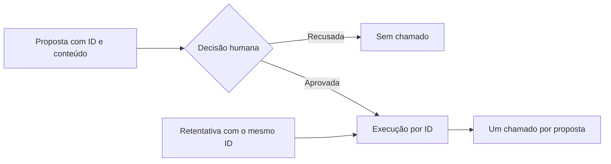

# Como um agente pode abrir chamados com aprovação humana e idempotência

[English](ARTICLE.en.md) · [Español](ARTICLE.es.md)

Um assistente detecta falhas no checkout e prepara um chamado para o plantão. O título e a prioridade fazem sentido, e alguém autoriza a abertura. A chamada que efetiva a gravação termina com timeout. Quem enviou sabe que ficou sem resposta e precisa decidir se repete. Se uma nova tentativa abrir outro chamado, o plantão passa a investigar o mesmo incidente em duas filas.

O [módulo de MCP](../../0010_mcp_local/article/ARTICLE.md) mostrou como um agente descobre e invoca ferramentas. Neste laboratório, usamos SQLite para acrescentar dois contratos que um sistema de chamados precisa ter: quem autoriza o efeito e o que acontece quando a mesma solicitação volta.

## Desenhe os estados antes da ferramenta

| Estado | Como chega nele | Efeito persistido |
| --- | --- | --- |
| `pendente` | O agente registra a proposta `pedido-42` | Título e prioridade para revisão |
| `aprovada` ou `rejeitada` | Uma pessoa registra a decisão | Decisão e identificador do operador |
| `executada` | O executor encontra uma proposta aprovada | ID de chamado ligado à proposta |

A interface de aprovação deve apresentar o conteúdo que será executado. No exemplo, a etapa `propor` recebe uma chave escolhida pelo cliente. Se `pedido-42` já aponta para outro título ou prioridade, a ferramenta retorna erro. Isso amarra a decisão ao conteúdo que o operador viu. Reenviar a mesma decisão com o mesmo operador recupera o estado salvo.

## Onde a idempotência é aplicada

A aprovação é consultada dentro da mesma transação que tenta inserir o chamado. A coluna `chamados.pedido` tem `UNIQUE`, e o `INSERT ... ON CONFLICT(pedido) DO NOTHING` reaproveita a associação existente. A própria chave do pedido permite recuperar o resultado após um timeout, inclusive em outra execução da CLI. Os comandos usam `BEGIN IMMEDIATE` para coordenar as escritas no SQLite. [Implementação do laboratório](../src/main.py) · [Transações do SQLite](https://sqlite.org/lang_transaction.html).

## Execute o percurso completo

Use o [início rápido](../README.md) com um arquivo SQLite novo. Registre a proposta, execute antes de aprovar e observe o código de saída `1`. Aprove a proposta, execute duas vezes e compare o campo `chamado` nos dois JSONs. Em outro pedido, registre `rejeitar` e confira que o campo continua `null` depois da tentativa de execução.

Abra o [notebook](../notebooks/aprovacao_idempotencia.ipynb) para acompanhar as chamadas. Os [testes](../../tests/test_approval_lab.py) exercitam propostas repetidas e execuções concorrentes no mesmo banco. Para repetir o exercício, use um caminho de banco diferente.

## Ao levar o desenho para outro serviço

O `--operador` é um rótulo informado na CLI. Em uma aplicação autenticada, obtenha a identidade do operador da sessão e verifique se ele pode autorizar aquele efeito. Um serviço externo não participa da transação local do SQLite. Se a criação do chamado usar uma API de terceiros, combine registro de entrega, uma chave de idempotência que o destino entenda e reconciliação de resultados em caso de timeout.

Depois de controlar o efeito de uma ferramenta, volte ao contexto que o agente usa para decidir e compare [duas formas de recuperar evidências com busca híbrida](../../0012_busca_hibrida/article/ARTICLE.md).

---

Developed with ❤️ by [Pathbit](https://www.pathbit.com.br/)
