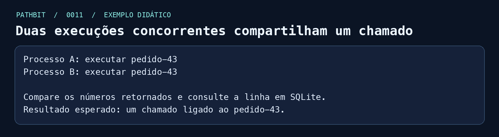

# Quando um agente pode abrir um chamado?

A pessoa de plantão aprovou o chamado “Checkout indisponível”. O sistema gravou o chamado. A conexão caiu antes da resposta. No retry, o executor recebeu a mesma solicitação e precisou decidir se deveria criar outro chamado.

É o tipo de falha que aparece quando o assistente passa de indicar ações a alterar o estado de um sistema. Um pedido bem escrito ajuda a identificar a intenção. No ponto em que o executor escreve, precisamos de uma autorização vinculada ao pedido e de um mecanismo que preserve o resultado entre tentativas.

## O que a aprovação protege

No laboratório, a proposta recebe a chave `pedido-42` e persiste o título e a prioridade. Enquanto está pendente, o comando `executar` falha. O operador pode aprovar ou rejeitar aqueles dados. Propor o mesmo ID com outra prioridade é um conflito, assim como tentar trocar uma decisão já registrada. Essa proteção evita aplicar dados diferentes dos que a pessoa viu.

A flag `--operador` representa um rótulo local. Em um produto, o servidor verificaria a identidade e a autorização do operador e mostraria a proposta exata para revisão.

## Como duas tentativas devolvem o mesmo número

O executor abre uma transação SQLite, confere a decisão, tenta inserir um chamado e consulta o resultado. A tabela que armazena chamados tem uma restrição de unicidade por `pedido`. A inserção usa `ON CONFLICT(pedido) DO NOTHING`. Se a tentativa anterior já criou a linha, a leitura devolve o mesmo chamado.

A consequência aparece na execução local. Antes de aprovar, a CLI retorna “A execução exige uma proposta aprovada.” Depois de aprovar, dois comandos de execução devolvem o mesmo ID. Para testar a primeira execução concorrente, registre outra proposta, aprove e inicie dois processos. Compare os IDs retornados e confira se há uma única linha no SQLite para aquele pedido.



## Faça a falha acontecer

Na pasta do módulo, use Python 3.10 ou superior.

```bash
base="$(mktemp -d)/agente.sqlite"
python3 src/main.py --base "$base" propor pedido-42 --titulo "Checkout indisponível" --prioridade alta
python3 src/main.py --base "$base" executar pedido-42
python3 src/main.py --base "$base" decidir pedido-42 aprovar --operador plantao
python3 src/main.py --base "$base" executar pedido-42
python3 src/main.py --base "$base" executar pedido-42
```

Observe o primeiro erro e os dois números iguais. Depois compare com outro pedido, registrado com a mesma descrição, mas com um ID diferente. Aí são dois incidentes distintos e dois chamados fazem sentido.

Um fornecedor por HTTP introduz outra janela de falha. Ele pode confirmar internamente e a aplicação cair antes de gravar o retorno. Para preservar o efeito, a chave precisa viajar até o fornecedor ou a aplicação precisa reconciliar o resultado com ele. O exercício usa uma única base SQLite justamente para deixar observável o que foi confirmado.

O [módulo com notebook, comandos concorrentes e exemplos de conflito](https://github.com/pathbit/pathbit-academy-ai/tree/master/0011_aprovacao_idempotencia) integra a série Academy IA da [Pathbit](https://www.pathbit.com.br/).
