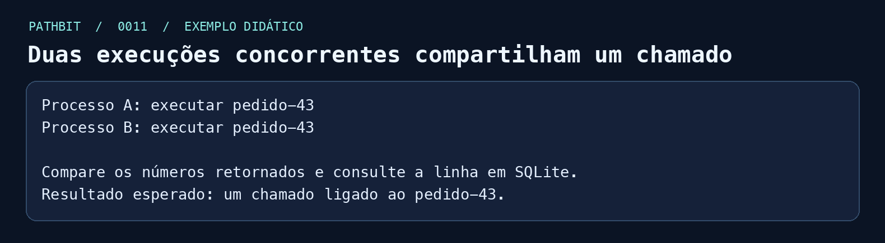

O agente abriu um chamado. A conexão caiu antes de devolver o número.

Quando a aplicação tenta de novo, quantos chamados aparecem no banco?

No laboratório 0011 da Academy IA, aprovei uma proposta e iniciei dois executores locais para a mesma chave. Os dois devolveram o mesmo chamado. Uma consulta ao SQLite mostrou uma linha.

O exercício também mostra a execução bloqueada antes da aprovação e o conflito ao tentar mudar a prioridade sob o mesmo ID. Dá para repetir com Python e um arquivo temporário.

📎 Laboratório, notebook e fluxo passo a passo

https://github.com/pathbit/pathbit-academy-ai/tree/master/0011_aprovacao_idempotencia

#AgentesIA #ToolCalling #SQLite #PathbitAcademy
