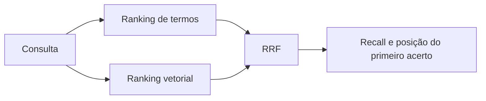

# Como combinar busca por palavras e embeddings em um RAG

[English](ARTICLE.en.md) · [Español](ARTICLE.es.md)

Em uma central de reservas, «protocolo RE42 para cancelar reserva» mistura um identificador exato com linguagem comum. «Redefinir senha» pode ter a resposta em um documento que chama o processo de recuperação de acesso. A primeira consulta beneficia de um índice que reconhece o código. A segunda precisa também de documentos semanticamente próximos.

O [módulo de RAG e bancos vetoriais](../../0003_rag_vector_database/article/ARTICLE.md) mostrou onde a recuperação entra no pipeline. Aqui paramos antes da geração para examinar quais documentos sobem e quais desaparecem quando as listas são fundidas.

## O que cada busca consegue enxergar

O laboratório lexical conta termos únicos que ocorrem na consulta e no documento com caixa normalizada. É uma maneira de inspecionar a lógica em poucas linhas. Em uma aplicação real, um índice com BM25 ou técnica equivalente pode tratar melhor a frequência e a raridade dos termos. A busca vetorial usa similaridade de cosseno com vetores pequenos escritos no [conjunto de dados](../data/search.json). Eles representam ordens controladas para o exercício. Ao usar embeddings reais, gere vetores para consultas e documentos com o mesmo modelo.

Pontuações menores ou iguais a zero ficam de fora. Cada método ordena seus candidatos e entrega até três IDs. A fusão recebe esses candidatos, então aumentar apenas o corte final não recupera o que nunca entrou em nenhuma lista.

## Una as posições com Reciprocal Rank Fusion

Para um documento na posição `r`, conte `1 / (60 + r)` a partir de `r = 1`. Some as contribuições das listas em que o documento aparece. Uma entrada nas posições 1 e 2 soma `1/61 + 1/62`, cerca de `0,03252`. Uma entrada que aparece apenas em primeiro soma cerca de `0,01639`. O método usa posições para combinar rankings com escalas diferentes. [Artigo original sobre RRF](https://cormack.uwaterloo.ca/cormacksigir09-rrf.pdf).

## Leia o resultado antes de trocar a arquitetura

| Consulta | Lexical, recall@2 | Vetorial, recall@2 | Híbrida, recall@2 |
| --- | --- | --- | --- |
| `redefinir senha` | 0,5 | 1,0 | 1,0 |
| `protocolo RE42 para cancelar reserva` | 0,5 | 1,0 | 0,5 |

Em `RE42`, `rain-policy` fica em primeiro e `notification` aparece nos dois rankings. A soma empurra `weather-alert` para fora das duas primeiras posições. A primeira resposta relevante continua em primeiro, então `reciprocal_rank_at_k` fica em `1.0` enquanto o recall cai. Uma métrica mede posição do primeiro acerto. A outra mede a cobertura dos documentos rotulados.

## Repita no seu terminal

Rode `python3 src/main.py --top 2` e `python3 src/main.py --top 3` como indicado no [guia de execução](../README.md). Compare `results` e `recall_at_k` por consulta. Em uma cópia do JSON, ajuste `candidate_depth` para `2` e passe `--dataset` para distinguir a profundidade de candidatos do corte da resposta. Use o [notebook](../notebooks/busca_hibrida.ipynb) para acompanhar os rankings passo a passo.

Duas consultas não sustentam a escolha de um mecanismo de produção. Use um conjunto rotulado com erros de digitação, códigos e vocabulário de clientes. Quando a recuperação entregar bons candidatos, o [artigo seguinte](../../0013_orcamento_contexto/article/ARTICLE.md) mostra como escolher os trechos que cabem na requisição.

---

Developed with ❤️ by [Pathbit](https://www.pathbit.com.br/)
