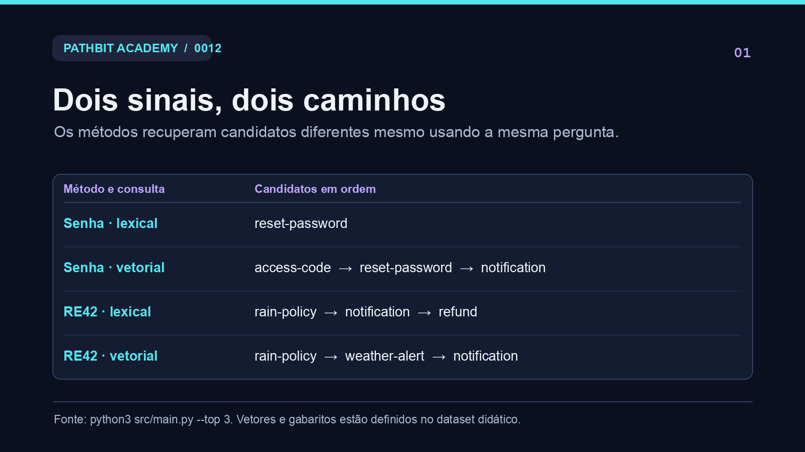
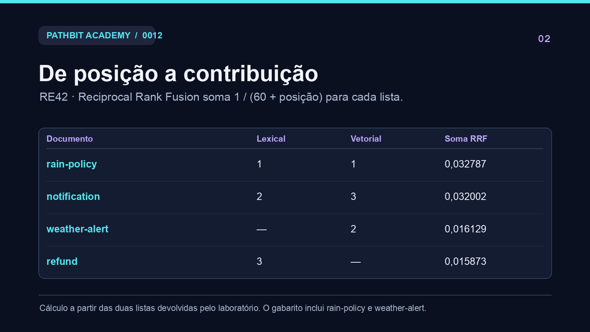
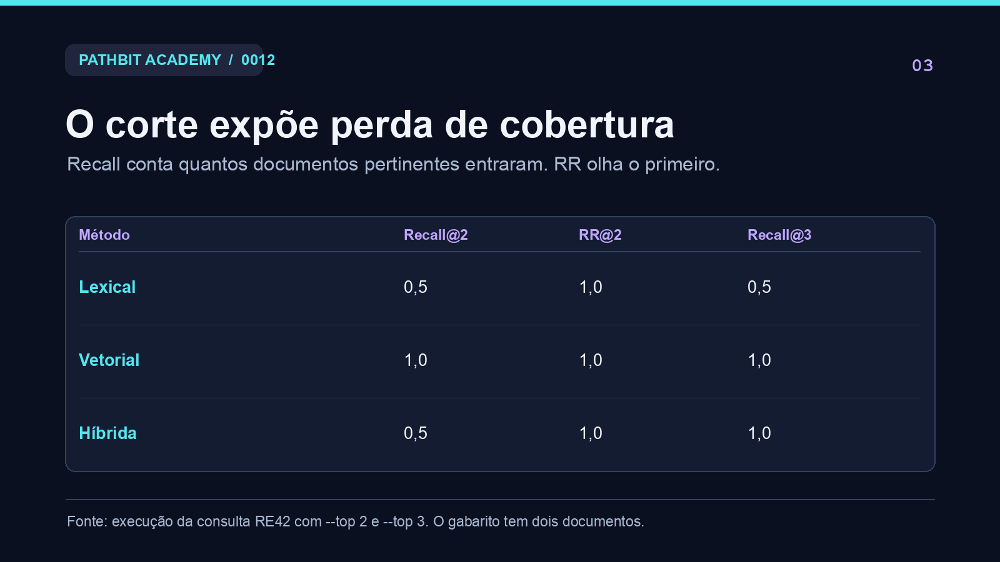
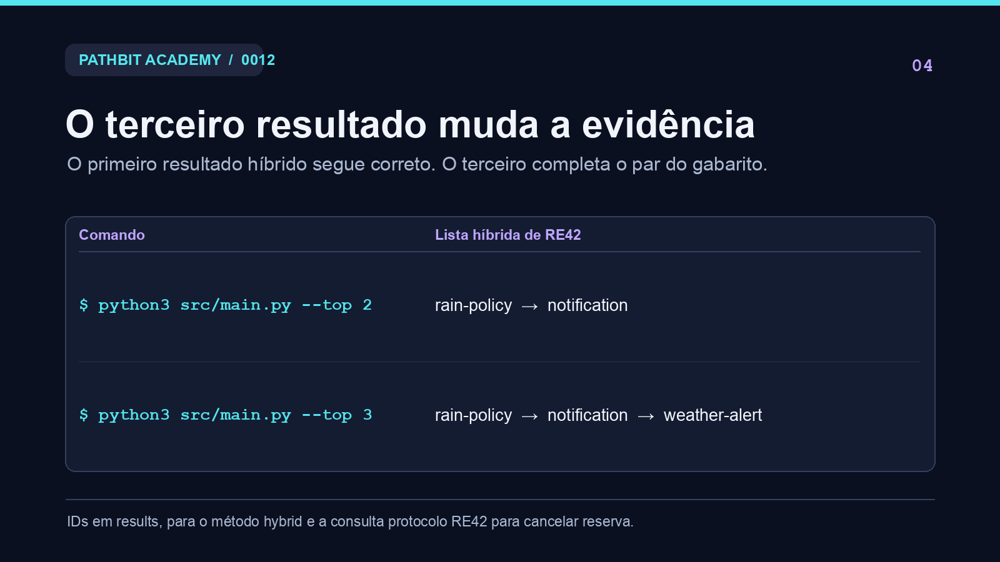

# 🔎 Busca híbrida em RAG: por que acertar o primeiro resultado pode ser pouco

> Série Academy IA · Artigo 0012 · Busque por termos, compare vetores e descubra quando fundir rankings muda a resposta que o RAG pode sustentar.

Um passageiro pergunta “protocolo RE42 para cancelar reserva”. O buscador devolve a regra de cancelamento por chuva. O resultado parece suficiente. Outro documento informa onde consultar o alerta que ativa a regra. Se esse documento cair na terceira posição e a aplicação enviar só dois trechos ao modelo, o assistente tem a regra, mas perde a informação para orientar a próxima ação.

Quando estudamos [RAG e bancos vetoriais](../../0003_rag_vector_database/article/ARTICLE.md), a similaridade ajudou a recuperar conteúdo por significado. Agora vamos confrontar uma busca lexical e uma vetorial sobre as mesmas perguntas, fundir os resultados e inspecionar um caso em que a busca híbrida perde cobertura. O [laboratório](../README.md) trabalha com seis documentos, duas consultas rotuladas e vetores manuais de três dimensões. Assim podemos explicar cada posição sem baixar um modelo.

## 1. Dois sinais para recuperar a mesma informação

A busca **lexical** tem boa visibilidade quando um termo raro, um código ou um nome de produto precisa aparecer. No laboratório, `terms()` aplica `casefold()`, extrai grupos de caracteres de palavra e devolve um conjunto. O escore é o número de palavras distintas que aparecem na consulta e no documento. Repetir `senha` três vezes mantém sua contribuição em um. Termos comuns como `para` contam do mesmo jeito que `RE42`. Essa simplicidade é deliberada. Uma busca de produção pode exigir ponderação por raridade, tratamento de idioma e regras explícitas para identificadores.

Consulte `redefinir senha`. `reset-password` tem palavras em comum e aparece sozinho na lista lexical. `access-code` fala de recuperação do acesso por código de segurança, sem usar as mesmas palavras. O documento é relevante para o objetivo do usuário e o dataset o inclui no gabarito.

A busca **vetorial** compara o vetor da consulta ao do documento pela similaridade de cosseno. O produto escalar soma as multiplicações de componentes correspondentes. Dividir pelo produto das normas mede alinhamento entre as direções. Se um dos vetores for nulo, o código dá escore zero. Os vetores têm dimensões compatíveis e estão explícitos em [data/search.json](../data/search.json). Escolhemos os valores para estudar o comportamento da recuperação e os casos difíceis. Em um produto, o modelo de embeddings e a apresentação das consultas também influenciariam os vetores.



> Figura 1. Cada linha mostra candidatos devolvidos pela CLI na execução com `--top 3`. Para a consulta de senha, a lista lexical tem só uma correspondência positiva.

Os dois métodos ordenam por escore decrescente e, em empates, por ID. Eles descartam escores não positivos e guardam até três candidatos, por configuração do dataset. A busca híbrida enxerga a união dessas listas de candidatos. Se um documento relevante ficar fora dos dois cortes, a fusão não consegue recuperá-lo sozinha.

## 2. Some contribuições de posição com RRF

Contagem de palavras e cosseno vivem em escalas diferentes. Somar diretamente, por exemplo, três coincidências com uma similaridade de 0,9 daria à escala lexical um peso difícil de justificar aqui. A Reciprocal Rank Fusion (RRF) converte posições em contribuições. O laboratório soma `1 / (60 + posição)` para cada ranking em que o mesmo ID aparece. O primeiro item ocupa posição 1. Se o ID estiver ausente de uma lista, essa lista não contribui para ele. O parâmetro 60 controla quanto a contribuição muda entre posições. [Artigo original da Reciprocal Rank Fusion](https://cormack.uwaterloo.ca/cormacksigir09-rrf.pdf).

Na consulta sobre `RE42`, `rain-policy` está em primeiro nas duas listas. `notification` aparece em segundo na lexical e terceiro na vetorial. `weather-alert` está em segundo na vetorial e não aparece na lexical. Calcule as contribuições antes de olhar o resultado.

| Documento | Lexical | Vetorial | Pontuação RRF aproximada |
| --- | ---: | ---: | ---: |
| `rain-policy` | 1 | 1 | 0,032787 |
| `notification` | 2 | 3 | 0,032002 |
| `weather-alert` | — | 2 | 0,016129 |
| `refund` | 3 | — | 0,015873 |



> Figura 2. Pontuações calculadas a partir das posições devolvidas pelo lab. O gabarito inclui `rain-policy` e `weather-alert`.

A fusão pôs `notification` na segunda posição porque apareceu nas duas buscas, embora não esteja no gabarito dessa consulta. `weather-alert` caiu para a terceira. Na consulta de senha, `reset-password` também sobe da segunda posição vetorial para a primeira híbrida por aparecer nas duas listas. `access-code` continua em segundo na fusão e fica disponível para o modelo. Os dois casos mostram a mesma regra operando com resultados diferentes.

## 3. Meça o que chega ao corte final

Use Python 3.10+ na pasta do módulo.

```bash
python3 src/main.py --top 2
python3 src/main.py --top 3
```

O relatório lista IDs, `recall_at_k` e `reciprocal_rank_at_k` por método e consulta. **Recall@K** é a fração de todos os documentos rotulados como relevantes que apareceu até a posição K. **RR@K** é o inverso da posição do primeiro relevante encontrado até K. Vale zero se nenhum aparecer. Compare as duas medidas no mesmo resultado.

| Consulta | Método | Recall@2 | RR@2 | Recall@3 |
| --- | --- | ---: | ---: | ---: |
| redefinir senha | lexical | 0,5 | 1,0 | 0,5 |
| redefinir senha | vetorial | 1,0 | 1,0 | 1,0 |
| redefinir senha | híbrida | 1,0 | 1,0 | 1,0 |
| protocolo RE42 para cancelar reserva | lexical | 0,5 | 1,0 | 0,5 |
| protocolo RE42 para cancelar reserva | vetorial | 1,0 | 1,0 | 1,0 |
| protocolo RE42 para cancelar reserva | híbrida | 0,5 | 1,0 | 1,0 |



> Figura 3. Métricas extraídas da CLI. Em RE42 o primeiro relevante continua em primeiro lugar, por isso o RR@2 fica em 1,0 mesmo com Recall@2 em 0,5.

Se você só olhar a média de RR (MRR) das duas consultas, todos os métodos empatam em 1,0. O resultado não ajuda a identificar o trecho ausente. Para uma pergunta que depende da regra e da condição que ativa a regra, a cobertura tem relação mais direta com o material disponível para responder. Já uma navegação que procura um único documento oficial pode dar mais importância à posição do primeiro item correto. O gabarito precisa refletir qual dessas tarefas o produto resolve.



> Figura 4. Com o corte 3 a fusão inclui `weather-alert`. Os resultados mantêm a ordem anterior. O que muda é quanto da lista chega ao consumidor.

## 4. Experimente alterar uma decisão por vez

Mantenha o gabarito e altere só o corte de saída, como fizemos. Assim você separa a ordenação da quantidade enviada ao modelo. Se aumentar o corte geral trouxer material redundante ou passar do limite da requisição, o seletor precisa decidir quais trechos entram. Esse é o próximo módulo da série.

Agora copie o dataset para um arquivo temporário. Use `candidate_depth: 2` e rode a CLI com `--dataset caminho/do/arquivo.json --top 2`. Nessa configuração o candidato `notification` deixa de aparecer na lista vetorial do caso RE42, pois estava em terceiro. Veja a disputa entre `notification` e `weather-alert` na fusão. Os dois aparecem em segundo em uma única lista, de modo que recebem a mesma contribuição. A implementação desempata pelo ID, e `notification` ainda ganha. A mudança no escore não basta para recuperar o documento perdido. Se pedir `--top 3` com esse dataset, a CLI rejeita a configuração porque a profundidade de candidatos é menor que o corte final.

Se a busca final precisa privilegiar um identificador exato, documente o que ele representa antes de impor uma regra. No exemplo, `RE42` identifica uma regra e a busca por código pode colocar o documento oficial primeiro. Ainda precisamos recuperar o alerta relacionado. Uma estratégia possível é reservar um candidato para a correspondência exata e medir as escolhas restantes com consultas que exigem múltiplas evidências. Fixe em anotações por que cada documento conta como relevante, para permitir revisão quando o gabarito for ambíguo.

## 5. O que medir antes de trocar a recuperação em produção

Dois casos controlados tornam o cálculo legível, mas são pouco para escolher uma arquitetura. Forme um conjunto com buscas por código, paráfrases, perguntas compostas e consultas em que documentos antigos disputam posição com os vigentes. Preserve perguntas de teste que não participaram da escolha de pesos ou cortes. Compare o primeiro acerto, a cobertura no corte que a aplicação usa e os resultados de cada grupo, para que um ótimo desempenho em consultas fáceis não esconda a perda em consultas de alto impacto.

Também vale registrar os IDs intermediários, a ordem após fusão e os trechos enviados ao gerador. Quando alguém aponta que a resposta omitiu uma condição, esses três pontos permitem identificar se a evidência nunca apareceu na recuperação, se caiu no ranking ou se foi excluída na montagem do contexto.

Use o [notebook](../notebooks/busca_hibrida.ipynb) para observar os dois cortes lado a lado. Em [orçamento de contexto](../../0013_orcamento_contexto/article/ARTICLE.md) vamos assumir que os candidatos foram recuperados. A próxima decisão é quanto cabe na requisição e como preservar os trechos que completam a resposta.

---

Developed with ❤️ by [Pathbit](https://www.pathbit.com.br/)
