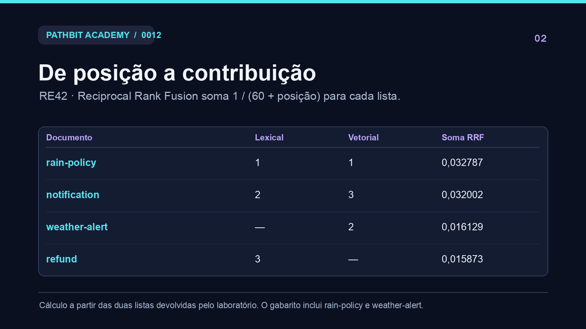

# A busca híbrida acertou o primeiro resultado. A evidência ficou incompleta.

Uma pessoa pergunta “protocolo RE42 para cancelar reserva”. A busca híbrida devolve a política certa em primeiro. O sistema pode parecer pronto para responder. Só que o documento que informa onde consultar o alerta aparece em terceiro, e o modelo recebe apenas dois trechos.

Esse foi o caso mais interessante no laboratório de busca híbrida da Academy IA. Fixei seis documentos, duas consultas rotuladas e vetores didáticos de três dimensões. A CLI roda offline e mostra quais documentos cada método entregou.

## Por que a fusão põe o aviso genérico na frente

A busca lexical do laboratório conta termos em comum. A vetorial ordena por similaridade de cosseno. Cada lista descarta escores não positivos e entrega até três candidatos.

Na consulta sobre o protocolo de cancelamento, `rain-policy` lidera as duas buscas. A busca lexical põe `notification` em segundo e a vetorial põe esse mesmo documento em terceiro. O trecho relevante `weather-alert` aparece em segundo apenas no ranking vetorial.

A Reciprocal Rank Fusion soma `1 / (60 + posição)` para cada lista em que o ID aparece. Assim, `notification` recebe cerca de 0,0320 e `weather-alert` recebe cerca de 0,0161. A fusão dá a segunda posição a `notification`. Os dois sinais concordaram sobre um documento que não pertence ao gabarito daquela pergunta.



## Duas métricas contam histórias diferentes

Com `--top 2`, o ranking híbrido encontra um de dois documentos pertinentes ao caso RE42. O Recall@2 é 0,5. Seu primeiro resultado é pertinente, então RR@2 permanece 1,0. A busca vetorial acha os dois relevantes com o mesmo corte. Com `--top 3`, a fusão inclui o alerta e chega a Recall@3 de 1,0.

Na outra consulta, “redefinir senha”, o ranking híbrido já recupera os dois documentos relevantes com o corte 2. O registro por consulta mantém essa diferença visível. Os dois casos servem para entender a mecânica da fusão; para escolher uma estratégia em produção, rotule consultas de código, paráfrases e perguntas que dependem de várias fontes.

## Reproduza, depois investigue o empate

Na pasta do módulo, execute com Python 3.10+.

```bash
python3 src/main.py --top 2
python3 src/main.py --top 3
```

Compare `results` antes de olhar as métricas. Depois faça uma cópia do dataset e reduza `candidate_depth` de 3 para 2. O aviso deixa de ocupar a terceira posição vetorial e empata no escore de fusão com o alerta. O desempate pelo ID ainda favorece o aviso. O caso mostra por que vale guardar os candidatos antes e depois de fundir. Quando evidência some, a equipe consegue localizar a decisão que mudou a lista.

O [laboratório com notebook e dados rotulados](https://github.com/pathbit/pathbit-academy-ai/tree/master/0012_busca_hibrida) integra a Academy IA da [Pathbit](https://www.pathbit.com.br/). O próximo módulo investiga o que acontece quando a lista recuperada compete com um orçamento de contexto.
