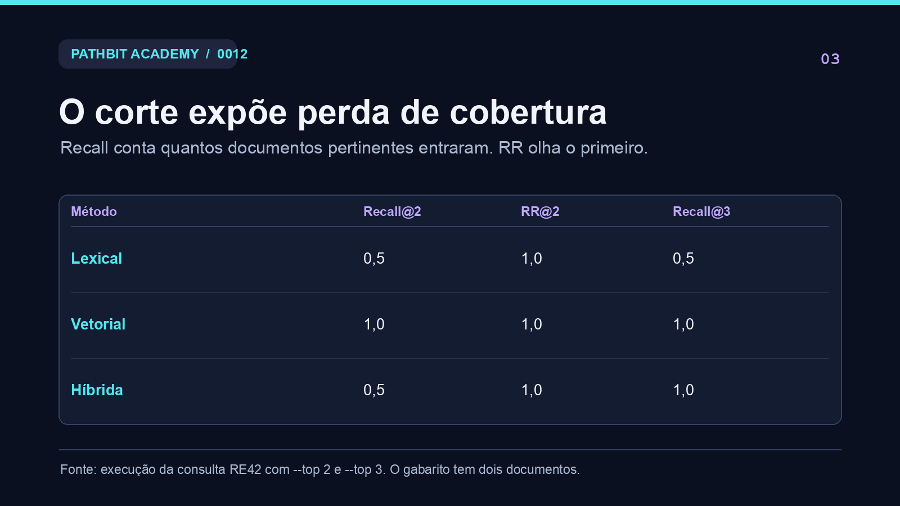

A busca híbrida devolveu o resultado correto em primeiro. O modelo ainda perdeu metade da evidência.

Na pergunta “protocolo RE42 para cancelar reserva”, precisamos tanto da regra quanto do alerta que ativa a regra. Com dois resultados, a fusão pegou um de dois trechos relevantes. RR@2 ficou em 1,0 e Recall@2 ficou em 0,5. Com o terceiro resultado, a evidência se completou.

No laboratório da Academy IA você roda os dois cortes, vê as contribuições da Reciprocal Rank Fusion e consegue explicar por que um aviso genérico ficou à frente do alerta.

📎 Laboratório offline, dataset, notebook e análise

https://github.com/pathbit/pathbit-academy-ai/tree/master/0012_busca_hibrida

#RAG #BuscaHíbrida #RecuperaçãoDeInformação #PathbitAcademy
