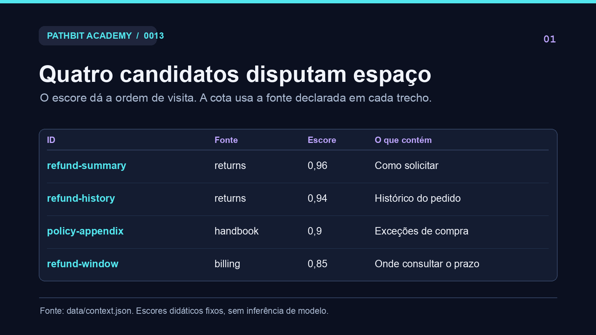
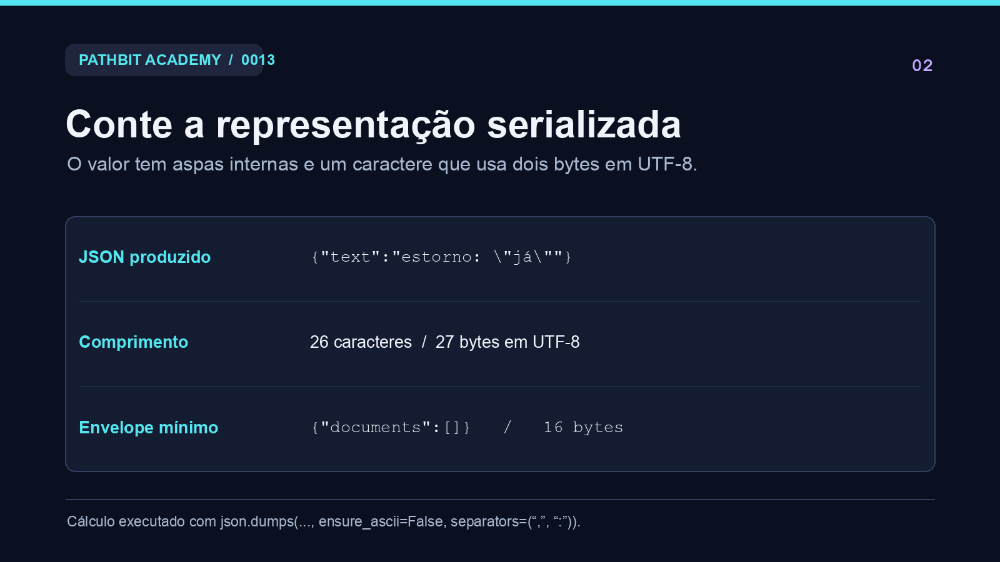
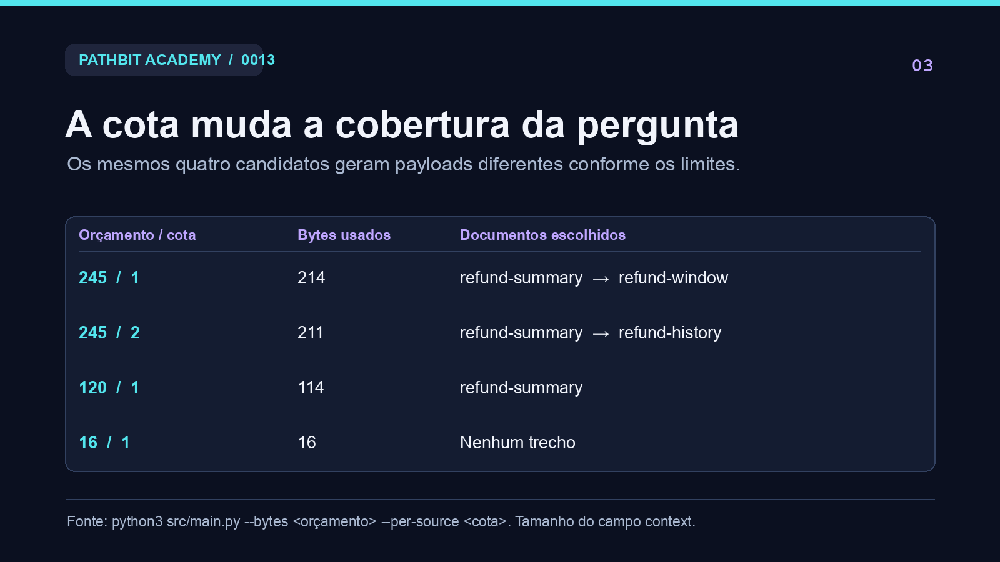
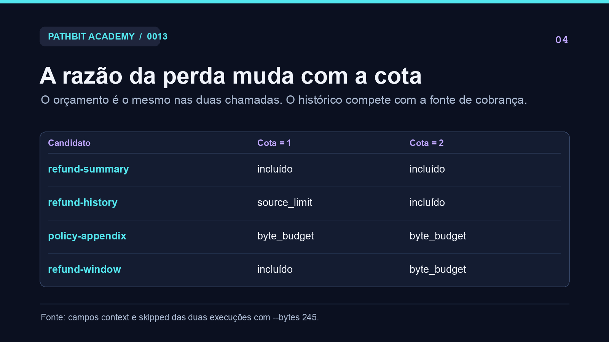

# 📦 Orçamento de contexto em RAG: quais trechos entram quando o espaço acaba?

> Série Academy IA · Artigo 0013 · Selecione trechos, confira o orçamento em bytes e veja como enviar fontes diferentes muda a resposta possível.

Uma cliente pergunta como solicitar um estorno e onde conferir o prazo. A recuperação devolve quatro trechos, incluindo três instruções curtas e um apêndice longo sobre exceções. Pelo escore, o segundo trecho fala do histórico do estorno. A instrução de prazo, que resolve metade da pergunta, aparece em quarto. Se o seletor simplesmente empilhar os primeiros resultados até encher o orçamento, pode enviar um contexto que explica onde pedir o estorno e ensina a acompanhar mudanças, mas deixa o prazo sem evidência.

Em [busca híbrida](../../0012_busca_hibrida/article/ARTICLE.md), investigamos quem chega ao corte do ranking. Agora vamos assumir que esses candidatos já existem. O [laboratório](../README.md) fixa o conjunto de candidatos e varia o orçamento e a quantidade por fonte. A execução usa Python e arquivos locais. O exercício mede a composição do payload, sem chamar um modelo ou avaliar a qualidade de uma resposta gerada.

## 1. Os quatro candidatos já estão em ordem

Em [data/context.json](../data/context.json), cada candidato tem `id`, `source`, `score` e `text`. O seletor ordena por escore decrescente e desempata pelo ID. Os escores são valores definidos para o exercício. A fonte é o rótulo usado para contar quantos trechos do mesmo grupo já entraram.

| ID | Fonte | Escore | Conteúdo |
| --- | --- | ---: | --- |
| `refund-summary` | `returns` | 0,96 | Onde solicitar o estorno |
| `refund-history` | `returns` | 0,94 | Onde observar mudanças no histórico |
| `policy-appendix` | `handbook` | 0,90 | Exceções para vários tipos de compra |
| `refund-window` | `billing` | 0,85 | Onde conferir o prazo |

Repare que `refund-window` responde onde consultar. O trecho não declara prazo em horas ou dias. Preservá-lo no contexto permite orientar a cliente para a fonte correta. Ainda não temos elementos para prometer um prazo.



> Figura 1. Os candidatos do exercício. Os dois primeiros usam a mesma fonte, enquanto o trecho que indica onde consultar o prazo vem de cobrança e tem o escore mais baixo do conjunto.

## 2. Conte os bytes do JSON que será consumido

O contexto que o laboratório monta tem o formato `{"documents":[...]}`. Cada documento preserva `id`, `source` e `text`. O escore serve para seleção e fica de fora do payload. A função de serialização evita espaços opcionais e usa `ensure_ascii=False`. O tamanho inclui nomes de chaves, aspas, vírgulas, colchetes e o conteúdo em UTF-8. [RFC 8259, formato JSON](https://www.rfc-editor.org/rfc/rfc8259.html).

Para reproduzir a conta mínima, execute:

```python
import json

document = {"text": 'estorno: "já"'}
payload = json.dumps(document, ensure_ascii=False, separators=(",", ":"))
print(payload)
print(len(payload), len(payload.encode("utf-8")))
```

O caractere `á` ocupa dois bytes em UTF-8, embora conte como um caractere Python. Aspas dentro do valor ganham escape e passam a contribuir também com a barra invertida. Conte depois de serializar. Somar só o tamanho dos textos deixaria de fora tanto esses escapes quanto o envelope.

Em [src/main.py](../src/main.py), o princípio é medir a mesma representação que vai ser retornada como contexto:

```python
json.dumps(
    {"documents": documents}, ensure_ascii=False, separators=(",", ":")
).encode("utf-8")
```

O relatório da CLI contém um campo `context` com o JSON acima como uma string. As barras mostradas quando o arquivo imprime essa string escapada pertencem ao JSON externo do relatório. Para medir o objeto que vai para o próximo passo, leia o relatório e aplique `len(report["context"].encode("utf-8"))`. O campo `bytes_used` mede esse contexto interno. As chaves diagnósticas `byte_budget` e `skipped` ficam no relatório e não entram na conta.



> Figura 2. Saída de Python com aspas escapadas e caractere acentuado. O tamanho cresce tanto com a serialização quanto com a codificação UTF-8.

O limite de transporte em bytes e a janela de contexto de um modelo são restrições distintas. Se você enviar a lista ao modelo dentro de mensagens, ainda precisa contar instruções, pergunta, ferramentas e margem de saída no formato e na unidade da API que usa. O número de bytes deste laboratório permite conferir a serialização e um teto para o payload. Uma aplicação pode aplicar as duas restrições, cada qual no componente que conhece sua unidade.

## 3. A cota por fonte altera quais evidências entram

O seletor percorre a ordem do ranking. Se já tiver usado a cota de uma fonte, registra `source_limit` e segue. Se a adição do candidato ultrapassar o limite de bytes, registra `byte_budget` e segue. A fonte só consome cota quando um trecho entra. O candidato seguinte ainda pode caber quando o anterior é grande demais. O algoritmo é guloso: ele mantém decisões já tomadas durante o percurso.

Execute na pasta deste módulo, com Python 3.10 ou superior:

```bash
python3 src/main.py --bytes 245 --per-source 1
python3 src/main.py --bytes 245 --per-source 2
python3 src/main.py --bytes 120 --per-source 1
python3 src/main.py --bytes 16 --per-source 1
```

| Orçamento | Cota por fonte | Bytes usados | Documentos incluídos |
| ---: | ---: | ---: | --- |
| 245 | 1 | 214 | `refund-summary`, `refund-window` |
| 245 | 2 | 211 | `refund-summary`, `refund-history` |
| 120 | 1 | 114 | `refund-summary` |
| 16 | 1 | 16 | nenhum |



> Figura 3. Resultados da CLI usando o dataset original. Com o orçamento fixo em 245 bytes, alterar apenas a cota muda a presença do trecho de cobrança.

A cota de um exclui `refund-history` porque o primeiro trecho já usa uma vaga de `returns`. Em seguida o apêndice ultrapassa o orçamento. Como a busca continua, `refund-window` encontra espaço e entra. Ao subir a cota para dois, o histórico entra na segunda posição do percurso e o trecho de cobrança já não cabe quando sua vez chega. O resultado é três bytes menor e fica com uma única fonte. O espaço usado, isoladamente, pouco diz sobre a cobertura da pergunta.



> Figura 4. Em ambos os casos o apêndice longo extrapola o orçamento. O diagnóstico de `refund-window` muda quando o histórico entra antes dele.

O orçamento mínimo de 16 bytes vem de `{"documents":[]}`. Com 16 o formato continua válido e a lista fica vazia. Com 15, a CLI rejeita a configuração. Esses dois testes de fronteira ajudam a distinguir configuração inválida de uma recuperação que não conseguiu encaixar trecho algum. Se o contexto chega vazio, a camada seguinte pode pedir mais informação ou declarar que não encontrou evidência.

## 4. Três perguntas para levar ao seu projeto

**Que parte de cada resposta precisa de uma evidência?** A pergunta “como solicitar e onde confiro o prazo?” pede duas coisas. Uma avaliação pode marcar a presença dos trechos que atendem a cada parte em vez de medir só a quantidade de fontes. Se duas partes dependem da mesma fonte autoritativa, uma cota de um pode fazer a aplicação perder justamente a segunda evidência.

**O que constitui uma fonte?** O laboratório trata `returns`, `handbook` e `billing` como categorias do dataset. Seu sistema pode agrupar por documento, página, equipe, versão ou autoridade. Se dois trechos quase iguais vierem de páginas irmãs, uma cota por URL pode continuar deixando os dois passarem. Se vários artigos independentes forem rotulados com o mesmo domínio, uma cota por domínio pode cortar documentos complementares.

**O seletor deve escolher outro conjunto ou outro trecho?** Um apêndice longo pode conter uma frase necessária que nunca entra. Compare tornar os trechos menores, filtrar por edição vigente ou reservar espaço para uma segunda evidência. Registre o resultado de cada alteração e conserve os IDs dos trechos efetivamente enviados. Pesquisas sobre posição de informação em contextos longos indicam que acrescentar conteúdo e mover uma evidência podem mudar o aproveitamento pelo modelo. Este exercício de seleção não mede esse efeito. [Lost in the Middle](https://arxiv.org/abs/2307.03172).

## 5. Faça o exercício antes de adicionar um modelo

Use o [notebook](../notebooks/orcamento_contexto.ipynb) para comparar as configurações com uma única execução. Em seguida:

1. Rode com `--bytes 15` e depois com 16. Localize o limite do envelope e explique por que só uma dessas requisições pode ser enviada no formato previsto.
2. Rode com `--bytes 214 --per-source 1` e depois com 213. Compare `skipped` para verificar se uma diferença de um byte troca a evidência de prazo.
3. Copie o dataset, encurte o apêndice e execute com `--input` apontando para a cópia. Marque quais trechos mudaram e se o conteúdo ficou mais útil para cada parte da pergunta.
4. Use `--output` para gravar o relatório temporário. Abra o campo `context` e confira o tamanho do JSON interno antes de usar o arquivo no próximo módulo.

Em [citações verificáveis](../../0014_citacoes_verificaveis/article/ARTICLE.md), vamos usar esse mesmo contexto como fronteira de verificação. Um ID pode existir no acervo inteiro e ainda ser inválido numa resposta se o trecho ficou fora da requisição.

---

Developed with ❤️ by [Pathbit](https://www.pathbit.com.br/)
