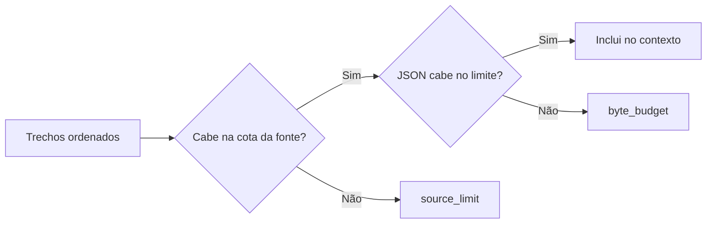

# Como montar o contexto de um RAG dentro de um limite

[English](ARTICLE.en.md) · [Español](ARTICLE.es.md)

Um assistente de compras recebe «onde peço o estorno e como vejo o prazo?». A busca devolve dois trechos da política de devoluções, um trecho da cobrança e um apêndice. O histórico de estorno pode ter boa pontuação e ocupar o espaço que a regra de prazo precisaria. O ranking é o começo da escolha. A montagem do contexto decide que evidências o modelo terá diante dele.

## Meça aquilo que vai para a requisição

O exemplo conta os bytes de `{"documents":[...]}` depois de serializar JSON compacto em UTF-8. Cada entrada inclui `id`, `source` e `text`. Conta aspas, chaves, separadores e caracteres multibyte que aparecem em `estorno é solicitado`. O relatório externo inclui `bytes_used`, `context` e motivos de exclusão. A medida refere-se ao JSON interno que você obtém ao interpretar `context`.

Uma API de modelos normalmente limita tokens, e pode ter limites de payload também. Para planejar a produção, conte tokens com o tokenizer adequado à requisição completa, incluindo mensagens, instruções e ferramentas, e reserve espaço para a resposta. O laboratório usa bytes para repetir a mesma medição sem depender de um modelo.

## Use uma cota quando a mesma fonte domina

Os [trechos de exemplo](../data/context.json) são ordenados por relevância e desempate por ID. O empacotador verifica a cota de fonte, mede o envelope com o próximo trecho e registra `source_limit` ou `byte_budget` quando a inclusão falha. Um trecho curto no fim da lista ainda pode caber depois que um anterior ficou de fora.

| Teto e cota | Contexto que cabe | Bytes |
| --- | --- | --- |
| `245`, uma entrada por fonte | `refund-summary` e `refund-window` | 214 |
| `120`, uma entrada por fonte | `refund-summary` | Confira `bytes_used` no relatório |
| `245`, duas entradas por fonte | `refund-summary` e `refund-history` | 211 |

Na última linha, os dois trechos de `returns` deixam pouco espaço para `billing`. A redução de três bytes no resultado significa que os dois trechos escolhidos são menores juntos. Ela não indica melhora na cobertura da pergunta sobre prazos. Use a coluna de exclusões para explicar a decisão.

## Rode e ajuste uma variável por vez

Reproduza os três cenários do [guia](../README.md), abra o JSON em `context` e compare a origem de cada trecho. Quando for ajustar o algoritmo, mantenha o conjunto de entrada constante durante a comparação. A estratégia gulosa atual favorece relevância por posição e custa uma serialização por tentativa. Para volume maior, meça latência e quantidade de evidências úteis por requisição antes de mudar o mecanismo.

O [notebook](../notebooks/orcamento_contexto.ipynb) usa o mesmo empacotador da CLI. No [próximo artigo](../../0014_citacoes_verificaveis/article/ARTICLE.md), o relatório vira a entrada para verificar as fontes de uma resposta.

---

Developed with ❤️ by [Pathbit](https://www.pathbit.com.br/)
