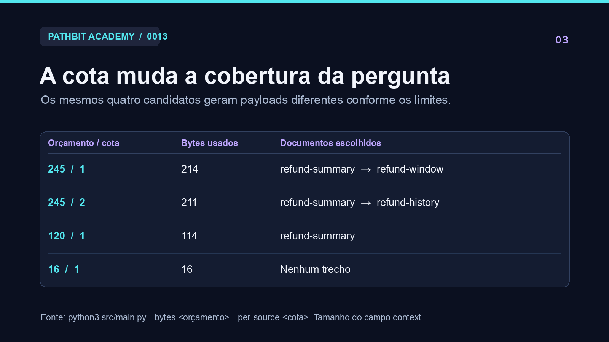

# Seu RAG recuperou quatro trechos. Quais entram na requisição?

Uma pessoa pergunta como pedir o estorno e onde conferir o prazo. O primeiro trecho explica como fazer o pedido. O segundo fala do histórico. O terceiro é um apêndice de exceções. A instrução de prazo vem em quarto.

Se o sistema montar o contexto só pela ordem de relevância, os dois trechos da mesma fonte podem ocupar o orçamento. O gerador recebe informações sobre como pedir e acompanhar o estorno, mas perde justamente onde conferir o prazo.

## Relevância e cobertura tomam decisões diferentes

No laboratório da Academy IA, a seleção ordena por escore, percorre os candidatos e testa cada adição na versão JSON já serializada. Uma cota limita quantos trechos por fonte podem entrar. Se um candidato não couber, a seleção continua. Assim, um parágrafo curto pode chegar ao contexto depois que o apêndice maior foi descartado.

Rodando com orçamento de 245 bytes e cota de um, entram `refund-summary` e `refund-window`, em 214 bytes. Com os mesmos 245 bytes e cota de dois, o histórico entra no lugar da instrução de prazo. O contexto fica três bytes menor e perde uma das fontes.



A cota foi útil neste conjunto porque duas passagens de `returns` competiam com a passagem de `billing`. Imagine agora duas instruções necessárias vindas da mesma política. Nesse cenário, a cota de um poderia jogar fora uma evidência indispensável. A unidade de agrupamento, a pergunta e o conteúdo disponível precisam aparecer na avaliação.

## Meça o JSON que será enviado

O tamanho inclui chaves, aspas, separadores e texto em UTF-8. A palavra `já` tem dois caracteres, mas três bytes em UTF-8. Uma aspa dentro do texto também ganha escape no JSON. Por isso o código mede o payload serializado em vez de somar o comprimento do texto de cada candidato.

A conta em bytes vale para o payload interno do relatório. Se sua aplicação também limita a janela do modelo, conte os tokens deles com a representação e os limites do provedor, incluindo instruções, pergunta e espaço para a resposta.

## Compare a cota e a fronteira do envelope

Na pasta do módulo, use Python 3.10 ou superior:

```bash
python3 src/main.py --bytes 245 --per-source 1
python3 src/main.py --bytes 245 --per-source 2
python3 src/main.py --bytes 16 --per-source 1
```

Abra o campo `skipped`. Na primeira execução ele identifica o histórico como `source_limit`. Na segunda ele identifica a passagem de cobrança como `byte_budget`. Com 16 bytes cabe exatamente `{"documents":[]}`. Com 15 o envelope fica inviável e a CLI sinaliza erro de configuração. Isso distingue um contexto vazio válido de um limite impossível.

O [módulo com notebook e exemplos de serialização](https://github.com/pathbit/pathbit-academy-ai/tree/master/0013_orcamento_contexto) integra a Academy IA da [Pathbit](https://www.pathbit.com.br/). O próximo exercício conecta o contexto efetivamente enviado a um verificador de citações.
