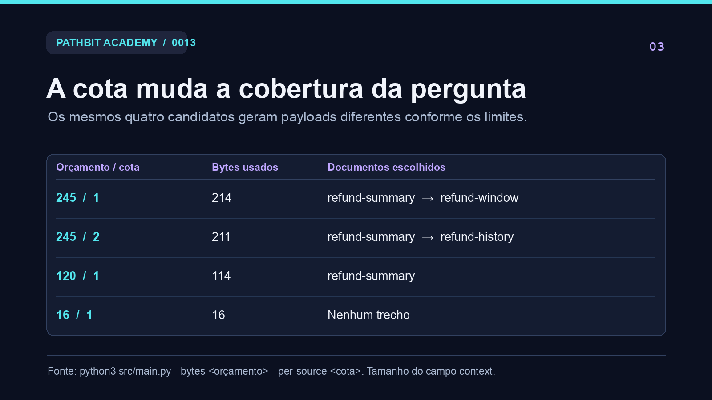

Três bytes a menos. Uma evidência importante a menos.

No laboratório 0013 da Academy IA, o orçamento ficou em 245 bytes. Com cota de um trecho por fonte entram a instrução para pedir o estorno e o caminho para conferir o prazo. Quando a cota passa a dois, o histórico ocupa a vaga e some a passagem de cobrança.

O resultado cabe em menos bytes, mas ajuda menos a responder à pergunta. O exercício mostra como contar o JSON em UTF-8 e investigar a razão de cada descarte.

📎 Laboratório offline, notebook e casos de fronteira

https://github.com/pathbit/pathbit-academy-ai/tree/master/0013_orcamento_contexto

#RAG #EngenhariaDeContexto #Python #PathbitAcademy
