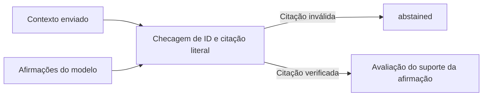

# Como conferir citações antes de mostrar uma resposta de RAG

[English](ARTICLE.en.md) · [Español](ARTICLE.es.md)

Um assistente de compras responde que o estorno deve ser solicitado no painel do pedido e atribui a orientação a `refund-summary`. Para publicar o texto, a aplicação precisa saber se aquele trecho realmente chegou à geração e se a citação é fiel. Um ID que existe no índice pode ter ficado de fora do orçamento e um trecho verdadeiro pode ser usado para sustentar uma promessa diferente.

## Valide contra o contexto enviado

A entrada do verificador é a lista de trechos dentro do envelope efetivamente enviado, junto com afirmações simuladas. Cada afirmação precisa ter uma citação com `source_id` e `quote`. O identificador deve corresponder ao campo `id` de um trecho. A citação deve ocorrer literalmente no texto daquela fonte. IDs repetidos tornam ambígua a origem do trecho e são recusados.

| Caso | O que procurar no relatório |
| --- | --- |
| ID presente com texto literal | `citations_verified` |
| Texto citado contém uma alteração | `quote_not_found` |
| Fonte ficou fora do contexto | `unknown_source` |
| Uma afirmação chegou sem citação | `missing_citation` |

Uma falha devolve `abstained` e lista vazia de afirmações. O consumidor pode apresentar ausência de evidência ao usuário e guardar os motivos para diagnóstico. Valide o esquema da resposta antes de enviá-la ao verificador.

## Compare a origem com o significado

Rode `--case unsupported-claim`. O trecho «O estorno é solicitado pelo painel do pedido.» existe na fonte e a citação passa. A afirmação promete concluir a operação em cinco minutos. Onde pedir e quanto demorar são propriedades diferentes. Para verificar esse tipo de suporte, use um conjunto de afirmações avaliadas e uma etapa própria de avaliação ou revisão humana. No contrato da aplicação, nomeie o sucesso pela garantia observada: `citations_verified`.

## Verifique a relação com o orçamento

No [início rápido](../README.md), exporte o relatório do [empacotador](../../0013_orcamento_contexto/article/ARTICLE.md) primeiro com `245` bytes e depois com `16`. A primeira execução pode citar `refund-summary`. A segunda tem só o envelope vazio. Mantenha as afirmações iguais e compare o `status` com o código registrado em `errors`.

O [notebook](../notebooks/citacoes_verificaveis.ipynb) repete os cenários sem acesso a um provedor. Para avaliar um produto, amplie os exemplos com fontes ausentes, citações editadas e afirmações sem suporte. O objetivo é medir em qual etapa o sistema perdeu a evidência, da [busca](../../0012_busca_hibrida/article/ARTICLE.md) até a apresentação ao usuário.

---

Developed with ❤️ by [Pathbit](https://www.pathbit.com.br/)
