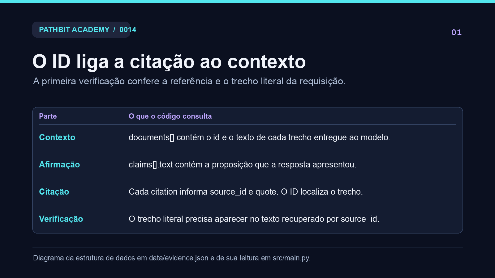
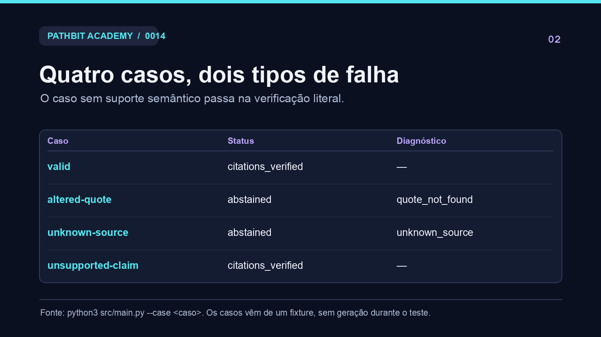
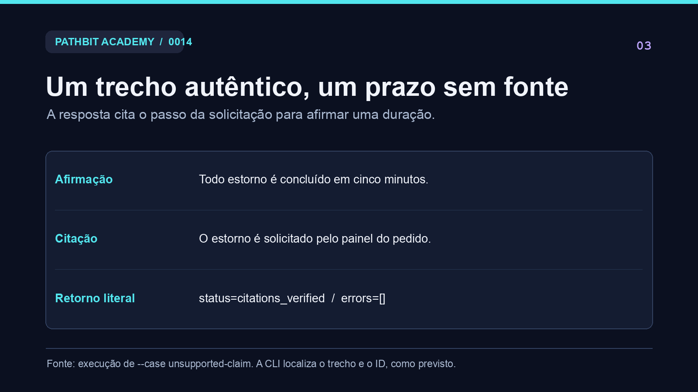
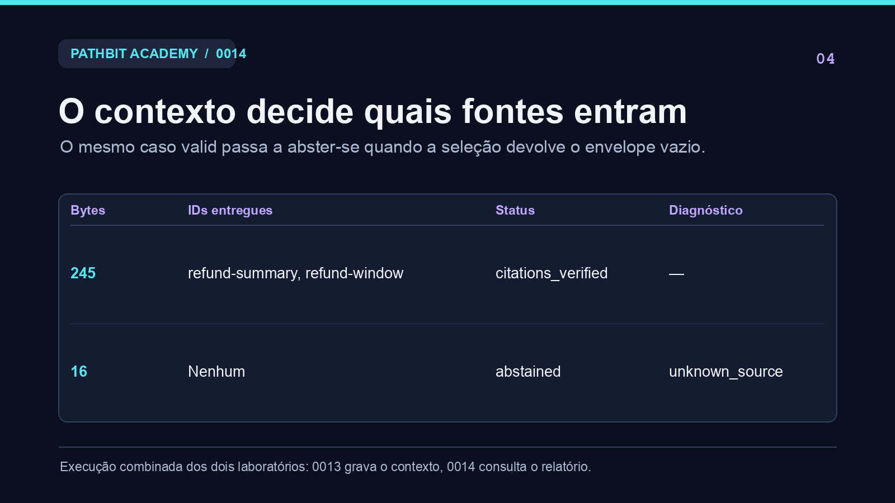

# 📚 Citações verificáveis em RAG: uma fonte verdadeira pode acompanhar uma afirmação falsa

> Série Academy IA · Artigo 0014 · Valide a origem da citação, confira o trecho e separe esse teste da pergunta que interessa à pessoa usuária.

Uma cliente pergunta quando o dinheiro de um estorno volta. O assistente responde “Todo estorno é concluído em cinco minutos” e cita uma frase verdadeira: “O estorno é solicitado pelo painel do pedido.” A referência existe e o trecho está transcrito corretamente. A frase só explica como iniciar o processo. O prazo prometido pode chegar ao atendimento com uma aparência de evidência que a fonte não fornece.

No [módulo anterior](../../0013_orcamento_contexto/article/ARTICLE.md), vimos que o orçamento muda quais documentos chegam ao assistente. Agora o [laboratório](../README.md) usa a lista entregue como fronteira de verificação. Ele valida IDs e trechos literais e devolve um resultado inspecionável. Também inclui, de propósito, a promessa de cinco minutos para tornar visível a diferença entre localizar uma citação e justificar uma afirmação.

## 1. Vincule cada afirmação ao contexto que a aplicação entregou

A entrada do verificador tem duas partes. A primeira é o contexto, com documentos identificados por `id` e texto em `text`. A segunda é a resposta candidata, representada por uma lista de afirmações. Cada afirmação traz `text` e uma lista de `citations`, e cada citação informa `source_id` e `quote`. Em [data/evidence.json](../data/evidence.json), as quatro respostas foram escritas para exercitar o validador. Nenhuma delas foi gerada durante a execução.

A referência aponta para um trecho de trabalho, quase como uma chave estrangeira para os documentos da requisição. O ID `refund-summary` identifica o trecho entregue. O rótulo `returns` identifica a fonte para o seletor do módulo anterior, mas não substitui o ID da citação. Dois parágrafos de uma mesma página podem ter conteúdo diferente e precisam ser diferenciáveis na análise de uma resposta.



> Figura 1. A verificação procura o ID e o trecho literal nos documentos daquela requisição. O vínculo é determinado por `source_id`.

Em [src/main.py](../src/main.py), a lógica monta um índice de IDs e recusa contextos com IDs repetidos. Para cada afirmação, exige pelo menos uma citação. Depois, verifica se a referência está no índice e se o trecho citado é uma substring literal do texto correspondente. Uma string vazia ou formada só por espaços falha. Diferenças de acentos, pontuação ou palavras podem alterar o resultado.

O limite do contexto é importante. Se o verificador se permitir buscar no acervo inteiro, pode confirmar uma evidência que a resposta nunca recebeu e perder o registro de como ela chegou à conclusão. É possível desenhar uma segunda tentativa para recuperar outra evidência, mas a próxima resposta precisa ser validada contra o novo contexto. Registre a primeira tentativa de forma independente.

## 2. Execute quatro casos controlados

Use Python 3.10+ na pasta do módulo. O script abre o mesmo fixture para os quatro comandos.

```bash
python3 src/main.py --case valid
python3 src/main.py --case altered-quote
python3 src/main.py --case unknown-source
python3 src/main.py --case unsupported-claim
```

| Caso | Retorno local | Como interpretar |
| --- | --- | --- |
| `valid` | `citations_verified` | A paráfrase orienta pedir pelo painel, e a frase citada aparece no trecho com esse ID |
| `altered-quote` | `abstained` / `quote_not_found` | A referência existe, mas “O estorno é imediato.” não faz parte do texto |
| `unknown-source` | `abstained` / `unknown_source` | A frase é plausível e aparece no contexto, mas o ID `missing` não corresponde a nenhum trecho |
| `unsupported-claim` | `citations_verified` | O ID e a citação foram localizados. O prazo de cinco minutos não é sustentado pelo conteúdo |



> Figura 2. Resumo das respostas da CLI. As duas abstenções devolvem `claims: []` e um diagnóstico. Os casos válido e sem suporte semântico têm o mesmo status literal.

A decisão de abstenção é para toda a resposta. Se uma afirmação trouxer duas citações, uma correta e outra forjada, o verificador não entrega a lista parcial junto do status de falha. Uma aplicação que opte por publicar apenas afirmações aprovadas precisaria validar dependências entre elas e recompor a resposta. O laboratório mantém o resultado binário para exercitar a fronteira.

Inspecione a diferença entre o conteúdo original e o caso alterado. A verificação de substring ajuda a impedir que aspas apresentem como literal um texto que a fonte nunca disse. Uma boa paráfrase fica em `claim.text`; a passagem usada como evidência fica em `quote`. Se houver necessidade de tolerar quebra de linha, hifens ou normalização Unicode, descreva a política de equivalência e preserve o trecho original para auditoria.

## 3. Leia de perto o caso que passa e deveria gerar revisão

O objeto que volta em `unsupported-claim` tem `status: "citations_verified"` e `errors: []`. A afirmação fala de duração máxima para todos os casos. A citação informa o local da solicitação. É possível validar o contrato de origem sem qualquer inferência textual. Para validar o suporte, um revisor precisa conferir se a evidência fala de duração e se sustenta a palavra “todo”.



> Figura 3. O trecho encontrado é autêntico e sugere um passo operacional diferente do prazo afirmado. A CLI verifica a presença literal do trecho.

Experimente ler a citação sozinha e perguntar qual orientação ela sustentaria. “Inicie pelo painel do pedido” preserva o sentido. “Em cinco minutos” acrescenta um fato. “Todo estorno” acrescenta uma generalização. Uma revisão de evidência deve marcar os três aspectos separadamente sempre que uma frase empacotar várias teses. Outro erro possível seria citar “pedidos pagos com cartão” para uma conclusão que também cobre Pix. A duração poderia até estar certa para uma modalidade, mas o escopo ainda exigiria outra fonte.

Uma forma prática de desenhar a próxima camada é classificar afirmações como apoiadas, contraditas ou insuficientemente sustentadas segundo as fontes entregues. Combine essa leitura com a cobertura. Se uma resposta tiver três afirmações factuais e só citar uma, uma citação excelente não resolve as duas pontas soltas. Projetos de pesquisa como ALCE tratam a avaliação de citações como problema distinto da fluência, com atenção à correção e à completude da evidência. O laboratório mantém o teste literal reproduzível. Um avaliador semântico requer nova implementação, um gabarito revisável e avaliação própria. [Pesquisa ALCE sobre geração com citações](https://aclanthology.org/2023.emnlp-main.398/).


### Faça a abstenção aparecer com uma resposta de duas frases

Copie `data/evidence.json` para fora da pasta versionada. No vetor `cases.valid`, mantenha a afirmação que orienta a pessoa a pedir o estorno pelo painel. Acrescente uma segunda afirmação com `"text": "O valor volta em cinco minutos."` e `"citations": []`. Rode `python3 src/main.py --input <cópia> --case valid`. O resultado aponta `claim: 2`, devolve `missing_citation` e deixa `claims` vazio. Dessa vez o problema é cobertura, porque a segunda alegação nem indicou uma referência.

Copie então a citação correta da primeira afirmação para a segunda. O teste literal volta a passar. Para uma revisão de suporte, mantenha o julgamento separado por frase. Você já tem um par de casos quase idênticos que difere só na presença da citação, e um contraexemplo que revela o limite da métrica literal. Num conjunto maior, calcule qual fração das afirmações tem pelo menos uma citação apoiadora. A saída local não mede essa fração e o rótulo precisa vir da revisão de evidência.

## 4. Use o contexto selecionado pelo laboratório anterior

Da pasta deste módulo, grave o relatório num diretório temporário. O verificador lê a string `context` produzida pelo seletor e extrai os documentos daquele envelope.

```bash
lab="$(mktemp -d)"
python3 ../0013_orcamento_contexto/src/main.py --bytes 245 --output "$lab/context.json"
python3 src/main.py --case valid --context-report "$lab/context.json"

python3 ../0013_orcamento_contexto/src/main.py --bytes 16 --output "$lab/context.json"
python3 src/main.py --case valid --context-report "$lab/context.json"
```

Com 245 bytes, `refund-summary` está presente e o caso `valid` passa. Com 16 bytes, o contexto é `{"documents":[]}`. A resposta candidata é a mesma, mas o verificador agora recebe uma lista vazia e retorna `unknown_source`. O comportamento distingue o inventário geral da evidência autorizada para uma requisição.



> Figura 4. Integração local entre os módulos 0013 e 0014. A resposta candidata não mudou. A seleção de contexto determina se a referência faz parte da requisição.

Quando esse teste falhar no seu sistema, registre o ID citado e quais IDs foram incluídos. Se o trecho faltou, investigue o ranking e o orçamento. Se o ID chegou mas a frase divergiu, investigue a versão do conteúdo, a geração da citação ou o processamento do texto. Se ambos passaram e a conclusão está errada, uma revisão semântica deve olhar para a proposição. Trate cada situação no ponto em que é observável.

## 5. Exercícios para projetar seu verificador

1. Copie o fixture e altere só a pontuação da citação válida. Rode com `--input` e localize o diagnóstico. Decida o que mudaria se o sistema aceitasse normalização.
2. No mesmo arquivo, adicione uma afirmação sem citações ao caso válido. Observe `missing_citation`. Explique o que uma interface mostraria na abstenção.
3. Reescreva a resposta à pessoa que pede um prazo com os dois trechos do contexto de 245 bytes. Separe a instrução de onde pedir e a orientação de onde conferir. Identifique a fonte de cada frase.
4. Crie uma pequena tabela com exemplos de afirmações apoiadas, contraditas e insuficientes. Faça outro leitor avaliar antes de decidir se a sua equipe já tem critérios claros o bastante para automatizar parte dessa revisão.

Use o [notebook](../notebooks/citacoes_verificaveis.ipynb) para repetir a checagem dos quatro casos e experimentar novos exemplos. Ao juntar esta prática à [busca híbrida](../../0012_busca_hibrida/article/ARTICLE.md) e ao [orçamento de contexto](../../0013_orcamento_contexto/article/ARTICLE.md), você consegue rastrear se um documento foi encontrado, se chegou à resposta e o que exatamente ele sustenta.

---

Developed with ❤️ by [Pathbit](https://www.pathbit.com.br/)
