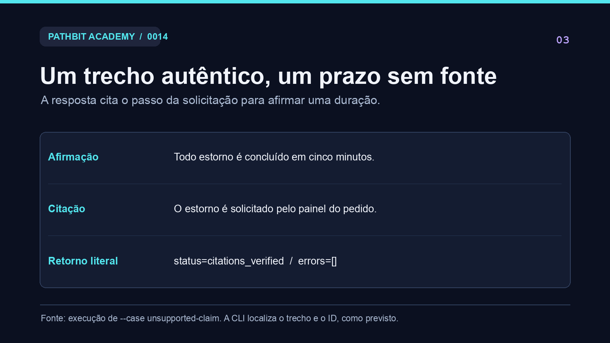

# Uma citação verdadeira pode acompanhar uma promessa sem evidência

“Todo estorno é concluído em cinco minutos.” A assistente cita uma passagem real: “O estorno é solicitado pelo painel do pedido.”

Você encontra exatamente essa passagem na fonte. O ID está correto. Mesmo assim, a frase ensina onde fazer a solicitação e não estabelece prazo. É o caso que faz valer separar duas tarefas ao avaliar respostas em RAG.

## Primeiro: a referência pertence a esta requisição?

O verificador da Academy IA recebe a lista exata de trechos do contexto e uma resposta com afirmações. Cada citação aponta para um `source_id` e inclui o trecho literal em `quote`. A verificação localiza o ID e busca o texto que aparece entre aspas na fonte correspondente.

No laboratório, uma frase alterada gera `quote_not_found`. Uma citação que traz um ID ausente dá `unknown_source`. Nos dois casos a resposta sai como `abstained`, sem afirmações publicadas. Essa camada ajuda a encontrar um vínculo incorreto entre resposta e contexto.

## Depois: o trecho sustenta a afirmação?

O caso dos cinco minutos retorna `citations_verified`. A verificação literal funcionou: a frase citada faz parte do documento. Falta um teste de suporte. Separe o que a resposta afirma em unidades revisáveis. “Inicie no painel” tem evidência. “Em cinco minutos” introduz duração. “Todo estorno” amplia o escopo para todos os casos. A política entregue não cobre os dois últimos pontos.



Essa diferença altera o que você apresenta para a pessoa. O status da CLI serve para dizer que a citação foi localizada. Uma interface que informe “resposta confirmada” estaria prometendo algo mais abrangente que o teste executado. Para validar suporte textual, anote casos apoiados, contraditos e insuficientes. Confira também se todas as afirmações factuais receberam evidência.

## Reproduza com o contexto do módulo anterior

Na pasta do laboratório, rode os exemplos com Python 3.10 ou superior:

```bash
python3 src/main.py --case altered-quote
python3 src/main.py --case unsupported-claim
```

Em seguida, grave um relatório de contexto com o script do módulo 0013. Com orçamento de 245 bytes, `refund-summary` chega ao verificador e a citação válida passa. Com 16 bytes, ele recebe uma lista vazia e devolve `unknown_source` para a mesma resposta candidata. A fonte ainda existe no fixture, mas já não pertence à requisição. A combinação demonstra a ligação entre seleção de contexto e verificação.

O [módulo com os quatro casos, código e notebook](https://github.com/pathbit/pathbit-academy-ai/tree/master/0014_citacoes_verificaveis) integra a Academy IA da [Pathbit](https://www.pathbit.com.br/).
