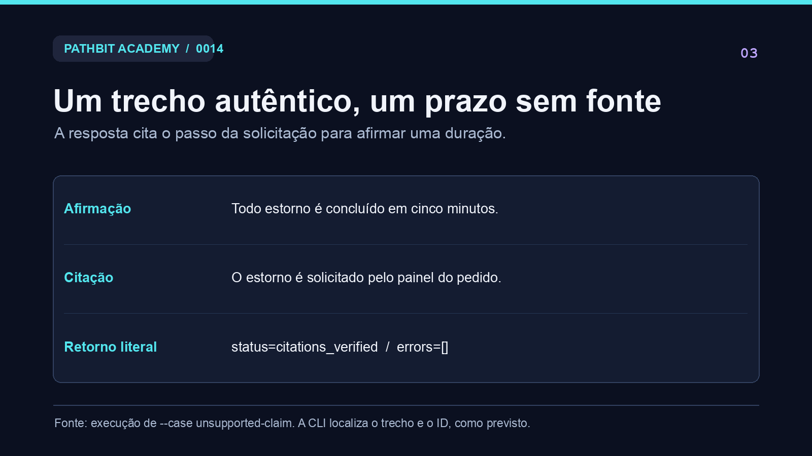

A fonte existe. O trecho foi copiado corretamente. O prazo foi inventado.

No laboratório da Academy IA, a frase “Todo estorno é concluído em cinco minutos” vem acompanhada de uma citação que só diz onde solicitar o estorno. O verificador confirma a localização do trecho. Para saber se ele sustenta o prazo, precisamos avaliar outra coisa.

O laboratório mostra quatro resultados locais, incluindo o que passa no teste literal apesar de acrescentar um fato. Também dá para repetir a verificação com o contexto selecionado no módulo anterior.

📎 Exemplos, código e notebook

https://github.com/pathbit/pathbit-academy-ai/tree/master/0014_citacoes_verificaveis

#RAG #Citações #AvaliaçãoDeIA #PathbitAcademy
